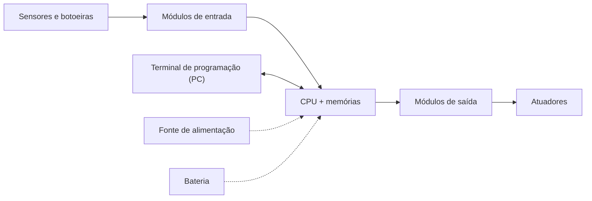
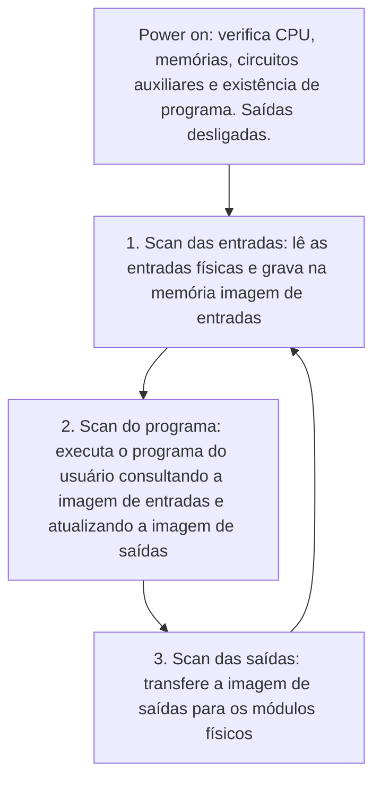
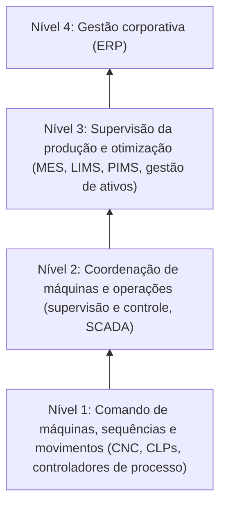
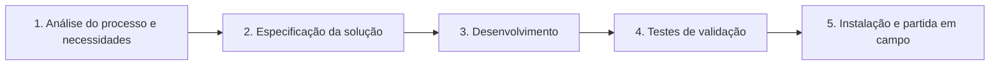

# Controladores Lógicos Programáveis (CLP)

> Do conceito à programação Ladder: histórico, arquitetura, entradas e saídas, instalação, hierarquia da automação, norma IEC 61131-3 e metodologia de projeto.

> [!NOTE]
> **Escopo.** Este documento trata **apenas de CLPs**. Sistemas Digitais de Controle Distribuído (SDCD / DCS) são abordados em material separado: [`SDCD.md`](./SDCD.md) *(ajuste o link para o nome real do arquivo)*.

---

## Sumário

1. [O que é um CLP](#1-o-que-é-um-clp)
2. [Histórico e evolução](#2-histórico-e-evolução)
3. [Tipos de sistema e onde o CLP se aplica](#3-tipos-de-sistema-e-onde-o-clp-se-aplica)
4. [Arquitetura interna](#4-arquitetura-interna)
5. [Ciclo de varredura (scan)](#5-ciclo-de-varredura-scan)
6. [Variáveis, sinais e tipos de dados](#6-variáveis-sinais-e-tipos-de-dados)
7. [Módulos de entrada e saída](#7-módulos-de-entrada-e-saída)
8. [Dispositivos de campo](#8-dispositivos-de-campo)
9. [Endereçamento de E/S](#9-endereçamento-de-es)
10. [Instalação: modelo genérico](#10-instalação-modelo-genérico)
11. [Tipos de CLP e modelos comerciais](#11-tipos-de-clp-e-modelos-comerciais)
12. [Pirâmide da automação](#12-pirâmide-da-automação)
13. [IEC 61131 e linguagens de programação](#13-iec-61131-e-linguagens-de-programação)
14. [Linguagem Ladder em detalhe](#14-linguagem-ladder-em-detalhe)
15. [Outras linguagens: IL, ST, FBD e SFC](#15-outras-linguagens-il-st-fbd-e-sfc)
16. [Controle PID no CLP](#16-controle-pid-no-clp)
17. [Redundância e disponibilidade](#17-redundância-e-disponibilidade)
18. [Metodologia de projeto de automação](#18-metodologia-de-projeto-de-automação)
19. [Exercícios propostos](#19-exercícios-propostos)
20. [Glossário](#20-glossário)
21. [Fontes](#21-fontes)

---

## 1. O que é um CLP

O **Controlador Lógico Programável** (CLP; em inglês *PLC — Programmable Logic Controller*) é um equipamento eletrônico digital usado para controlar máquinas e processos industriais. Ele lê sinais de **sensores**, executa um **programa** e comanda **atuadores**.

Uma analogia comum: o controlador é o **cérebro** do sistema de automação, os sensores são os **sentidos** e os atuadores são os **músculos**.

Duas definições clássicas:

| Entidade | Definição (resumida) |
|---|---|
| **ABNT** | Equipamento eletrônico digital, com hardware e software compatíveis com aplicações industriais. |
| **NEMA** (EUA) | Aparelho eletrônico digital com memória programável para armazenar instruções que implementam lógica, sequenciamento, temporização, contagem e aritmética, controlando máquinas ou processos por meio de módulos de entrada e saída. |

### Vantagens sobre painéis de relés

Antes do CLP, a lógica era feita com **relés, temporizadores e contatores** interligados por fiação em painéis. Esse tipo de painel ainda funciona (e ainda é usado em circuitos muito simples, que nunca mudam), mas qualquer alteração de lógica exigia **refazer a fiação**.

- Maior confiabilidade e flexibilidade
- Menos espaço físico e menor consumo de energia
- Programação e reprogramação fáceis, sem religar fios
- Reutilizável em outros processos
- Projetos mais rápidos
- Capacidade de comunicação com outros dispositivos e redes

---

## 2. Histórico e evolução

A indústria automobilística precisava reconfigurar suas linhas com frequência e perdia tempo e dinheiro a cada mudança nos painéis de relés. Por volta de **1968/1969**, a **General Motors** especificou um controlador para substituí-los. O protótipo, projetado por **Dick Morley** (com Mike Greenberg), foi batizado de **MODICON** (*MOdular DIgital CONtroller*).

**Requisitos da especificação original da GM:**

- facilidade de programação;
- manutenção com conceito *plug-in*;
- alta confiabilidade;
- dimensões menores que os painéis de relés;
- envio de dados a um processamento centralizado;
- preço competitivo;
- sinais de entrada e saída em 115 V CA;
- expansão em módulos;
- mínimo de 4000 palavras de memória.

### Décadas

- **Anos 1970:** os controladores ganham microprocessadores e passam a ser chamados de CLPs.
- **Anos 1980:** melhoram as funções de comunicação e os CLPs passam a operar em rede.
- **Hoje:** linguagens de alto nível, funções avançadas, painéis mais simples e comunicação em rede.

### Cinco gerações

| Geração | Característica |
|:---:|---|
| 1ª | Programação em **Assembly**, exigindo conhecimento completo do hardware. |
| 2ª | Linguagens de nível médio, com programas que convertem o código do usuário para linguagem de máquina. |
| 3ª | Entradas de programação, permitindo conectar teclados ou programadores portáteis. |
| 4ª | **Comunicação serial** com computador: programar, transferir e testar o programa pelo PC. |
| 5ª | **Protocolos de comunicação padronizados**, facilitando integração com outros equipamentos e sistemas supervisórios. |

---

## 3. Tipos de sistema e onde o CLP se aplica

Antes de escolher um controlador, é preciso entender o tipo de sistema a controlar:

- **Sistemas a eventos discretos** (*event driven*): as variáveis são eventos. *Exemplo:* uma esteira em que um par emissor/receptor óptico detecta cada peça que interrompe o feixe. A passagem da peça é o evento que muda o estado do sistema.
- **Sistemas contínuos** (*time driven*): as variáveis existem a todo instante e variam analogicamente (velocidade, pressão, torque, temperatura).

O foco clássico dos CLPs são **manufatura, intertravamento, controle de movimento e posicionamento**. Aplicações típicas:

- sequenciamento rápido;
- predominância de pontos digitais (ex.: indústria automobilística);
- aplicações de segurança;
- *drive systems*: controle de velocidade com inversores de frequência (papel e celulose, siderurgia, bobinadeiras);
- automação portuária e centros de controle de motores;
- do alarme residencial à soldagem robotizada em linhas de montagem.

### Intertravamento

**Intertravamento** é permitir ou impedir uma ação dependendo de uma condição. *Exemplo:* em um portão de garagem com sensor na parte de baixo, "se houver um carro sob o sensor, **não** feche o portão". Na indústria, é a base da lógica de segurança e de sequenciamento entre equipamentos.

---

## 4. Arquitetura interna

De forma simplificada, o CLP tem três blocos: **entradas → CPU → saídas**. Nas entradas ficam sensores e transdutores; nas saídas, os atuadores (contatores, válvulas, lâmpadas, motores).



### Componentes

| Componente | Função |
|---|---|
| **Fonte de alimentação** | Converte a tensão de rede (110–220 V CA) nas tensões internas (5 V CC para CPU e memórias; 12 V CC para comunicação com o programador; 12 ou 24 V CC para as E/S) e mantém a bateria carregada. |
| **CPU / UCP** | Executa o programa do usuário e atualiza a memória de dados e a memória imagem de E/S. Em CLPs modulares costuma ficar em uma placa separada. |
| **Bateria** | Mantém o relógio de tempo real e preserva parâmetros e programa (quando em RAM) durante falta de energia. |
| **Memória do programa monitor** | Equivale ao sistema operacional do CLP: gerencia as atividades, faz o *start-up* e a sequência de operações. Não é editável pelo usuário (PROM/EPROM/EEPROM). |
| **Memória do usuário** | Guarda o programa aplicativo (RAM, EPROM, EEPROM ou Flash). Tem dois estados: **RUN** (varredura cíclica) e **PROG** (parado, para carregar programa). |
| **Memória de dados** | Valores de temporizadores, contadores, senhas e outras variáveis do programa. |
| **Memória imagem de E/S** | Tabela que reflete o estado de todas as entradas e saídas; é a que a CPU consulta durante o processamento. |
| **Circuitos auxiliares** | Evitam acionamento indevido das saídas na energização, perda de dados na queda de energia e erros de processamento (detectando falhas no microprocessador). |
| **Módulos de E/S** | Adequam eletricamente os sinais de campo para a CPU (e os da CPU para os atuadores). |
| **Terminal de programação** | PC (ou, antigamente, programador portátil com teclado e display). Permite programar, monitorar, fazer alterações *online*, autodiagnóstico e gravar/apagar memória. |

> **Microprocessador × microcontrolador:** o microprocessador é só o elemento central de processamento e precisa de componentes externos (memórias etc.). O microcontrolador integra essas funções em um único *chip*.

### Elementos físicos de um sistema modular

Um CLP modular é montado em um **rack** com: fonte, CPU, cartões de entradas/saídas digitais e analógicas e cartões de rede. A expansão de E/S pode ser local, estendida ou em **estações remotas** conectadas por rede.

---

## 5. Ciclo de varredura (scan)

O CLP funciona de forma **cíclica e sequencial**.



- A leitura das entradas leva **alguns microssegundos**.
- Durante o programa, a CPU **não lê as entradas físicas**: usa a **memória imagem**, que foi "congelada" no início do scan.

> [!IMPORTANT]
> **A ordem das instruções importa.** O programa é executado de forma sequencial (uma instrução após a outra, na ordem em que foi escrita). Mudar a ordem das linhas pode alterar o **número de scans** necessários para uma condição se estabilizar, ou até o **resultado final** da lógica. Um erro comum de iniciante é tratar o programa como um circuito elétrico instantâneo; na verdade, ele é reavaliado a cada scan.

---

## 6. Variáveis, sinais e tipos de dados

Um processo real mistura:

- **Variáveis digitais (discretas):** dois estados. *Ex.:* motor ligado/desligado, presença/ausência de uma pessoa.
- **Variáveis analógicas:** variam continuamente numa faixa. *Ex.:* temperatura, pressão, vazão.

O CLP precisa de módulos de E/S compatíveis com o tipo de variável e com a **estratégia de controle** desejada.

### Tipos de dados

| Tipo | Descrição |
|---|---|
| **Bit (Bool)** | 0 ou 1; estado de uma E/S digital |
| **Inteiro (Word / Integer)** | Números inteiros: contadores, temporizadores, endereços |
| **Real (Float)** | Ponto flutuante: cálculos analógicos e PID |
| **String** | Texto: comunicação e IHM |

### Conversões

- **A/D (ADC):** analógico → digital, nas entradas analógicas.
- **D/A (DAC):** digital → analógico, nas saídas analógicas.

---

## 7. Módulos de entrada e saída

### Entradas digitais

Reconhecem **presença ou ausência** de sinal dentro de uma faixa, sem informar a amplitude. Tensões usuais: **24 V CC** e **110–220 V CA**. São as mais usadas em CLPs, alimentadas por sensores, botoeiras, fins de curso, termostatos e pressostatos.

Os módulos de entrada usam **optoisolador** em cada circuito: o sinal externo acende um LED que sensibiliza um fototransistor, isolando eletricamente o campo da CPU. Capacidade típica citada nos slides: até **100 mA** e cerca de **10 milhões** de acionamentos.

### Entradas analógicas

Usadas quando o processo exige controle mais preciso: a cada scan, o CLP lê o **valor instantâneo** da variável. Os sinais mais comuns:

- **Tensão:** 0 a 10 V CC
- **Corrente:** 4 a 20 mA

Internamente, um **conversor A/D** trata o sinal.

### Saídas digitais

Comportam-se como **chave aberta ou fechada** e aplicam ao atuador a tensão disponível na saída (geralmente 24 V CC, 127 V CA ou 220 V CA). Podem comutar por **relé**, **triac** ou **transistor**:

| Tipo de saída | Vantagens | Limitações / dados típicos | Uso recomendado |
|---|---|---|---|
| **Relé** | Robusta, praticamente imune a transientes de rede | Vida útil menor: cerca de **150 mil a 300 mil** acionamentos; até **5 A** | CA ou CC, cargas de comando |
| **Triac** | Estado sólido, longa vida | Até **10 milhões** de acionamentos; até **1 A** | Fontes de **corrente alternada** |
| **Transistor** (comum ou FET) | Estado sólido, longa vida; normalmente o mais usado | Até **10 milhões** de acionamentos; até **1 A** | Fontes de **corrente contínua** |

### Saídas analógicas

Fornecem sinal **variável** (0–10 V ou 4–20 mA), definindo a **intensidade** de atuação do equipamento, e não apenas ligando/desligando. Usam um **conversor D/A**.

---

## 8. Dispositivos de campo

| Tipo de E/S | Exemplos de dispositivos |
|---|---|
| **Entradas digitais** | Interruptores, botoeiras, chaves fim de curso, termostatos, pressostatos, sensores indutivos, capacitivos e fotoelétricos |
| **Entradas analógicas** | Potenciômetros, sensores de pressão, vazão e distância, termopares |
| **Saídas digitais** | Contatores, lâmpadas de sinalização, *soft-starters*, válvulas eletro-hidráulicas ou eletropneumáticas |
| **Saídas analógicas** | Conversores (inversores) de frequência, posicionadores de válvula |

### Contatos NA e NF

A nomenclatura refere-se à posição de **repouso**. Em um botão com 1 contato NA e 1 NF, ao apertar: o NA **fecha** e o NF **abre**. Ao soltar, ambos voltam ao repouso.

- **NA** → entrada só vai a nível alto quando o dispositivo é acionado.
- **NF** → entrada fica em nível alto o tempo todo e cai quando o dispositivo é acionado (útil, por exemplo, para detectar o toque de uma peça no fim de curso).

### Aplicações práticas

- **Elevador de carga (entradas digitais):** botoeiras de chamada e fins de curso para detectar o andar; o programa interpreta os sinais como pedidos de subir, descer ou parar.
- **Temperatura de sala:**
  - *Termostato em entrada digital* → o CLP só sabe se está acima ou abaixo do ajuste → estratégia **liga/desliga (on-off)**.
  - *Termopar em entrada analógica* → o CLP recebe o valor instantâneo e a intensidade das variações → permite estratégias **proporcional, integral e derivativa (PID)**.
- **Bombeamento de água (saídas digitais):** sensores de nível, motobomba principal e reserva, lâmpadas de sinalização. Motores acionados por **contatores**; lâmpadas diretamente pelo CLP. Só há dois estados (ligado/desligado) → controle on-off.
- **Esteira com motor de indução (saída analógica):** o CLP envia 0–10 V ao inversor de frequência, que ajusta a velocidade do motor entre o mínimo e o máximo parametrizados.

> [!WARNING]
> As saídas do CLP são projetadas para **cargas de comando**, não de potência. Para motores, use sempre um dispositivo intermediário (contator, *soft-starter*, inversor). **Nunca ligue o motor diretamente à saída do CLP** e sempre consulte no manual do fabricante a tensão e a corrente máximas de cada saída.

---

## 9. Endereçamento de E/S

Cada entrada ou saída física corresponde a um endereço na memória imagem. O formato depende do fabricante, mas segue lógica parecida. Exemplo típico de um grande fabricante:

```
I:12/04
│ │   └── 04 = bit dentro da palavra do módulo
│ └────── 12 = posição (ranhura/slot) do módulo no controlador ou expansão
└──────── I = Input (entrada). O = Output (saída)
```

- A imagem de entradas é **independente** da de saídas: `I:12/04` e `O:12/04` são endereços diferentes.
- `I:12/04` é o bit 4 do módulo de entrada 12. Se usado, por exemplo, na linha 15 do programa, pode habilitar `O:02/06` (bit 6 do módulo de saída 02).

> Siemens, Allen-Bradley, WEG e outros usam convenções próprias de letras, separadores e ordem módulo/bit. **O manual do equipamento é sempre a referência final.**

---

## 10. Instalação: modelo genérico

Exemplo didático: CLP alimentado em **24 V CC** com **8 entradas digitais**, **2 entradas analógicas (0–10 V)**, **4 saídas digitais a relé** e **2 saídas analógicas (0–10 V)**.

Dispositivos conectados no exemplo:

| Ponto | Dispositivo | Observação |
|---|---|---|
| I1 | Interruptor | contato **NA** |
| I3 | Chave fim de curso | contato **NF** → I3 fica em nível alto até uma peça tocar a chave |
| I6 | Sensor indutivo | contato **NA** → nível alto ao aproximar peça metálica |
| IA1 | Sensor de vazão (0–10 V) | referenciado ao terminal negativo da fonte |
| Q1 | Contator (220 V CA) | saída fechada alimenta a bobina |
| Q3 | *Soft-starter* | recebe 24 V CC dele e devolve o sinal ao fechar, como pedido de acionamento |
| Q4 | Lâmpada de sinalização (127 V CA) | com fusível |
| QA2 | Inversor de frequência (0–10 V) | controla a rotação de um motor de indução |

**Pontos importantes:**

1. Não é preciso usar todas as E/S, nem em ordem; **o programa define quais serão usadas**.
2. As saídas a relé comutam **independentemente** umas das outras.
3. Proteja os circuitos com **fusíveis**.
4. Respeite os limites de tensão e corrente das saídas (ver aviso da seção 8).

A **programação** depende diretamente dessa configuração: primeiro defina quais E/S serão usadas e quais dispositivos estão ligados a elas; depois implemente o programa, que relaciona entradas e saídas por lógica combinacional e sequencial.

---

## 11. Tipos de CLP e modelos comerciais

### Por capacidade de E/S

| Classe | Capacidade aproximada |
|---|---|
| **Micro CLP** | Até 16 E/S, geralmente em um único módulo |
| **Médio porte** | Até 256 E/S, módulo básico expansível |
| **Grande porte** | Até 4096 E/S, construção modular configurável conforme o processo |

### Por arquitetura / aplicação

| Tipo | Características |
|---|---|
| **Compacto** | Construção fixa, número fixo de E/S, poucos recursos de expansão; baixo custo |
| **Modular** | Construção flexível, grande variedade de cartões de E/S, permite redundância |
| **Soft PLC** | O "CLP" roda dentro de um PC, com E/S remotas via rede |
| **Safe PLC** | Sistemas dedicados de segurança (queimadores, *shutdown*, prensas) |

### Modelos citados nas fontes

| Modelo | Fabricante | Porte / uso típico |
|---|---|---|
| ControlLogix | Rockwell Automation | Grande porte, automações complexas |
| SLC 500 | Rockwell Automation | Pequeno/médio porte |
| MicroLogix 1000 | Rockwell Automation | Pequeno porte, automações simples |
| S7-300 / S7-400 | Siemens | Grande porte, automações complexas |
| LOGO! | Siemens | Pequenas automações, baixo custo |
| CLIC | WEG | Pequenas automações, baixo custo |
| PACSystems RX3i | GE / Emerson | Suporta redundância quádrupla |

### Critérios de especificação

Ao escolher um CLP, considere:

- compatibilidade entre a instalação elétrica e os pontos de E/S;
- tipo e forma de endereçamento;
- estrutura da palavra;
- tipo e forma dos sinais aceitos;
- compatibilidade com os equipamentos eletromecânicos;
- memória e capacidade de processamento.

---

## 12. Pirâmide da automação

O CLP ocupa a **base** da hierarquia da automação (alinhada à norma ISA-95).



O CLP interage **diretamente com sensores e atuadores em tempo real**. Quanto mais alto o nível, maior a dependência de redes, servidores e softwares, e menor a de hardware de controle.

---

## 13. IEC 61131 e linguagens de programação

No início, cada fabricante criava a própria linguagem, com incompatibilidade entre equipamentos. A **IEC** publicou em **1994** a norma **IEC 61131**. A **Parte 3** padroniza as linguagens.

### Partes da norma

| Parte | Conteúdo |
|:---:|---|
| 1 | Informações gerais |
| 2 | Requisitos de equipamentos e testes de certificação |
| 3 | **Linguagens de programação** |
| 4 | Diretrizes do usuário (especificação, instalação, comissionamento) |
| 5 | Comunicações |
| 6 | Funcionalidades de segurança (para Safe PLC até SIL 3) |
| 7 | Programação de controle *fuzzy* |
| 8 | Implementação das linguagens |
| 9 | Interface de comunicação digital para pequenos sensores e atuadores (SDCI) |

### Características inovadoras da 61131-3

1. Incentiva programas bem estruturados (*top-down* ou *bottom-up*).
2. Exige **tipagem forte** de variáveis.
3. Controle completo da execução, com diferentes partes do programa em eventos e taxas de varredura distintas.
4. Suporte a processos sequenciais complexos via **SFC**.
5. Liberdade para escolher a linguagem mais adequada a cada parte do processo.
6. Software de programação **independente do fabricante** do equipamento.

### As linguagens e quando usar

| Classe | Linguagem | Quando usar |
|---|---|---|
| Textual | **IL**: Instruction List | Legado, parecida com Assembly, difícil; aceitação limitada, útil para migração de produtos antigos |
| Textual | **ST**: Structured Text | Cálculos matemáticos complexos, protocolos e *strings* ASCII, *loops* em tabelas e vetores |
| Gráfica | **LD**: Ladder Diagram | Lógica booleana, intertravamento de máquinas, operações paralelas, comunicação e rotinas que a **manutenção** precisa interpretar rápido |
| Gráfica | **FBD**: Function Block Diagram | Controle de *drives*, processos contínuos, malhas de controle |
| Gráfica | **SFC**: Sequential Function Chart | Sequências repetitivas, processos em batelada, controle de movimento, máquinas de estado |
| Gráfica | **CFC**: Continuous Function Chart | Variante contínua de diagramas de blocos |

### Etapas de desenvolvimento de um programa

1. Escrever as instruções
2. Editar o programa
3. Verificar e corrigir erros de sintaxe
4. Imprimir/documentar (opcional)
5. Carregar e testar no controlador

---

## 14. Linguagem Ladder em detalhe

O **Ladder** (diagrama de contatos) é a linguagem mais usada por reproduzir visualmente um diagrama elétrico de relés: **contatos** (entradas) se combinam para energizar **bobinas** (saídas).

### Regras gráficas

- As **bobinas** ficam sempre totalmente à **direita** das linhas horizontais.
- As linhas verticais são as **linhas-mãe** (barramentos de energia).
- Causa e efeito seguem **da esquerda para a direita e de cima para baixo**.
- A bobina só é energizada se houver **continuidade lógica** dos contatos à sua esquerda **naquele scan**.

### 14.1 Funções básicas

**NA (normalmente aberto):** saída replica a entrada.

```
 I1                Q1
|-| |---------------( )-|        Q1 = I1
```

**NF (normalmente fechado):** saída é o inverso da entrada.

```
 I1                Q1
|-|/|---------------( )-|        Q1 = NOT I1
```

**E (AND):** contatos em série.

```
 I1       I2       Q1
|-| |------| |------( )-|        Q1 = I1 · I2
```

**OU (OR):** contatos em paralelo.

```
 I1                  Q1
|-+-| |-+------------( )-|
| |     |                       Q1 = I1 + I2
| +-| |-+
    I2
```

### 14.2 Funções combinadas

| Função | Equação | Comportamento |
|---|---|---|
| **NA-NF em série** | Q1 = I1 · ¬I2 | Só ativa quando I1 está alta **e** I2 baixa |
| **NA-NF em paralelo** | Q1 = I1 + ¬I2 | Só fica desativada quando I1 está baixa **e** I2 alta |

### 14.3 Funções especiais

| Função | O que faz |
|---|---|
| **SET (S)** | Força e **mantém** saída/memória em nível alto mesmo depois que a entrada volta a baixo. Só **RESET** desativa. |
| **RESET (R)** | Força e mantém em nível baixo até um novo SET. |
| **Temporizador** | Aciona/desaciona saída conforme tempo programado (ver abaixo). |
| **Contador** | Ativa saída após um número de pulsos/eventos. Pode ser crescente, decrescente ou *up/down*, com entrada de **reset**. |
| **Relógio (RTC)** | Ativa/desativa saída em horários e dias da semana (ex.: segunda a sexta, 08h15 às 14h30). |
| **PID** | Controle proporcional-integral-derivativo, usado com E/S analógicas (seção 16). |

**Temporizador com retardo na energização (TON):** a saída só liga depois que a entrada permanecer ativa pelo tempo T. Se a entrada voltar a zero antes de T, a saída **não** é acionada; ao desligar a entrada, a saída desliga **imediatamente**.

```
I1 : ___┌──────────────────┐______
Q1 : ___________┌──────────┐______   (liga após T, desliga junto com I1)
              |<-- T -->|
```

**Temporizador com retardo na desenergização (TOF):** a saída liga **imediatamente** e, quando a entrada cai, permanece ligada por mais T.

```
I1 : ___┌──────────┐______________
Q1 : ___┌────────────────┐________   (desliga T após I1 cair)
                    |<-T->|
```

**Contador up/down:** uma entrada incrementa (CU), outra decrementa (CD) e uma terceira zera (R). Ao atingir o valor pré-selecionado (PV), a saída é acionada, independentemente do estado atual da entrada de contagem, até um reset.

### 14.4 Exemplo clássico: partida com selo (retenção)

Muito comum em comando de motores. O botão **Liga** (NA) energiza a saída; um contato da própria saída "sela" a linha, mantendo-a ligada depois que o botão é solto; o botão **Desliga** interrompe.

```
        I0.0 Liga        I0.1 Desliga            Q0.0 Motor
 |--+----| |------+--------| |-----------------------( )--|
 |  |             |                                        |
 |  |  Q0.0       |                                        |
 |  +----| |------+                                        |
```

> **Por que `I0.1` aparece como contato NA?** Porque, por segurança, o botão Desliga é ligado fisicamente como **NF**: em repouso a entrada está em nível alto. Se o fio romper, a entrada cai e o motor **para** (comportamento *fail-safe*). No programa, o contato NA enxerga "nível alto = botão não pressionado".

O mesmo comportamento pode ser feito com SET/RESET:

```
 I0.0 Liga                      Q0.0
|----| |--------------------------(S)--|

 I0.1 Desliga                   Q0.0
|----| |--------------------------(R)--|
```

### 14.5 Categorias de instruções (Allen-Bradley como referência)

A maioria das instruções de CLP se agrupa em **sete categorias**. Os mnemônicos abaixo seguem a linha Rockwell/Allen-Bradley usada nos slides; outros fabricantes usam nomes diferentes para as mesmas funções.

| # | Categoria | Instruções (exemplos) |
|:-:|---|---|
| 1 | **Lógica de relé / bit** | `XIC` (examina se fechado, equivale a NA), `XIO` (examina se aberto, equivale a NF), `OTE` (bobina), `OTL` (bobina com retenção), `OTU` (desliga retenção) |
| 2 | **Temporização e contagem** | `TON` (retardo na energização), `TOF` (retardo na desenergização), `RTO` (temporizador com retenção), `CTU` (contador crescente), `CTD`, `CTUD` |
| 3 | **Aritméticas** | `ADD`, `SUB`, `MUL`, `DIV`, `SQR` (raiz quadrada) |
| 4 | **Manipulação de dados** | `MOV`, `MVM` (mover com máscara), `AND`, `OR`, `XOR`, `NOT`, `FFL` (FIFO) |
| 5 | **Controle de execução** | `JSR` / `SBR` / `RET` (sub-rotinas), `JMP` / `LBL` (saltos) |
| 6 | **Transferência de dados** | `MSG` (mensagem), `BTR` / `BTW` (leitura/escrita de blocos) |
| 7 | **Avançadas** | `PID`, comunicação |

Nas instruções de temporizador e contador, os registradores principais são:

- **PRESET (PRE):** valor programado;
- **ACCUM (ACC):** valor acumulado;
- **DN (*done*):** bit que vai a 1 quando `ACCUM = PRESET`.

---

## 15. Outras linguagens: IL, ST, FBD e SFC

Considere a equação booleana:

```
O5 = (I1 · ¬I2 · I3) + I4
```

**Lista de Instruções (IL):**

```
LD   I1      // carrega I1
ANDN I2      // e não I2
AND  I3      // e I3
OR   I4      // ou I4
ST   O5      // armazena em O5
```

**Texto Estruturado (ST)**, parecido com Pascal/BASIC:

```pascal
O5 := (I1 AND NOT I2 AND I3) OR I4;
```

**Diagrama de Blocos de Função (FBD):** a mesma lógica com blocos `AND` (&) e `OR` (≥1). Blocos mais avançados cobrem operações numéricas, deslocamento, *flip-flop*, contadores, temporizadores, comunicação, PID, tempo, conversão de tipos e comparação. O FBD executa os blocos **das entradas para as saídas**, e as referências de entrada são atualizadas no início de cada scan.

### SFC (Sequential Function Chart / Grafcet)

Representa o programa como **passos** e **transições**, desenhados verticalmente.

- **Passo:** retângulo que representa um estado operacional, com nome único. Um passo ativo recebe uma "marca" (*token*). Cada passo tem uma variável de atividade (`passo.X`) e uma de tempo (`passo.T`).
- **Transição:** barra entre passos, com uma condição booleana (a *receptividade*). Quando satisfeita, desativa o passo anterior e ativa o seguinte.
- **Ações:** associadas aos passos por **qualificadores**:

| Qualificador | Efeito |
|:-:|---|
| **N** | Ação simples, enquanto o passo estiver ativo |
| **S / R** | Liga (set) / desliga (reset) e mantém, vinculado a passos |
| **L** | Ação com **tempo limitado** |
| **D** | Ação com **entrada retardada** |
| **P** | Ação **pulsada** |
| **SD, DS, SL** | Combinações (set com retardo, retardada e setada, set com tempo limitado) |

- **Regras de evolução:** simultaneidade (E divergente/convergente), escolha (OU divergente/convergente), derivação, malha fechada (retorno a passo anterior) e sequência repetitiva.

---

## 16. Controle PID no CLP

Em processos contínuos, o CLP pode executar **malhas PID** usando entradas e saídas analógicas (instrução `PID` ou bloco PID em FBD).

| Ação | Efeito |
|:-:|---|
| **P** (proporcional) | Resposta imediata, proporcional ao erro |
| **I** (integral) | Elimina o desvio em regime, com velocidade proporcional ao erro acumulado |
| **D** (derivativa) | Reage à taxa de variação do erro, antecipando a resposta |

### Relação entre ganhos (padrão ISA para independentes)

```
Kp = Kc
Ki = Kc / (60 · Ti)
Kd = Kc · Td · 60
```

### Ajuste inicial (regras práticas empíricas)

| Variável | Kp | Integral | Derivativo |
|---|:-:|:-:|:-:|
| Vazão / pressão de gás | 1 a 5 | 0,3 a 3 s | Não |
| Pressão de líquido | 2 a 10 | 0,1 a 2 min | Não |
| Nível | sem ref. | 1 a 10 min | Não |
| Qualidade do produto | 10 a 1000 | 1 min a 2 h | 0,1 a 20 min |
| Temperatura / pressão de vapor | 1 a 10 | 0,2 a 60 min | 0,1 a 20 min |

### Sintonia por tentativa e erro (malha fechada)

1. Elimine I e D (Ti no máximo, Td no mínimo).
2. Dê a Kp um valor baixo e coloque o controlador em automático.
3. Aumente Kp em pequenos passos até surgir oscilação mantida após pequena mudança no setpoint.
4. Reduza Kp pela metade.
5. Diminua Ti até nova oscilação mantida e fixe Ti em **3 vezes** esse valor.
6. Aumente Td até nova oscilação e fixe Td em **1/3** desse valor.

> Evite saturação da saída do controlador durante o teste; ela pode causar oscilação mantida mesmo com Kp diferente do ganho supremo.

### Ziegler-Nichols: método da oscilação mantida (malha fechada)

Determine o **ganho supremo Kpu** (que causa oscilação mantida) e o **período supremo Pu**:

| Controlador | Kp | Ti | Td |
|---|:-:|:-:|:-:|
| P | 0,50 · Kpu | — | — |
| PI | 0,45 · Kpu | Pu / 1,2 | — |
| PID | 0,60 · Kpu | Pu / 2 | Pu / 8 |

Variantes mais conservadoras (com/sem sobressinal) reduzem Kp para 0,33·Kpu ou 0,20·Kpu.

### Ziegler-Nichols: curva de reação (malha aberta, só sistemas estáveis)

Aplica-se um degrau na saída do controlador e mede-se o tempo de retardo **L** e a constante **T**:

| Controlador | Kp | Ti | Td |
|---|:-:|:-:|:-:|
| P | T / L | — | — |
| PI | 0,9 · T / L | L / 0,3 | — |
| PID | 1,2 · T / L | 2 · L | 0,5 · L |

> Os métodos de Ziegler-Nichols são **primeira aproximação** (visam decaimento de 1/4). Depois, faz-se **sintonia fina** em campo. Existe ainda a sintonia automática (*autotuning*, Åström-Hägglund) por relé com zona morta.

---

## 17. Redundância e disponibilidade

Em processos críticos (ex.: plataforma de petróleo), uma parada não programada é cara ou perigosa. CLPs modulares podem operar em **hot standby**:

- Dois controladores (mestre e reserva) trabalham lado a lado e funcionam como **um só** do ponto de vista do processo.
- O reserva mantém sua memória **sincronizada** com a do mestre.
- Se o mestre falhar, o reserva assume em **frações de segundo**.
- Exige módulos de hardware dedicados de sincronização: encarece, mas eleva muito a **disponibilidade**.

Modelos como o **PACSystems RX3i** suportam redundância quádrupla.

> Um armário de CLP de grande porte, com muitos cartões de E/S, pode custar centenas de milhares de reais (ordem de grandeza citada em aula).

---

## 18. Metodologia de projeto de automação

Ciclo de vida de um projeto com CLP:



| Etapa | Atividades | Documentos |
|---|---|---|
| **1. Análise** | Reuniões com o cliente; levantamento de campo (processo, instrumentação, cabeamento, máquinas); lista de motores e instrumentos; avaliar reaproveitamento de equipamentos | P&ID, lista de equipamentos, descritivos de processo, diagramas causa-efeito, lista de E/S |
| **2. Especificação** | Definir CLP, módulos de E/S, redes, módulos de comunicação, drives de acionamento (CCM), supervisório e softwares; definir arquitetura | Especificação técnica, arquitetura do sistema, diagrama de painéis (CCM, CLP, remotas) |
| **3. Desenvolvimento** | Estruturar aplicativos; mapear E/S no CLP; configurar redes; desenvolver aplicativo do CLP, do supervisório e a integração com o nível 3 | Aplicativos e configurações de rede |
| **4. Testes** | Testes internos em bancada com rotinas de simulação; **TAF** (testes de aceitação de fábrica) com o cliente | Roteiro de testes, documento de aceitação da TAF |
| **5. Instalação** | **TAC** (testes de aceitação de campo): comissionamento de equipamentos e E/S, testes preliminares (ex.: teste com água, em vazio), partida do processo | *As-built*, documento de aceitação final |

---

## 19. Exercícios propostos

Adaptados da disciplina *Controladores Programáveis* (Zancan, 2011). Para cada um, apresente o **diagrama de instalação** do CLP (entradas, saídas, dispositivos) e o **programa em Ladder**.

1. **Circuito digital → Ladder.** Dado um circuito com a expressão `S = (¬A · (B + C)) + (B · C)`, obtenha o equivalente em Ladder.

2. **Reservatório de água.** O nível deve ficar entre um máximo e um mínimo, dados por dois sensores: **S1** (contato NA, nível máximo) e **S2** (contato NA, nível mínimo). A bomba **liga** quando S2 for desativado (nível mínimo) e **desliga** quando S1 for ativado (nível máximo). Um interruptor **Ch1** interrompe manualmente o controle automático. Uma lâmpada **L1** fica ligada enquanto o sensor de nível mínimo estiver desativado.

3. **Esteira com três motores.** M1 move a esteira; M2 e M3 são motores de processo em mesas com fim de curso (FC). A mesa do operador tem um sensor. Deve haver botão de emergência que desligue tudo. Sequência:
   1. O operador coloca a peça; o sensor liga a esteira (M1) até a mesa do M2.
   2. Na mesa do M2 a esteira para e M2 liga por **10 s**.
   3. M2 desliga e a esteira leva a peça à mesa do M3.
   4. Na mesa do M3 a esteira para e M3 liga por **15 s**.
   5. M3 desliga e a esteira retorna a peça à mesa do operador.
   6. Ao chegar, a esteira desliga e o operador retira a peça.

4. **Duas esteiras com teste de altura.** A esteira 1 tem um sentido; a esteira 2 tem dois. A peça passa por FC1 e FC2: altura abaixo de FC2 ou acima de FC1 = **ruim**; entre as duas = **boa**. A esteira 2 liga no sentido correspondente por **5 s**, e a esteira 1 desliga após a peça passar. Após **5 peças ruins**, uma lâmpada L1 acende e só apaga com o reset da contagem por um botão pulsante B1.

---

## 20. Glossário

| Termo | Significado |
|---|---|
| **CLP / PLC** | Controlador Lógico Programável / *Programmable Logic Controller* |
| **CPU / UCP** | Unidade Central de Processamento |
| **Scan (varredura)** | Ciclo de leitura de entradas, execução do programa e atualização de saídas |
| **Memória imagem** | Tabela com o estado de todas as entradas e saídas, consultada pela CPU |
| **NA / NF** | Contato normalmente aberto / normalmente fechado |
| **ADC / DAC** | Conversor analógico-digital / digital-analógico |
| **IHM** | Interface Homem-Máquina |
| **SCADA** | *Supervisory Control and Data Acquisition*: supervisão e aquisição de dados |
| **MES** | *Manufacturing Execution System* |
| **Transdutor** | Sensor que converte a grandeza física em sinal elétrico |
| **Atuador** | Dispositivo que age sobre o processo (cilindros, motores, válvulas, resistências, lâmpadas) |
| **Contator** | Dispositivo eletromecânico que, a partir de um circuito de comando, aciona cargas de potência |
| **Intertravamento** | Permitir ou bloquear uma ação conforme condições do processo |
| **Hot standby** | Redundância em que o equipamento reserva assume automaticamente em caso de falha |
| **PID** | Controle Proporcional-Integral-Derivativo |
| **TAF / TAC** | Teste de Aceitação de Fábrica / de Campo |
| **IEC 61131-3** | Norma que padroniza as linguagens de programação de CLP |

---

## 21. Fontes

- ZANCAN, Marcos Daniel. **Controladores Programáveis**. 3. ed. Santa Maria: UFSM / Colégio Técnico Industrial de Santa Maria, 2011. (Sistema e-Tec Brasil.)
- ANDRADE, Alexandre Acácio de. **Automação em Sistemas de Manufatura / Automação em Sistemas Industriais**. Slides de aula, UFABC.
- Transcrição automática de aula em vídeo sobre controladores, arquiteturas e linguagens. O áudio tinha muitos erros de reconhecimento de fala; só foram aproveitadas informações confirmadas pelos slides.

> **Observação sobre exemplos:** o exemplo de partida com selo (14.4) e os diagramas de temporização em ASCII são ilustrações didáticas de conceitos presentes nas fontes, escritos para este material. Mnemônicos de instruções seguem a convenção Rockwell/Allen-Bradley dos slides; consulte o manual do seu fabricante.