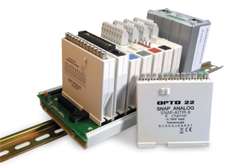

# CLP - Exercícios

### Questão 1 - Qual é a alternativa verdadeira sobre cartões de CLP 

(a) Cartões analógicos funcionam exclusivamente com o padrão elétrico 4 a 20 mA

(b) Cartões analógicos funcionam frequentemente com o padrão elétrico 4 a 20 mA

(c) Cartões analógicos são utilizados para sensores discretos.

(d) Cartões analógicos recebem sinais de rede Device-net.

(e) Todos os cartões analógicos funcionam identicamente do ponto de vista de padrões elétricos.

A alternativa verdadeira é a b. Cartões analógicos funcionam frequentemente com o padrão elétrico 4 a 20 mA.
Explicação detalhada:
• Por que a B está correta? O padrão de 4 a 20 mA é um dos sinais de corrente mais comuns e amplamente utilizados na indústria para transmissão de dados analógicos devido à sua alta imunidade a ruídos e capacidade de detectar falhas (fio partido).
• Por que as outras estão incorretas?
	• a: Não é exclusivo; cartões analógicos também trabalham com outros padrões, como 0 a 10 V, 0 a 20 mA, etc.
	• c: Sensores discretos (liga/desliga) utilizam cartões digitais, não analógicos.
	• d: DeviceNet é um protocolo de rede industrial, que necessita de um cartão de comunicação específico, não de um cartão analógico convencional.
	• e: Eles não são idênticos; existem variações nos tipos de sinal (tensão vs. corrente), faixas de trabalho e resoluções.
Se precisar de ajuda com outras questões de automação ou CLP, é só enviar!

### Questão 2 - Sobre CLPs. Qual é a alternativa falsa  

(a) São eletricamente robustos.

(b) Podem funcionar com diversas linguagens de programação.

(c) São equipamentos industriais robustos e possuidores de grandes (Tb) memórias para programação.

(d) São muito flexíveis adaptando-se a diversos tipos de processos.

(e) Possuem grandes variações no que tange ao numero de IOs e memória

A alternativa falsa é a c. São equipamentos industriais robustos e possuidores de grandes (Tb) memórias para programação.
Explicação detalhada:
• Por que a C está incorreta (falsa)? Embora os CLPs sejam extremamente robustos, eles não possuem memórias na ordem de Terabytes (Tb). Os programas de CLP controlam lógicas industriais baseadas em variáveis booleanas e numéricas simples, exigindo pouca memória. A capacidade de memória de um CLP é medida geralmente em Kilobytes (KB) ou Megabytes (MB).
• Por que as outras são verdadeiras?
	• a: São projetados especificamente para suportar o ambiente fabril, resistindo a ruídos elétricos, surtos de tensão e interferências eletromagnéticas.
	• b: A norma IEC 61131-3 define cinco linguagens padrão de programação para CLPs (Ladder, Texto Estruturado, Bloco de Funções, Lista de Instruções e Grafcet/SFC).
	• d: Podem ser reprogramados e adaptados facilmente para controlar desde pequenas máquinas isoladas até complexas linhas de produção inteiras.
	• e: Existem desde micro-CLPs com menos de 10 pontos de E/S (I/O) e poucos KB de memória até CLPs de grande porte com milhares de I/Os e módulos expansíveis de memória.
Se você tiver mais questões de múltipla escolha sobre CLP, automação ou redes industriais, envie-as aqui para que possamos resolver juntos!

### Questão 3 - Escolha uma opção:

O controlador lógico programável (CLP) é muitas vezes chamado de cérebro de uma célula de automação porque é ele que verifica continuamente o programa aplicativo em ladder(ou outra linguagem) tomando todas as decisões dezenas de vezes por segundo. Neste contexto, qual a melhor analogia que poderia ser feita aos cartões de entradas e saídas?

(a) Na verdade as entradas e saídas fazem parte do cérebro porque também ajudam a processar o programa do Ladder.

(b) Esqueleto – uma vez que todos os programas estão sendo sustentados pelas entradas e saídas.

(c) Estômago – Uma vez que são pelas entradas e saídas que o programa é alimentado.

(d) Memória – Pois são eles que guardam os dados passados pelo processo nos vários scan de programa anteriores.

(e) Sentidos (visão, audição, tato e paladar) - pois são as entradas e saídas que trocam informações com os sensores e atuadores de campo interpretando e atuando no processo.

A melhor analogia é a e. Sentidos (visão, audição, tato e paladar) - pois são as entradas e saídas que trocam informações com os sensores e atuadores de campo interpretando e atuando no processo.
Explicação detalhada:
• Por que a E é a melhor analogia? Se o CLP é o cérebro, ele precisa de meios para perceber o mundo ao seu redor e interagir com ele. Os cartões de entrada funcionam como os órgãos dos sentidos (recebem estímulos dos sensores, como temperatura, presença ou pressão), enquanto os cartões de saída funcionam como o sistema motor ou respostas do corpo (enviam ordens para os atuadores, como motores, válvulas e lâmpadas).
• Por que as outras estão incorretas?
	• a: Os cartões não processam a lógica do programa Ladder; essa é uma função exclusiva da CPU (processador).
	• b: A sustentação física ou estrutural do CLP seria mais bem comparada ao rack ou trilho DIN, não aos cartões de I/O.
	• c: O "estômago" ou sistema de alimentação seria a fonte de energia do CLP.
	• d: A retenção de dados históricos e variáveis de processos anteriores é feita pelas memórias RAM/Flash da CPU, e não pelos cartões de interface.
Deseja continuar resolvendo mais questões desse questionário ou quer que eu explique melhor o ciclo de varredura (scan) do CLP?

### Questão 4 - Sobre intertravamentos é correto afirmar que:

(a) São realizados devido a grande numero de malhas de controle.

(b) Trata-se de processo de ligação entre os contatos de vários dispositivos, pelo qual as posições de operação desses dispositivos são dependentes umas das outras. Através do intertravamento, evita-se a ligação de certos dispositivos antes que os outros permitam essa ligação.

(c) Possuem software de supervisão incorporados.

(d) São realizados devido a grande numero de sinais analógicos.

(e) Nunca são utilizados em plantas Petroquímicas.

A alternativa correta é a b. Trata-se de processo de ligação entre os contatos de vários dispositivos, pelo qual as posições de operação desses dispositivos são dependentes umas das outras. Através do intertravamento, evita-se a ligação de certos dispositivos antes que os outros permitam essa ligação.
Explicação detalhada:
• Por que a B está correta? O intertravamento (seja elétrico, mecânico ou lógico via software) é uma medida de segurança e controle. Ele condiciona o acionamento de um dispositivo ao estado de outro. O exemplo mais clássico é o intertravamento de partida reversa de motores: impede-se que a contatora de marcha a ré ligue enquanto a contatora de marcha a frente estiver ativa, o que causaria um curto-circuito.
• Por que as outras estão incorretas?
	• a e d: O intertravamento está ligado a condições lógicas de segurança (binárias/digitais), e não ao tamanho ou quantidade de malhas de controle ou sinais analógicos.
	• c: Intertravamentos são lógicas ou ligações elétricas, eles não trazem softwares de supervisão (SCADA) incorporados em si.
	• e: Pelo contrário, plantas petroquímicas são ambientes de altíssimo risco e dependem criticamente de sistemas de intertravamento de segurança (conhecidos como SIS - Sistemas Instrumentados de Segurança) para evitar explosões e acidentes.

---

Respostas: (1-b), (2-c), (3-e), (4-b).