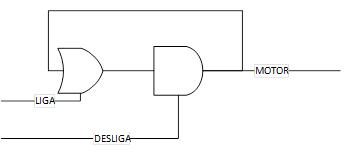
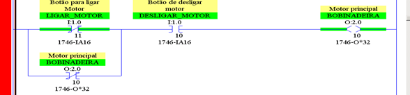
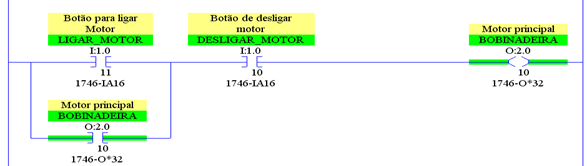
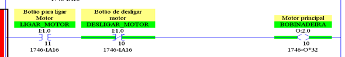
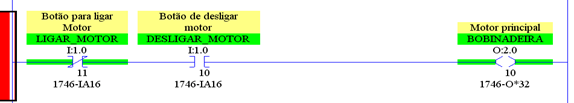
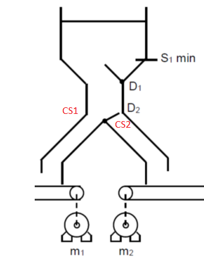
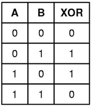
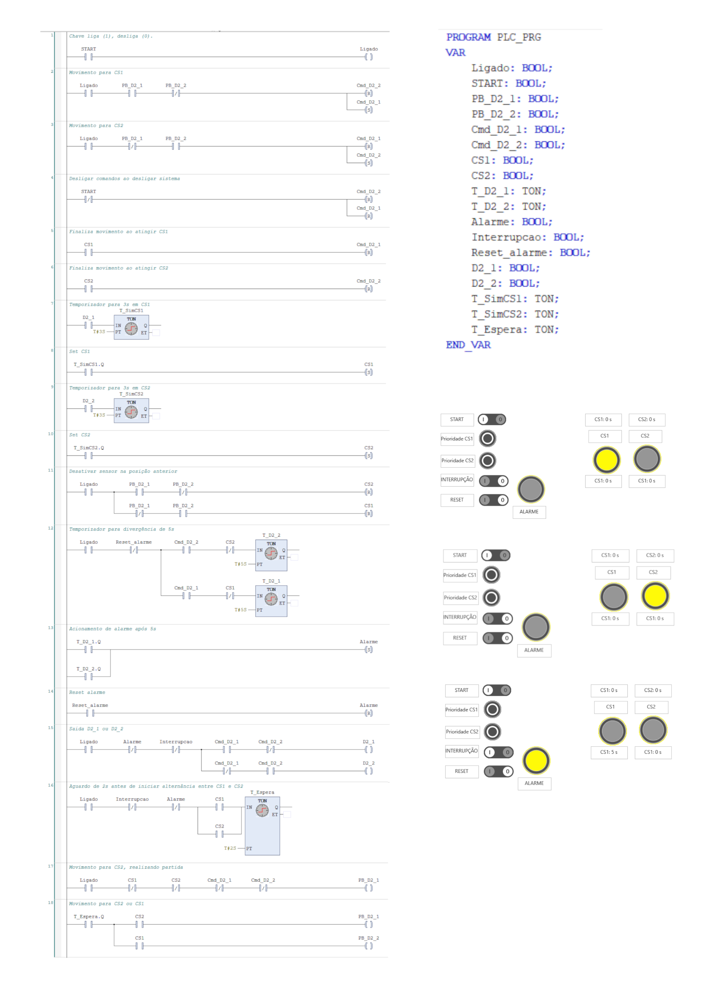
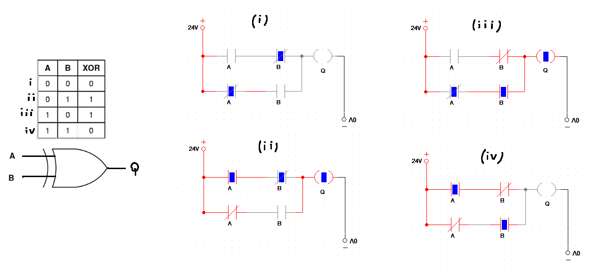

# CLP - Exercícios

### Questão 1 - Em relação às saídas digitais de um CLP, é correto afirmar que: 

(a) Podem ser utilizadas para o acionamento direto de quaisquer tipos de cargas elétricas, independentemente da potência;

(b) Não permitem o emprego de corrente continua.

(c) Permitem a utilização de estratégias de controle avançadas, como a estratégia proporcional;

(d) A tensão de saída será sempre idêntica a de alimentação do CLP;

(e) São as mais empregadas em CLPs, possuindo apenas dois estados, acionada e desacionada.

### Questão 2 - Em relação às entradas analógicas de um CLP, é correto afirmar que: 

(a) Utilizam sinais elétricos que podem ser de tensão ou corrente, geralmente nos valores de O a 10 Vcc e 4 a 20 mA, respectivamente;

(b) Necessitam de um conversor de sinais digitais para analógicos (DAC) no módulo de entrada;

(c) A forma de identificação das grandezas externas permite somente o uso da estratégia de controle on-off;

(d) Somente podem receber sinais elétricos em corrente alternada

(e) Estão aptas a identificar a presença ou não de um sinal elétrico proveniente de um determinado dispositivo, dentro de uma determinada faixa de valores, não reconhecendo sua amplitude;

### Questão 3
Abaixo é mostrado uma sequência de portas lógicas. 
A mesma sequência pode ser feita com lógica ladder. Supondo que “A” corresponda a um botão Liga (I:1.0/11 ), “B” corresponda a um botão de Desliga (I:1.0/10) e “C” a uma saída digital (O:2.0/10) para ligar um motor, qual a melhor representação para esta lógica em linguagem Ladder?

(a) As portas lógicas não podem ser representadas em linguagem Ladder uma vez que possuem níveis de tensão não compatíveis com níveis lógicos do CLP (5 Vdc ou 15 Vdc).

(b)

(c)

(d)

(e)

### Questão 4
Dado o sistema de armazenagem da figura  considere o seguinte damper D2 o qual possui duas saídas (D2_1 e D2_2 ) para seu acionamento o damper possui também dois sensores de posição CS1 e CS2. Crie um alarme de divergência para esse damper, ou seja o alarme deve ser ativado em caso de uma ação pretendida não ser correspondida dado que o damper demora aproximadamente 5s para ir de um lado para o outro.

### Questão 5
Crie um programa em linguagem em ladder que execute a logica explicitada pela tabela da verdade abaixo.

### Questão 6 
Qual é a alternativa falsa sobre linguagens de programação de CLPs

(a) A linguagem de blocos de funções é muito conveniente quando se tem funções muito utilizadas como o PID.

(b) A linguagem de texto estruturado se presta bem a cálculos complexos.

(c) A linguagem ladder se presta bem a intertravamentos.

(d) Não é possível realizar sequencias claras e repetitivas(por exemplo maquina de estados) com a linguagem ladder.

(e) A linguagem SFC é conveniente quando se tem uma sequencia clara e repetitiva.

---

Respostas: 
(1)
* **a. Incorreta:** Elas possuem limites rígidos de corrente e tensão suportados (especialmente saídas a transistor ou relé), exigindo componentes intermediários (como relés de interface ou contatores) para acionar cargas de alta potência.
* **b. Incorreta:** Existem diversos tipos de saídas digitais que operam perfeitamente com corrente contínua (CC), como as saídas a transistor (PNP ou NPN).
* **c. Incorreta:** Estratégias de controle proporcional (como malhas PID) exigem **saídas analógicas** (ou sinais modulados por largura de pulso - PWM sob certas condições), e não saídas digitais puras de dois estados.
* **d. Incorreta:** Dependendo do tipo de saída (por exemplo, saídas a relé ou com fontes de alimentação externas isoladas), a tensão da carga pode ser diferente da tensão de alimentação do próprio CLP.
* **e. Correta:** As saídas digitais são as mais comuns em Controladores Lógicos Programáveis (CLPs) e operam de forma discreta, possuindo apenas dois estados possíveis: **acionada** (ligada/1 lógico) e **desacionada** (desligada/0 lógico).

(2)
* **a. Correta:** As entradas analógicas de um CLP processam sinais contínuos que representam grandezas físicas (como temperatura, pressão, nível), sendo os padrões industriais mais comuns a tensão (ex.: **0 a 10 Vcc**) e a corrente (ex.: **4 a 20 mA**).
* **b. Incorreta:** Os módulos de entrada analógica utilizam um conversor **Analógico-Digital (ADC)** para transformar o sinal físico do campo em dados que a CPU do CLP compreende. O DAC (Digital-Analog Converter) faz o inverso e é usado em *saídas* analógicas.
* **c. Incorreta:** O controle *on-off* é característico de sinais discretos (digitais). As entradas analógicas permitem monitorar variáveis contínuas e são fundamentais para estratégias de controle avançadas ou proporcionais (como malhas PID).
* **d. Incorreta:** A grande maioria dos sinais industriais aplicados em entradas analógicas utiliza **corrente contínua (CC)**.
* **e. Incorreta:** As entradas analógicas **reconhecem a amplitude** exata do sinal (variando de forma proporcional à grandeza medida), ao contrário das entradas digitais, que apenas identificam a presença (ligado) ou ausência (desligado) de um nível lógico.

(3)
Explicação da Lógica Ladder:

1. Contato em Série (I:1.0/10): O contato associado ao botão DESLIGA fica em série no início da linha (rung). Ele interrompe o fluxo de corrente caso seja acionado, desligando o circuito.
2. Ramificação Paralela (Selo): O contato aberto associado à saída do O:2.0/10 é colocado em paralelo com o botão LIGA (I:1.0/11). Quando o botão LIGA é pressionado momentaneamente, a saída é ativada e o contato de selo se fecha, mantendo a linha energizada mesmo após o botão ser solto.
3. Bobina de Saída (O:2.0/10): Representa o acionamento físico do MOTOR conectado à saída digital do CLP.   

(4)

(5)

(6)
a. Correta: A linguagem de Blocos de Funções (FBD) facilita a reutilização e a conexão de blocos complexos, sendo ideal para malhas de controle como o PID.

b. Correta: O Texto Estruturado (ST) é uma linguagem textual de alto nível (semelhante ao Pascal ou C), excelente para cálculos matemáticos complexos e manipulação de dados.

c. Correta: A linguagem Ladder foi concebida com base em diagramas elétricos de relés, sendo extremamente intuitiva e adequada para lógica de intertravamento.

d. Incorreta (Falsa): É plenamente possível realizar sequências e máquinas de estados em linguagem Ladder (através do uso de bits de controle, relés auxiliares, temporizadores, contadores e lógica de avanços de etapa). Embora a linguagem SFC seja mais moderna e específica para esse tipo de estrutura sequencial, a linguagem Ladder sempre foi amplamente utilizada para implementar sequências na automação industrial.

e. Correta: O Grafcet / Sequential Function Chart (SFC) foi desenhado especificamente para modelar processos sequenciais, passos e transições de forma clara.