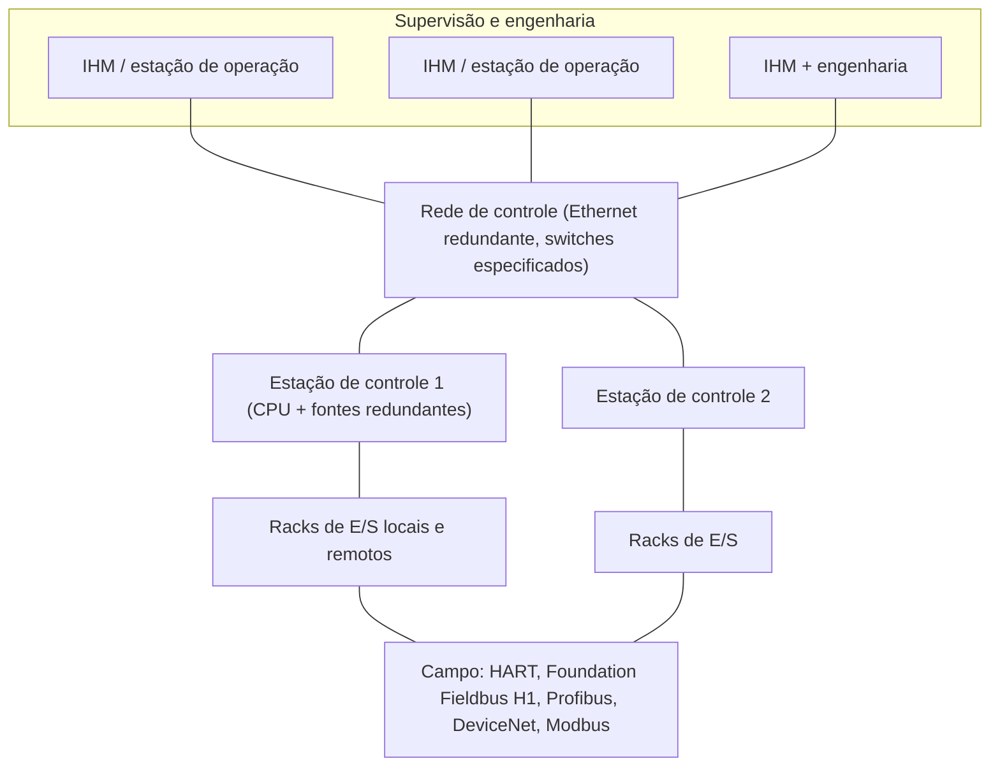
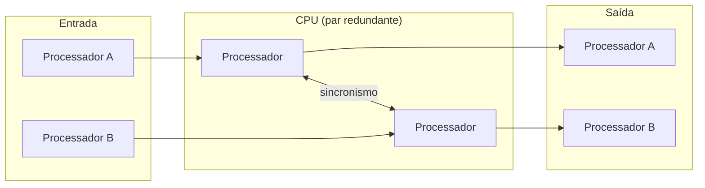
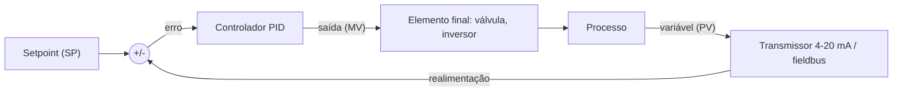
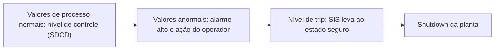
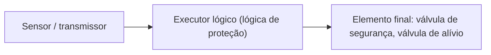
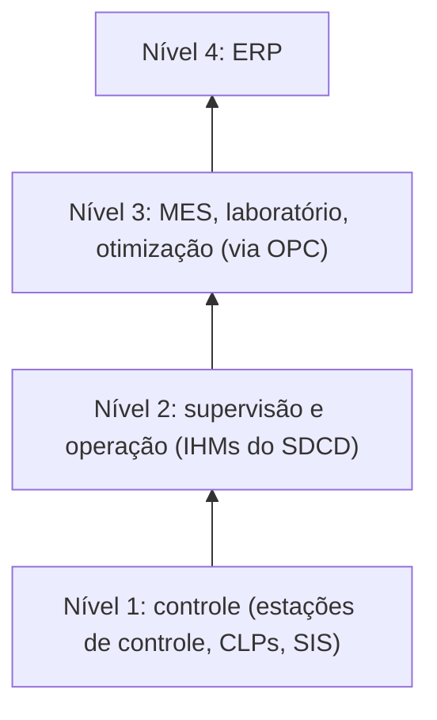

# Sistemas Digitais de Controle Distribuído (SDCD / DCS)

> Controle regulatório, altíssima disponibilidade e supervisão incorporada: história, filosofia, arquitetura, estudo de caso (CENTUM VP), comparação com CLPs, controladores híbridos e sistemas instrumentados de segurança (SIS / Safe PLC).

> [!NOTE]
> **Escopo.** Este documento complementa [`CLP.md`](./CLP.md). Conceitos de CLP (ciclo de varredura, Ladder, IEC 61131-3, PACs) **não são repetidos aqui**; quando necessário, há remissão ao arquivo de CLPs. As siglas **SDCD** (português) e **DCS** (*Distributed Control System*, inglês) são usadas como sinônimos.

---

## Sumário

1. [O que é um SDCD](#1-o-que-é-um-sdcd)
2. [Por que o SDCD surgiu](#2-por-que-o-sdcd-surgiu)
3. [História e fabricantes](#3-história-e-fabricantes)
4. [Filosofia do SDCD](#4-filosofia-do-sdcd)
5. [Aplicações recomendadas e não recomendadas](#5-aplicações-recomendadas-e-não-recomendadas)
6. [Arquitetura típica](#6-arquitetura-típica)
7. [Estudo de caso: Yokogawa CENTUM VP](#7-estudo-de-caso-yokogawa-centum-vp)
8. [Redundância e disponibilidade](#8-redundância-e-disponibilidade)
9. [Controle regulatório no SDCD](#9-controle-regulatório-no-sdcd)
10. [SDCD × CLP](#10-sdcd--clp)
11. [Controlador híbrido](#11-controlador-híbrido)
12. [Quando o SDCD faz o trabalho de um CLP: turbomáquinas](#12-quando-o-sdcd-faz-o-trabalho-de-um-clp-turbomáquinas)
13. [Segurança funcional e SIS (Safe PLC)](#13-segurança-funcional-e-sis-safe-plc)
14. [Tecnologia dos executores lógicos de segurança](#14-tecnologia-dos-executores-lógicos-de-segurança)
15. [Integração, padrões abertos e níveis superiores](#15-integração-padrões-abertos-e-níveis-superiores)
16. [Como definir o sistema: guia de escolha](#16-como-definir-o-sistema-guia-de-escolha)
17. [Projeto, testes e retrofit](#17-projeto-testes-e-retrofit)
18. [Perguntas de revisão e casos](#18-perguntas-de-revisão-e-casos)
19. [Glossário](#19-glossário)
20. [Fontes](#20-fontes)

---

## 1. O que é um SDCD

O **Sistema Digital de Controle Distribuído** é um sistema de controle destinado a **processos regulatórios**. Seus traços definidores:

- **alta capacidade de processamento**;
- **base de dados integrada**;
- **ambiente de supervisão incorporado** (o mesmo sistema traz as telas de operação);
- implantação de **controle avançado e preditivo**;
- garantia de **operação ininterrupta**: *download* online, **saque a quente** (*hot swap*), redundância total etc.

Tecnicamente, o SDCD **é** um controlador programável, mas de um tipo específico, nascido para resolver outro problema que o do CLP. Ele convive com o CLP sob o mesmo "guarda-chuva" dos controladores de processos industriais: os dois podem, às vezes, atuar sobre o mesmo processo, mas são equipamentos de **filosofias muito diferentes**.

> **Saque a quente (*hot swap*):** retirar, por exemplo, um cartão de E/S de dentro do armário **com o sistema em operação** e inserir outro, sem desligar nada. Equipamentos antigos não permitiam isso: tirar o cartão derrubava a CPU, e só se recolocava com tudo desligado.

---

## 2. Por que o SDCD surgiu

O CLP foi criado para **lógica de relé e intertravamento** (ver [`CLP.md`](./CLP.md), seção 2). O SDCD veio de outra pergunta: **como fazer controle no sentido da teoria de controle**, ou seja, como manter variáveis analógicas (temperatura, pressão, vazão, nível) em valores desejados, com PID e estratégias mais sofisticadas.

Antes dos SDCDs já existiam controladores de processo, mas **pneumáticos, mecânicos ou analógicos**: precisos e confiáveis, porém **muito caros** e pouco flexíveis. As aplicações com CLP para controle regulatório passaram a ser questionadas pela **dificuldade de implementação**.

> Na indústria de processos, "controle" costuma ser usado como sinônimo de **controle PID/regulatório**. A teoria de controle é mais ampla, mas esse é o jargão da área.

Dois universos, portanto:

| | **CLP** | **SDCD** |
|---|---|---|
| Problema original | Substituir painéis de relés; intertravar; sequenciar | Controlar malhas analógicas contínuas |
| Variável predominante | Digital (discreta) | **Analógica** |
| Processo típico | Manufatura discreta, máquinas | **Processos contínuos** e batelada |

---

## 3. História e fabricantes

### O contexto

Os SDCDs ganharam espaço com a **disponibilidade crescente de microcomputadores** e a **proliferação de microprocessadores** no controle de processos. Computadores já eram usados na automação de processos havia algum tempo, de duas formas:

- **Controle digital direto (DDC):** o computador fechava a malha.
- **Controle por *setpoint*:** abordagem mais conservadora, em que o computador **supervisionava conjuntos de controladores analógicos**.

No início dos anos 1970, surgiram aplicações do tipo SDCD sobre **minicomputadores** (DEC PDP-11, Varian Data Machines, MODCOMP etc.) com hardware de E/S proprietário: o sistema 1010 da Taylor Instruments, o FOX1 da Foxboro e o 1055 da Bailey Controls. Eram capazes de controle contínuo e em lotes sofisticado para a época, com estações de trabalho de monitor CRT e gráficos de caracteres rústicos.

### 1975: o nascimento comercial

| Ano | Marco |
|:-:|---|
| **1975** | A **Yokogawa** lança o **CENTUM**, considerado o primeiro SDCD do mercado; a **Honeywell** lança o **TDC 2000** de forma independente, na mesma época; a **Bristol** (EUA) lança o **UCS 3000** |
| **1980** | A **Bailey** (hoje ABB) lança o **Network 90**; a **Fisher & Porter** (hoje ABB) lança o **DCI-400** (*Distributed Control Instrumentation*) |
| Hoje | Sistemas gerenciam cerca de **1.000.000 de tags** |

> Há controvérsia sobre quem foi o primeiro em 1975. A Yokogawa reivindica o pioneirismo e é essa versão que os slides adotam; Honeywell e outros também contam a história a seu favor.

### Evolução do CENTUM (Yokogawa)

| Ano | Geração |
|:-:|---|
| 1975 | CENTUM (primeiro SDCD) |
| 1983 | CENTUM V |
| 1988 | CENTUM-XL |
| 1993 | CENTUM CS (HIS, redes Vnet) |
| 1998 | CENTUM CS 3000 |
| 2001 / 2005 | CS 3000 R3, com rede Vnet/IP |
| 2008 | **CENTUM VP**, com compatibilidade retroativa total e mais de 20.000 sistemas instalados no mundo (segundo os slides) |

As redes proprietárias evoluíram de barramentos **duplos redundantes de 250 kbps e 1 Mbps (token pass)** até **Vnet/IP**, baseada em Ethernet.

### Fabricantes de SDCD citados

| Fabricante | Linhas citadas |
|---|---|
| **Emerson** | Muito presente no Brasil |
| **Foxboro** (Invensys) | I/A Series |
| **Yokogawa** | CENTUM |
| **Honeywell** | TDC 2000 / TDC 3000 |
| **ABB** | AC700F; herdeira de Bailey (Infi 90, Network 90), Taylor (Mod 300) e Fisher & Porter (DCI) |
| **Measurex** | Vision |

Uma observação histórica útil: **os primeiros fabricantes de SDCD eram fabricantes de instrumentos** (como a Emerson). Por isso o SDCD conversa tão bem com instrumentos de campo: válvulas, medidores e transmissores. O mesmo vale, por analogia, para fabricantes de CLP que também fabricam CNCs, cujos produtos tendem a se integrar bem.

---

## 4. Filosofia do SDCD

Quatro pilares definem o SDCD:

| Pilar | O que significa |
|---|---|
| **Controle regulatório** | Predominância de **variáveis analógicas**; **processos contínuos**; controle avançado (PID e outros). Gerencia **centenas de malhas** ao mesmo tempo |
| **Altíssima disponibilidade** | Não para o processo para alterar hardware ou software; **redundância total** (rede, E/S, CPU, fonte); **saque a quente** |
| **Controle distribuído** | Arquitetura com **estações de controle espalhadas pela planta**, cada uma gerenciando uma parte do processo (uma falha em uma área não derruba as outras) |
| **Supervisão incorporada** | **Frontais** (*faceplates*) criados automaticamente; **mesmo ambiente de desenvolvimento** para controle e operação |

### Por que a redundância é fundamental

Se a CPU falha, a outra assume **sem derrubar o processo e sem intervenção humana**. Isso é essencial porque normalmente se trata de processo em tempo real, e o operador humano não reage rápido o bastante para evitar um problema. Ao mesmo tempo, a **distribuição física** do controle faz com que um problema em uma parte da planta não paralise as demais.

### Supervisão incorporada: a "IHM" do SDCD

A **IHM** (interface homem-máquina) é a interface gráfica entre os operadores e o sistema. No SDCD ela faz parte do pacote e usa a **mesma base de dados** do controlador. Já nos CLPs, a supervisão é feita por softwares de terceiros, que podem ser usados com CLPs de vários fabricantes (não há "venda casada"). Em um SDCD, a supervisão e o controle vêm integrados do mesmo fabricante.

---

## 5. Aplicações recomendadas e não recomendadas

| | Aplicações |
|---|---|
| **Recomendadas** | **Controle regulatório de processos:** indústria química, termoelétricas, petroquímicas, refinarias, cogeração. **Controle de batelada:** sequenciamento e receitas |
| **Não recomendadas** | **Controle discreto:** *motion control*, intertravamento, **segurança**, manufatura em geral |

**Custo:** a ordem de grandeza é muito diferente. Em aula, o professor citou que um CLP pequeno pode custar da ordem de **mil reais**, enquanto um SDCD costuma estar na faixa de **100 mil a 1 milhão** (ordens de grandeza, não preços de tabela). Por isso, onde um CLP resolve bem, ninguém usa SDCD.

Outro ponto prático: **retrofit**. É comum ser necessário **substituir um SDCD antigo por um novo**, porque o sistema antigo ficou obsoleto. Nesses casos, manter a mesma arquitetura (por exemplo, uma plataforma Yokogawa) é um caminho clássico.

---

## 6. Arquitetura típica



**Pontos de leitura:**

- Cada **armário / estação de controle** executa **integralmente** uma parte do processo: é o sentido de "distribuído".
- A **rede de controle** liga IHMs e estações. Não é qualquer *switch*: ele precisa ser **bem especificado** e homologado para a aplicação.
- A arquitetura da estação de controle é **modular e em rack**, parecida com a de um CLP: fonte redundante, CPUs redundantes, cartões de E/S analógicas e digitais, cartões de comunicação.
- Os **instrumentos de campo** (atuadores e sensores) podem se comunicar diretamente com o sistema por **protocolos de campo**.
- Em um SDCD, **cada IHM consulta diretamente a estação de controle** (sem servidor de dados central). Assim, as estações de operação são **redundantes entre si**.
- O tempo de varredura é **mais lento que o de um CLP** (da ordem de **50 ms**). Em compensação, o SDCD faz coisas que o CLP não faz.

Instalações de grande porte (campos de petróleo, refinarias, grandes plantas químicas) com centenas ou milhares de malhas são o "habitat natural" do SDCD.

---

## 7. Estudo de caso: Yokogawa CENTUM VP

Caso mostrado nos slides: linha Centum Yokogawa na **Refinaria Landulpho Alves (RLAM)**, da Petrobras. Os números abaixo são do **CENTUM VP**, usados como exemplo de ordem de grandeza de um SDCD moderno.

### Estação de controle (equivale à CPU)

| Característica | Valor |
|---|---|
| Alta capacidade de processamento | Estação com **8 slots de E/S** |
| Capacidade | até **1280 E/S analógicas**, até **4096 E/S digitais**, até **4000 words** de comunicação, até **128 segmentos Foundation Fieldbus** |
| Lógicas de sequenciamento e intertravamento | Varreduras de **50 ms, 100 ms, 200 ms, 500 ms e 1 s** |
| *Download* online | Novas configurações ou lógicas, e também **alterações** da existente, **sem parar o processamento** |
| Disponibilidade | **99,9999954 %** ("sete noves", segundo o fabricante) |

### Expansão

- Até **14 racks de E/S remotos** (até **118 cartões** de E/S).
- **Expansão e adição de hardware online**, locais e remotas, sem parar o processamento.
- **Racks locais** (até 10 m) por barramento **ESB** e **racks remotos** por **fibra óptica** (até 20 km), usando **o mesmo hardware** (racks e cartões) para as duas aplicações.
- Certificado para **área classificada**: Classe 1, Divisão 2, Grupos A, B, C e D, temperatura T4.

### Aplicações de grande porte

- Suporta até **256 nós** na rede (IHMs e CPUs).
- Conexão com até **124 equipamentos de terceiros** padrão Ethernet.
- Até **1.000.000 de tags** (PID, elementos de sequência etc.).

### Recursos adicionais

| Recurso | Descrição |
|---|---|
| **Redundância total** | Todos os itens do hardware permitem redundância e troca à quente: CPU, fonte, módulos de E/S (analógico, digital, fieldbus, serial, Ethernet, DeviceNet). Arquitetura **Pair & Spare** |
| **OPC** | Troca de dados com níveis superiores (laboratório, simulação, otimização). A estação **SIOS** converte dados OPC (DA e A&E) em tags do sistema; até **16 OPC servers** por SIOS e **100.000 dados** por SIOS. O sistema pode operar a planta toda como **interface única** |
| **Integração com SIS** | O PLC de segurança **ProSafe** atende **SIL 3** com arquitetura simples, **sem gateway** para interface com o SDCD e com redundância de CPU (Pair & Spare) e de E/S. Certificado TÜV (ver seção 13) |
| **Portal de aplicações** | Acesso por navegador (servidores web, *firewalls*, redes Wi-Fi e Internet) |
| **Simulador integrado** | A **lógica pode ser testada sem o hardware**: um simulador de estação de controle, **fiação automática virtual** e planta virtual na memória do PC |
| **Teclado dedicado** | Teclado com botões equivalentes às funções do software do sistema (hardware de operação otimizado para o SDCD) |

### Tecnologias abertas e padrões de mercado

| Categoria | Padrões / protocolos |
|---|---|
| Cartões de comunicação | Foundation Fieldbus, Profibus-DP/PA/AS-i, HART, DeviceNet, Modbus serial/Ethernet, Ethernet/IP |
| Troca de dados | OPC DA, AE e HDA |
| Controle de batelada | **S88.01** (ISA-88) |
| Gerenciamento de alarmes | **EEMUA 191** |

---

## 8. Redundância e disponibilidade

Nos SDCDs a redundância é **parte do projeto conceitual** do produto, não um acréscimo. Ela é **total**: rede de controle, CPU, fontes, redes de E/S e cartões de E/S.



### Características

- É possível combinar **entrada simples / saída redundante**, **entrada redundante / saída simples** etc.; os CLPs em geral não fazem essas combinações.
- **Todas** as partes do hardware (CPU, fontes, cartões de E/S) permitem **troca à quente**. Nem todos os CLPs permitem.
- Disponibilidade entre **6 e 7 noves**.
- Arquitetura **Pair & Spare**: dois processadores por CPU, e um par reserva pronto para assumir.
- Em um CLP, redundância de cartões de E/S e CPU normalmente exige **duplicar o rack**, o que complica muito a lógica. Os CLPs costumam ter redes de controle **duais** (não redundantes) e deixam a redundância a cargo do supervisório. (Para o *hot standby* de CLP, ver [`CLP.md`](./CLP.md), seção 19.)

### O que significam os "noves"

Tempo máximo de indisponibilidade por ano (cálculo simples sobre 365,25 dias):

| Disponibilidade | Parada máxima por ano |
|---|---|
| 99,9 % (três noves) | ≈ 8,8 horas |
| 99,99 % | ≈ 52,6 minutos |
| 99,999 % | ≈ 5,3 minutos |
| 99,9999 % (seis noves) | ≈ 32 segundos |
| 99,99999 % (sete noves) | ≈ 3 segundos |
| 99,9999954 % (valor citado para o CENTUM VP) | ≈ 1,5 segundo |

Em aula, o professor mencionou como ordem de grandeza que esse tipo de equipamento chega a falhar **uma vez a cada várias décadas** (comentário informal, não um dado de especificação).

---

## 9. Controle regulatório no SDCD

### A malha de controle



Nos SDCDs, a **malha PID é a unidade de trabalho**. Por isso o conceito de **tag** muda em relação ao CLP (ver seção 10): **um PID é um tag**.

### PID: resumo

| Ação | Efeito |
|:-:|---|
| **P** (proporcional) | Resposta imediata, proporcional ao erro |
| **I** (integral) | Elimina o desvio em regime; velocidade proporcional ao erro acumulado |
| **D** (derivativa) | Reage à taxa de variação do erro, antecipando a resposta |

Sintonia por **Ziegler-Nichols, oscilação mantida** (malha fechada), com ganho supremo `Kpu` e período supremo `Pu`:

| Controlador | Kp | Ti | Td |
|---|:-:|:-:|:-:|
| P | 0,50 · Kpu | — | — |
| PI | 0,45 · Kpu | Pu / 1,2 | — |
| PID | 0,60 · Kpu | Pu / 2 | Pu / 8 |

Sintonia por **curva de reação** (malha aberta, só sistemas estáveis), com retardo `L` e constante `T`:

| Controlador | Kp | Ti | Td |
|---|:-:|:-:|:-:|
| P | T / L | — | — |
| PI | 0,9 · T / L | L / 0,3 | — |
| PID | 1,2 · T / L | 2 · L | 0,5 · L |

> Esses métodos dão uma **primeira aproximação**; depois vem a sintonia fina em campo. Mais detalhes (relações de ganho, regras empíricas por tipo de variável, sintonia por tentativa e erro) estão em [`CLP.md`](./CLP.md), seção 18.

### Biblioteca de blocos de processo

Os SDCDs trazem, em geral, uma **biblioteca extensa de blocos** voltados ao controle de processo, desenvolvidos a partir da experiência do fornecedor em controle regulatório. Exemplos: **PID com *self-tuning / auto-tuning***, **limite cruzado** (*cross-limiting*), **aquecimento/resfriamento** (*heat/cool*). Nos CLPs a biblioteca para esse fim é menos vasta, e customizações exigem linguagens de baixo nível.

### Batelada

Além do contínuo, o SDCD faz **controle de batelada**: **sequenciamento** e **receitas**, apoiado no padrão **S88.01** (ISA-88). O **SFC** (ver [`CLP.md`](./CLP.md), seção 17) é a linguagem típica para descrever esses passos.

---

## 10. SDCD × CLP

Os dois equipamentos são muito semelhantes na estrutura (rack, CPU, cartões), mas muito diferentes na **filosofia**. Comparação ponto a ponto (slides):

| Aspecto | **SDCD (DCS)** | **CLP** |
|---|---|---|
| **Configuração e supervisão** | Todas as variáveis da estação de controle ficam **automaticamente** disponíveis na estação de operação, onde se escolhem **frontais padrão** (base de dados única) | As variáveis precisam ser **transcritas** para a base do supervisório; todas as variáveis acessadas devem ser declaradas lá |
| **Redundância** | Parte do projeto; **total** (rede de controle, CPU, fontes, redes de E/S, cartões); combinações simples/redundante | CPU e E/S redundantes costumam exigir **duplicação do rack**; redes de controle **duais** (não redundantes), com gestão pelo supervisório |
| **Troca à quente** | **Todo** o hardware | Nem todos os modelos |
| **Disponibilidade** | **6 a 7 noves** | Menor |
| **Telas de diagnóstico** | **Telas padrão** do sistema (rede, fontes, CPU, E/S) | Precisam ser **construídas manualmente** (consome horas-homem e capacidade de tags do supervisório) |
| **Inclusão de novos tags** | **Sem parar a planta** (*download* online) e com **equalização automática** em todas as CPUs e IHMs | Exige **reinicializar** individualmente todas as CPUs que usam o tag |
| **Conceito de tag** | Tag = **função** executada (**1 PID = 1 tag**) | Tag = **informação / parâmetro** acessado (PID, P, I, D, H, HH, L, LL = **8 tags** para a mesma malha) |
| **Escalabilidade** | Inclusão de cartões de E/S e de redundância **sem parar a CPU** | Apesar de *Plug & Play*, normalmente exige **reinicializar a CPU** para reconhecer cartões, parando o processo |
| **Biblioteca de blocos** | Extensa (self-tuning, limite cruzado, heat/cool) | Menos vasta; customização em baixo nível |
| **Arquitetura de operação** | **Sem cliente-servidor**: cada IHM pede dados direto à estação de controle; as IHMs são **redundantes entre si** | **Cliente-servidor** com PC/servidor: **ponto único de falha** (alguns fabricantes oferecem servidor redundante) |
| **Velocidade de varredura** | Mais lento (**a partir de 50 ms**) | Rápido (**µs**) no discreto |
| **Melhor uso** | Processos **regulatórios**, contínuos | **Discreto**, intertravamento, máquinas |

> **Conclusão prática:** quanto mais **analógico, contínuo e crítico** o processo, mais o SDCD se justifica. Quanto mais **discreto, rápido e barato**, mais o CLP é a escolha.

---

## 11. Controlador híbrido

O **controlador híbrido** reúne funcionalidades de **CLP** (por exemplo, tempo de processamento rápido em Ladder) e de **SDCD** (controle regulatório complexo). Pode ser aplicado em **controle regulatório** e em **controle discreto / manufatura**, mas há limitações para aplicações muito específicas.

Posição no espectro (slides):

```
Estratégia de controle
 complexo  ^                                   [ SDCD ]
           |                       ( HÍBRIDO )
           |        [ CLP ]
 simples   +------------------------------------------>
              discreta                      regulatório
                         Aplicação de controle
```

*(Esquema ilustrativo das posições relativas; não é um gráfico em escala.)*

### Híbrido × CLP

| Aspecto | **Híbrido** | **CLP** |
|---|---|---|
| Download online | Sim | Alguns modelos, com restrições |
| Redundância | Fonte, CPU e rede | Exige outro rack em paralelo |
| Saque a quente | Sim | Não |
| Varredura discreta | **8 ms** | µs |
| Varredura analógica | **10 ms** | **> 50 ms** |
| Limite de malhas/blocos | **Sem limitação** | Alguns modelos limitam (ex.: PID) |
| Programação | **IEC 61131-3** | Ladder |

### Híbrido × SDCD

| Aspecto | **Híbrido** | **SDCD** |
|---|---|---|
| Download online | Sim | Sim, também de **hardware** |
| Redundância | Fonte, CPU e rede | **Total**, com dois processadores por CPU |
| Saque a quente | Sim | Sim |
| Varredura discreta / analógica | 8 ms / 10 ms | A partir de **50 ms** |
| Capacidade de E/S | Cerca de **1200 pontos** | **Mais de 4000 pontos** |
| Expansão | Até **3 racks** | Até **14 racks** |
| Supervisório | **Qualquer** | **Incorporado**, com criação automática de frontais |

### Na prática

- Em uma planta citada em aula, o **intertravamento** foi colocado em um **CLP** e a parte de **controle mais analógico** em um **SDCD**, e os dois se comunicam por **rede**, exatamente a arquitetura híbrida.
- Segundo o professor, SDCD e CLP tendem a **convergir** em um único tipo de equipamento. Essa visão é compatível com o conceito de **PAC** (ver [`CLP.md`](./CLP.md), seção 13), pois a fronteira entre os dois mundos é cada vez mais de grau, não de natureza.

---

## 12. Quando o SDCD faz o trabalho de um CLP: turbomáquinas

Exemplo dos slides de **SDCD fazendo o papel de CLP**: controle de **turbinas a vapor**.

**Contexto de mercado:**

- O sistema de controle da turbina costuma ser escopo do fornecedor de instrumentação e controle (I&C).
- A indústria prefere que o controle da turbina e o SDCD da planta sejam do **mesmo fornecedor**.
- Fabricantes de turbinas têm dificuldade em agregar tecnologias novas (fieldbus, PRM etc.); uma aliança com fornecedores de I&C pode ser conveniente.

**O problema:** o sistema de energia exige **resposta muito rápida**. O controle de admissão de vapor precisa de módulo com resposta de **5 a 10 ms**, bem abaixo dos 50 ms de um SDCD comum. A solução foi desenvolver **dois módulos novos**, em formato de cartão, aproximadamente **10 vezes mais rápidos**:

| Módulo | Função |
|---|---|
| **Módulo servo** | Controla a **velocidade** da turbina por válvulas de controle de admissão de vapor (PID em **5 ms**) |
| **Módulo de proteção de alta velocidade** | **Impede o disparo** (excesso de velocidade) fechando as válvulas de admissão; é **obrigatório** |

| Proteção da turbina (*trip*) | Controle principal da turbina |
|---|---|
| Por alta velocidade | Controle de partida |
| Por vibração | Controle de parada |
| Por desgaste dos mancais | Controle de velocidade / carga |
| Por baixo vácuo | Controle de pressão de admissão e extração |

**Modelo de módulo servo citado:** AGS813, com **4 LVDT, 4 AI, 2 DI, 2 AO e 2 DO**, com isolação; até **16 módulos** em algumas famílias de estação de controle e até **8** em outras. Aplicações: termoelétricas, óleo e gás, açúcar e álcool.

> **Moral do caso:** é possível fazer lógica de CLP usando um cartão de SDCD, e o caso prova que "dá para fazer". Mas, em geral, é mais lógico usar um CLP onde se precisa de lógica de CLP. Esse tipo de solução é **bem específico**.

---

## 13. Segurança funcional e SIS (Safe PLC)

Até aqui falamos de **controle**. Segurança é outro assunto: o objetivo é **levar o processo a um estado seguro** quando algo dá errado. Por isso, segundo os slides, **segurança não é aplicação recomendada para SDCD ou para CLP comum**; ela é feita por um **Sistema Instrumentado de Segurança (SIS)**, baseado em **CLPs de segurança** (*Safe PLC*).

> **Aprofundamento:** o tema SIL (determinação, verificação, arquiteturas, normas IEC 61508/61511 e exemplo completo) está em [`SIL.md`](./SIL.md).

### Por que segurança industrial?

- Operar um processo industrial envolve **risco** para pessoas e para o ambiente.
- A sociedade aceita risco **até um nível aceitável**.
- Muitos processos precisam de **redução de risco** para se encaixar nesse nível.

### Risco (IEC 61508)

```
Risco = Consequência (C) × Frequência (F)
```

Impactos considerados: pessoas, perda de produção, meio ambiente, processos judiciais, investimento em equipamentos e imagem da empresa.

### Camadas de proteção

Nenhuma camada sozinha basta. O risco é reduzido por **camadas independentes**, das internas (que **reduzem a probabilidade** de incidentes) às externas (que **reduzem a severidade**):

| Camada (de dentro para fora) | Papel |
|---|---|
| **Processo** | Origem do risco inerente |
| **Controle de processo básico (SDCD)** | Mantém o processo em operação normal |
| **Alarmes críticos e intervenção do operador** | Resposta humana a valores anormais |
| **SIS** | **Última linha de proteção automática**: leva a planta a *shutdown* (trip) |
| **Proteção física: dispositivos de alívio** | Válvulas de alívio |
| **Proteção física: diques e muradas** | Contenção |
| **Plano de emergência da planta** | Procedimento de evacuação |
| **Plano de emergência da comunidade** | Resposta externa |



Pontos importantes:

- O **SIS é independente** do SDCD ("externo" a ele).
- Os dispositivos de segurança, de preferência, **não executam suas ações de proteção durante seu ciclo de vida**: são uma espécie de **apólice de seguro**.

### Definição de SIS

Sistema composto por **sensores, circuitos lógicos (executor lógico) e elementos finais de controle**, com o propósito de levar o processo a um **estado seguro** quando condições predeterminadas forem violadas.



### Curiosidades (lições de gestão)

- Segurança **não contribui diretamente** para o retorno de investimento (ROI).
- Segurança **complica** a operação e a manutenção.
- Exige atenção contínua de **especialistas** ao longo de todo o ciclo de vida.

### Normas

Os slides citam: **ANSI/ISA S84**, **IEC 61508**, **DIN 19250 / DIN V 19250**, **TÜV**, entre outras. A **IEC 61508** é a norma-base de segurança funcional; para a **indústria de processo**, a norma específica derivada dela é a **IEC 61511** (acréscimo deste material, não consta nos slides).

### Ciclo de vida de segurança

Concepção inicial (desenvolvimento e fabricação), definição do sistema, **análise de risco**, aplicação, projeto, instalação, operação, procedimentos de modificação, manutenção e desativação. O fabricante e seus processos de desenvolvimento são certificados, e a responsabilidade é **dividida entre fabricantes, integradores e usuário final**.

### SIL: nível de integridade de segurança

O **SIL** estabelece a **ordem de grandeza da redução de risco** necessária. Os requisitos se aplicam à **malha completa** (sensor + lógica + elemento final), e não a um único equipamento. Cada nível corresponde a uma **PFD** (*probability of failure on demand*, probabilidade média de falha na demanda):

| SIL | PFD média | Disponibilidade | Fator de redução de risco |
|:-:|:-:|:-:|:-:|
| **4** | ≥ 10⁻⁵ a < 10⁻⁴ | > 99,99 % | > 10.000 |
| **3** | ≥ 10⁻⁴ a < 10⁻³ | 99,9 a 99,99 % | 1.000 a 10.000 |
| **2** | ≥ 10⁻³ a < 10⁻² | 99 a 99,9 % | 100 a 1.000 |
| **1** | ≥ 10⁻² a < 10⁻¹ | 90 a 99 % | 10 a 100 |
| 0 | não aplicável (controle) | | |

```
PFD(malha) = PFD(sensores) + PFD(executor lógico) + PFD(elementos finais)
Condição:   PFD(malha) ≤ PFD(alvo do SIL especificado)
```

**Falha na demanda:** não ação ou ação incorreta de pelo menos um atuador quando ocorre o evento iniciador que exigia a ação.

### Classes AK (DIN V 19250) e relação com SIL

| Classe AK | SIL equivalente (sugestão do TÜV) |
|:-:|:-:|
| AK 1 | SIL 0 |
| AK 2 e 3 | SIL 1 |
| AK 4 | SIL 2 |
| AK 5 e 6 | SIL 3 |
| AK 7 e 8 | SIL 4 |

### Determinação qualitativa do SIL: gráfico de risco

O **gráfico de risco** usa quatro parâmetros:

| Parâmetro | Níveis |
|---|---|
| **C**: consequência ao ser humano | C1 prejuízos menores · C2 prejuízos sérios, morte de 1 pessoa · C3 morte de várias pessoas · C4 consequências catastróficas |
| **F**: frequência de exposição na área de risco | F1 rara · F2 frequente a permanente |
| **P**: possibilidade de evitar o risco | P1 possível · P2 dificilmente possível |
| **W**: probabilidade de ocorrência | W1 muito baixa · W2 baixa · W3 alta |

O resultado do gráfico é uma letra, que se traduz em requisito de segurança:

| Resultado | Requisito |
|:-:|---|
| – | Sem requisitos de segurança |
| a | Requisitos de segurança não especiais |
| b, c | **SIL 1** |
| d | **SIL 2** |
| e, f | **SIL 3** |
| g | **SIL 4** |
| h | **Um SIS não é suficiente** (é preciso outra medida) |

(A grade completa do gráfico está nos slides originais.) A versão alemã (DIN V 19250) usa parâmetros equivalentes (S, A, G, W) para chegar às classes AK 1 a 8.

### Ferramentas de análise

| Ferramenta | Natureza |
|---|---|
| **PHA** (*Process Hazard Analysis*) | Análise de perigos de processo |
| **HAZOP** | Qualitativa |
| **LOPA** | Quantitativa (camadas de proteção) |

### Etapas de um projeto de segurança

1. Reconhecer as áreas potenciais de perigo.
2. Avaliar o risco aceitável dessas áreas.
3. Selecionar as medidas de proteção.
4. Classificar o **SIL** requerido dessas medidas.
5. Implementar e manter um **sistema de gerenciamento de segurança**: documentação, auditoria (**testes periódicos**), procedimentos e controle de **fatores humanos**.

---

## 14. Tecnologia dos executores lógicos de segurança

O executor lógico de um SIS pode usar diferentes tecnologias:

- relés;
- acionamentos pneumáticos;
- **sistemas eletrônicos programáveis** (simples **1oo1D**, dual **1oo2D**, triplo **2oo3**);
- **lógica de estado sólido** (tecnologia normal ou com **falha segura inerente**).

A notação `MooN` significa "**M** canais **de** N" necessários.

### 1oo1D: canal simples

Uma entrada, um controlador e uma saída. O "**D**" indica a função de **diagnóstico**.

```
Entrada --> [circuito de entrada] --> [CPU] --> [circuito de saída] --> Saída
                     ^                  |
                     +--- diagnóstico --+
```

### 1oo2D: canal duplo

Dois canais **idênticos**, cada um com seu próprio diagnóstico. É redundante e **tolerante a falhas**, com **SIL elevado e baixa PFD** (segurança) e **baixo índice de trips falsos** (disponibilidade). Basta **um canal de dois** para o sistema operar ou para dar *shutdown*.

```
          +-- [entrada A] -> [CPU A] -> [saída A] --+
Entrada --+                                         +--> Saída
          +-- [entrada B] -> [CPU B] -> [saída B] --+
              (cada canal com diagnóstico próprio)
```

### TMR 2oo3: redundância modular tripla

Três canais idênticos com **votação**: **dois de três** são necessários para o sistema operar ou dar *shutdown*.

```
          +-- [entrada A] -> [CPU A] -> [saída A] --+
Entrada --+-- [entrada B] -> [CPU B] -> [saída B] --+--> [votador] --> Saída
          +-- [entrada C] -> [CPU C] -> [saída C] --+
```

### Falha segura inerente (SLS)

Lógica de estado sólido em que, internamente, o sistema trabalha com **frequência pulsada (1 kHz)**: na falha de qualquer componente, a saída é "grampeada" em estado seguro. O projeto substitui o requisito de diagnóstico (**D**).

### Revisão das tecnologias

QMR (quádrupla), TMR e 1oo2D são caminhos para o mesmo objetivo. O que interessa ao usuário **não é a metodologia**, e sim a **segurança e a disponibilidade** do sistema.

**Principais requisitos desejados:**

- atender o SIL com configurações **simples**;
- alto MTBF e **baixa PFD**;
- **manter o SIL** mesmo com falhas.

### Tipos de falha

| Termo | Definição |
|---|---|
| **Falha** | Não cumprimento do serviço esperado de um dispositivo |
| **Falha espúria** | A falha resulta na ação de pelo menos um atuador **sem** que tenha ocorrido o evento iniciador (um *trip* falso) |
| **Falha na demanda** | Não ação ou ação incorreta de um atuador **quando** o evento iniciador ocorre |
| **Falha oculta (encoberta)** | Só é percebida quando a malha de segurança é solicitada (por demanda ou por teste) |
| **Tolerância a falha** | Capacidade de continuar funcionando diante de um evento limitado de falhas de hardware ou software |
| **Inerente à falha** | Projeto em que a técnica de diagnóstico (software) não tem cobertura de 100 % das falhas possíveis, sendo o próprio projeto que garante o estado seguro |

> Para a visão de **Safe PLC como classe de CLP**, ver [`CLP.md`](./CLP.md), seção 12.

---

## 15. Integração, padrões abertos e níveis superiores

Embora tenham origem proprietária, os SDCDs modernos adotam **padrões abertos**:

| Função | Padrões |
|---|---|
| Barramentos de campo | **Foundation Fieldbus** (H1), **Profibus** (DP, PA), **HART**, **DeviceNet**, **Modbus** (serial e Ethernet), **Ethernet/IP** |
| Troca de dados com sistemas superiores | **OPC** (DA: dados atuais; AE: alarmes e eventos; HDA: dados históricos) |
| Batelada | **S88.01** (ISA-88) |
| Alarmes | **EEMUA 191** |
| Segurança | Integração com SIS certificado por **TÜV** |

**Relação com a pirâmide da automação** (ver [`CLP.md`](./CLP.md), seção 14): com a supervisão incorporada, o SDCD cobre o **nível 1** (controle) e boa parte do **nível 2** (coordenação, supervisão). A ligação com o **nível 3** (MES, laboratório, simulação, otimização) é feita tipicamente por **OPC**; o nível 4 (ERP) fica acima.



---

## 16. Como definir o sistema: guia de escolha

### Perguntas a fazer (slides)

1. Qual a **quantidade de pontos** necessária?
2. Quais os **tipos de pontos** e a aplicação: discreta, controle regulatório, batelada?
3. Qual a **velocidade de processamento** exigida?
4. Quais **protocolos** (Fieldbus, Profibus, Modbus, DeviceNet etc.)?
5. É preciso **redundância** (processador, fonte, módulos de E/S, barramento de controle)?
6. Já existe **supervisório padronizado** (iFix, InTouch etc.)?
7. A arquitetura será **centralizada** ou precisará de **remotas** espalhadas pela área?
8. A instalação é em **área classificada** (Zona 0, 1 ou 2)?

### Guia comparativo

| Critério | **CLP** | **PAC** | **Híbrido** | **SDCD** | **SIS / Safe PLC** |
|---|---|---|---|---|---|
| Vocação | Discreto, máquinas, intertravamento | Lógica + movimento + processo + dados | Discreto e regulatório moderado | **Regulatório contínuo**, batelada | **Segurança** (levar ao estado seguro) |
| Velocidade | Muito alta (µs) | Alta | 8 ms (discreto) / 10 ms (analógico) | A partir de 50 ms | Conforme SIL e arquitetura |
| Disponibilidade | Boa; redundância opcional | Boa a muito boa | Alta | **Altíssima (6 a 7 noves)** | Alta, com SIL certificado |
| Porte (E/S) | Pequeno a grande | Médio a grande | ≈ 1200 pontos | **Milhares** (até 1.000.000 tags) | Dedicado |
| Custo | **Baixo** | Médio | Médio | **Alto** | Alto |
| Supervisão | Terceiros | Integrada ou terceiros | Qualquer | **Incorporada** | Normalmente via SDCD |

### Cenários

| Cenário | Escolha provável | Por quê |
|---|---|---|
| Linha de montagem com esteiras e sensores | **CLP** | Discreto, rápido, barato |
| Refinaria com centenas de malhas PID e requisito de nunca parar | **SDCD** | Regulatório, redundância total, escala |
| Unidade com intertravamento rápido **e** malhas analógicas moderadas | **Híbrido** (ou CLP + SDCD em rede) | Equilíbrio entre velocidade discreta e controle regulatório |
| Intertravamento de queimador ou parada de emergência | **SIS (Safe PLC)** | Função de segurança certificada por SIL |
| Turbina a vapor em termoelétrica | **SDCD com módulos específicos** ou controlador dedicado | Resposta de 5 a 10 ms e proteção por trip |
| Troca de um SDCD obsoleto | **Retrofit** na mesma arquitetura | Menor risco de migração |

---

## 17. Projeto, testes e retrofit

O ciclo de vida de um projeto de automação (análise, especificação, desenvolvimento, testes, instalação) é o mesmo descrito em [`CLP.md`](./CLP.md), seção 20. Particularidades no mundo SDCD:

- **Base de dados única:** ao configurar uma variável no controlador, o frontal de operação já fica disponível, o que reduz muito o retrabalho de engenharia.
- **Teste virtual:** o **simulador integrado** executa a lógica de controle em um PC, com planta virtual e fiação automática, **antes** de existir hardware. É um aliado direto dos testes de aceitação de fábrica (TAF).
- **Evolução sem parada:** *download* online de lógicas, adição de cartões e de racks sem parar o processo, o que permite expandir a planta com a produção rodando.
- **Retrofit:** substituir SDCDs antigos é uma atividade comum. Normalmente se mantém a mesma plataforma do fabricante, aproveitando a **compatibilidade retroativa**.
- **Documentos típicos:** P&ID, lista de instrumentos e de E/S, descritivo funcional, diagramas causa-efeito, arquitetura do sistema, roteiros de TAF e TAC.
- **Segurança:** o SIS é projetado e testado **separadamente** do SDCD, com **testes periódicos** ao longo da vida da planta (falhas ocultas só aparecem em teste ou na demanda).

---

## 18. Perguntas de revisão e casos

1. Em que sentido o SDCD é "distribuído"? O que acontece se uma estação de controle falhar?
2. Por que o SDCD **não** é recomendado para intertravamento e segurança?
3. Explique a diferença entre **tag** em SDCD e **tag** em CLP, usando o exemplo de uma malha PID com alarmes H, HH, L e LL.
4. O que é **saque a quente** e por que ele importa em uma refinaria?
5. Compare o **supervisório** de um SDCD com o de um CLP quanto à base de dados, às telas de diagnóstico e ao ponto único de falha.
6. O que significam "seis noves" e "sete noves" de disponibilidade em horas ou segundos de parada por ano?
7. Quando um **controlador híbrido** é preferível a um CLP e a um SDCD?
8. Por que o SDCD de turbinas precisou de módulos de 5 a 10 ms?
9. Defina **SIS**, **SIL** e **PFD**. Qual a relação entre elas?
10. Calcule: uma malha de segurança tem sensores com PFD = 2×10⁻⁴, executor lógico com PFD = 1×10⁻⁴ e válvula com PFD = 5×10⁻⁴. Qual a PFD da malha e que SIL ela atinge? Se o alvo era SIL 3, a malha está dentro?

<details>
<summary>Resposta da pergunta 10</summary>

```
PFD(malha) = 2×10⁻⁴ + 1×10⁻⁴ + 5×10⁻⁴ = 8×10⁻⁴
```

Como 10⁻⁴ ≤ 8×10⁻⁴ < 10⁻³, a malha está na faixa de **SIL 3**. Portanto, **está dentro** do alvo SIL 3. Observação: com uma pequena margem, já que 8×10⁻⁴ está perto do limite de 10⁻³; qualquer degradação (por exemplo, um intervalo de teste maior) poderia empurrá-la para SIL 2.

</details>

---

## 19. Glossário

| Termo | Significado |
|---|---|
| **SDCD / DCS** | Sistema Digital de Controle Distribuído / *Distributed Control System* |
| **Controle regulatório** | Controle contínuo de variáveis analógicas (PID e correlatos) |
| **Controle distribuído** | Controle espalhado em estações, cada uma responsável por parte do processo |
| **Saque a quente / hot swap** | Troca de hardware com o sistema em operação |
| **Download online** | Carga de nova lógica ou configuração sem parar o processamento |
| **Pair & Spare** | Arquitetura em que um par de processadores tem um par reserva |
| **IHM / HIS** | Interface homem-máquina / *Human Interface Station* |
| **Frontal (faceplate)** | Tela padrão de operação de uma variável (PID, válvula etc.) |
| **Estação de controle (FCS)** | A "CPU" do SDCD, com racks de E/S |
| **Tag** | Identificador de um elemento (no SDCD, em geral, uma função como um PID) |
| **OPC (DA / AE / HDA)** | Padrão de troca de dados (atuais / alarmes e eventos / históricos) |
| **Foundation Fieldbus / Profibus / HART** | Protocolos de comunicação com instrumentos de campo |
| **S88.01 (ISA-88)** | Padrão de controle de batelada |
| **EEMUA 191** | Diretriz de gerenciamento de alarmes |
| **Híbrido** | Controlador com características de CLP e de SDCD |
| **SIS** | Sistema Instrumentado de Segurança |
| **Safe PLC** | CLP de segurança, usado como executor lógico de um SIS |
| **SIL** | *Safety Integrity Level* (nível de integridade de segurança), de 1 a 4 |
| **PFD** | *Probability of Failure on Demand* (probabilidade de falha na demanda) |
| **Falha espúria** | Ação indevida (trip falso) sem evento iniciador |
| **Falha oculta** | Falha que só aparece em teste ou na demanda |
| **1oo1D / 1oo2D / 2oo3 (TMR)** | Arquiteturas de votação de canais do executor lógico |
| **HAZOP / PHA / LOPA** | Técnicas de análise de perigos e de camadas de proteção |
| **AK (DIN V 19250)** | Classes de requisitos de segurança, de 1 a 8 |
| **Retrofit** | Modernização/substituição de um sistema de controle existente |
| **TAF / TAC** | Teste de aceitação de fábrica / de campo |

---

## 20. Fontes

- ANDRADE, Alexandre Acácio de. **Automação em Sistemas Industriais: Controladores II (extra)**: SDCD / Híbridos e SAFE-PLC. Slides de aula, UFABC. (Arquivo `SDCD_SAFE.pdf`.)
- Transcrição automática de aula em vídeo comentando os slides de SDCD (arquivo `transcricao.txt`). O áudio tinha **muitos erros de reconhecimento de fala**; foram aproveitadas apenas as informações que puderam ser confirmadas pelos slides ou que são comentários de contexto claramente identificáveis (comentários informais, como ordem de grandeza de custo e de falhas, estão sinalizados como tal).
- ANDRADE, Alexandre Acácio de. **Automação em Sistemas de Manufatura**. Slides de aula, UFABC (PID, sintonia, metodologia de projeto), conforme reunido em [`CLP.md`](./CLP.md).
- ZANCAN, Marcos Daniel. **Controladores Programáveis**. Santa Maria: UFSM / CTISM, 2011; GROOVER, Mikell P. **Automação industrial e sistemas de manufatura**. Pearson, 2011. (Usados em [`CLP.md`](./CLP.md).)

> **Observação sobre acréscimos:** a menção à IEC 61511, a tabela de "noves" (cálculo de indisponibilidade por ano), a tabela de cenários, as perguntas de revisão e o resumo de PID em forma de diagrama de malha são material de apoio escrito para este documento, e não conteúdo literal dos slides. Números de capacidade (E/S, tags, tempos de varredura) são os do fabricante citado no estudo de caso (CENTUM VP) e variam por produto e versão; consulte a documentação oficial do fornecedor.