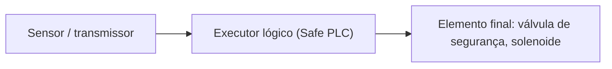
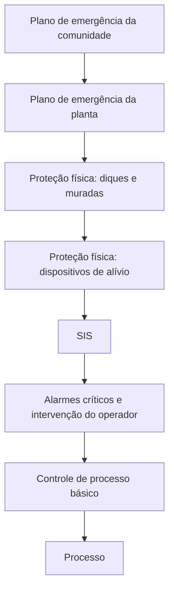
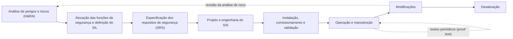
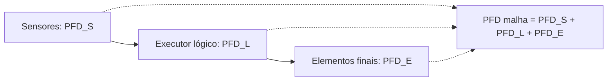

# SIL: Safety Integrity Level (Nível de Integridade de Segurança)

> Segurança funcional em sistemas automatizados: risco, camadas de proteção, SIS e SIF, normas IEC 61508 / IEC 61511, determinação (gráfico de risco e LOPA), verificação (PFD, SFF, HFT), arquiteturas de votação, fatores humanos e um exemplo completo de projeto de uma função instrumentada de segurança.

> [!NOTE]
> **Escopo e relação com os outros arquivos.** Este documento aprofunda o tema de segurança que foi apresentado de forma resumida em [`SDCD.md`](./SDCD.md) (seções 13 e 14) e se apoia em [`CLP.md`](./CLP.md) (CLP, IEC 61131-3, redundância). O assunto **não é coberto** pelo Groover nem pela apostila do Zancan.
>
> **Origem do conteúdo** (indicada em cada seção):
> - **Slides** = `SDCD_SAFE.pdf` (Prof. Alexandre Acácio de Andrade, UFABC);
> - **Aula** = transcrição da aula em vídeo (áudio com muitos erros de reconhecimento; só entrou o que pôde ser entendido com segurança);
> - **Norma / consulta técnica** = pesquisa em fontes públicas sobre IEC 61508, IEC 61511 e normas brasileiras correlatas (a íntegra das normas é paga; este material **resume e não reproduz** o texto normativo).
>
> O material do **AVA** não foi enviado e, portanto, **não foi usado**. Se quiser incluí-lo, basta enviar os arquivos.

---

## Sumário

1. [Por que segurança funcional](#1-por-que-segurança-funcional)
2. [Conceitos fundamentais](#2-conceitos-fundamentais)
3. [Camadas de proteção](#3-camadas-de-proteção)
4. [Normas e quem as usa](#4-normas-e-quem-as-usa)
5. [Ciclo de vida de segurança](#5-ciclo-de-vida-de-segurança)
6. [O que é SIL](#6-o-que-é-sil)
7. [Determinação do SIL requerido](#7-determinação-do-sil-requerido)
8. [Verificação do SIL: PFD, SFF e HFT](#8-verificação-do-sil-pfd-sff-e-hft)
9. [Tipos de falha e métricas](#9-tipos-de-falha-e-métricas)
10. [Arquiteturas de votação](#10-arquiteturas-de-votação)
11. [Tecnologias do executor lógico (Safe PLC)](#11-tecnologias-do-executor-lógico-safe-plc)
12. [Sensores e elementos finais](#12-sensores-e-elementos-finais)
13. [SIS e SDCD: independência](#13-sis-e-sdcd-independência)
14. [Fatores humanos, organização e manutenção](#14-fatores-humanos-organização-e-manutenção)
15. [Exemplo completo: SIF de alta pressão](#15-exemplo-completo-sif-de-alta-pressão)
16. [Perguntas de revisão](#16-perguntas-de-revisão)
17. [Glossário](#17-glossário)
18. [Fontes](#18-fontes)

---

## 1. Por que segurança funcional

*Origem: aula, slides.*

Operar um processo industrial significa **risco para pessoas e ambiente**. Três fatos orientam tudo o que vem a seguir:

1. **Risco zero não existe.** Quem promete "eliminar o risco" está vendendo uma fantasia. O que se faz é **reduzir** o risco até um nível **tolerável**.
2. A **sociedade aceita risco**, mas só até um **limite**, o "nível aceitável".
3. Alguns processos têm **risco inerente** muito maior que outros. Fabricar xampu não envolve explosão; produzir nylon ou gasolina envolve matérias-primas inflamáveis ou tóxicas, em grande escala (muita energia e muita massa). Ali o risco precisa ser reduzido por camadas de proteção.

### O que está em jogo (impactos do risco)

| Impacto | Exemplo |
|---|---|
| **Pessoas** | Ferimentos e mortes |
| **Meio ambiente** | Grande vazamento de óleo |
| **Investimento em equipamentos** | Planta destruída |
| **Perda de produção** | Fábrica parada |
| **Processos judiciais** | Responsabilização civil e criminal |
| **Imagem da empresa** | Marca manchada por décadas |

### Casos históricos mostrados em aula

Os três acidentes abaixo foram usados para ilustrar **por que** segurança importa e **como** falhas de projeto, organização e manutenção se combinam. (Datas e números conferidos em fontes públicas; onde as estimativas variam, isso está dito.)

| Caso | O que aconteceu | Lição para a automação |
|---|---|---|
| **Three Mile Island** (EUA, **28/03/1979**) | Falha no circuito secundário, seguida de uma válvula de alívio do pressurizador que travou aberta. Na sala de controle, a luz do painel indicava apenas que o **comando** de fechamento havia sido enviado, **não** a **posição real** da válvula. Os operadores acharam que ela estava fechada. Além disso, válvulas do circuito de água de alimentação de emergência estavam fechadas (possivelmente deixadas assim após um teste dois dias antes). Operadores formaram uma "imagem mental" errada e **interromperam a injeção de segurança** | O instrumento deve mostrar o **estado real** do elemento final, não só o comando. Erros de interpretação e de procedimento transformam um incidente em acidente |
| **Piper Alpha** (Mar do Norte, **06/07/1988**) | Plataforma de petróleo. Uma bomba de condensado estava em manutenção e sua **válvula de segurança havia sido removida**, com a abertura apenas tampada. Na troca de turno, **a informação não chegou** a quem decidiu religar a bomba reserva, e o vazamento de gás gerou explosões e incêndio. **167 mortes** | **Má organização do trabalho**: permissões de trabalho, passagem de turno e comunicação entre áreas. Um equipamento de proteção fora de serviço precisa ser **conhecido por todos** |
| **Bhopal** (Índia, **02 a 03/12/1984**) | Fábrica de pesticidas. Redução de custos, **supervisão e qualificação reduzidas** e manutenção precária. Segundo o vídeo, sistemas de segurança estavam desativados ou inoperantes (refrigeração, neutralização, queima) quando água entrou em um tanque de isocianato de metila e iniciou reação descontrolada. O gás tóxico atingiu a cidade | **Manutenção deficiente** e degradação da segurança. As estimativas de mortes variam muito entre fontes; o vídeo citado em aula fala em cerca de 2.300 mortes e mais de 200 mil intoxicados |

> **Moral comum:** quase nunca há uma única causa. Há **camadas de proteção que falharam ou foram desativadas**, instrumentação ambígua, falhas de organização e manutenção. A segurança funcional existe para tratar essa cadeia de forma **sistemática** e **mensurável**.

Outro exemplo usado em aula para o erro de comunicação homem-máquina: um piloto recebeu a informação de que o motor **direito** estava em chamas, quando o defeito era no **esquerdo** (os fios dos mostradores estavam trocados). Ele desligou o motor bom e o avião continuou voando com o motor em chamas. A **informação** estava errada, não o operador.

---

## 2. Conceitos fundamentais

*Origem: slides, norma.*

### Risco

Na **IEC 61508**, risco é o produto da **consequência** de um evento pela **frequência** com que ele ocorre:

```
Risco = Consequência (C) × Frequência (F)
```

### Risco inerente, tolerável e residual

```
Risco inerente ao processo
        │  camadas de proteção (cada uma reduz o risco)
        ▼
Risco residual   ≤   Risco tolerável
```

- **Risco inerente:** o do processo, sem proteções.
- **Risco tolerável:** o máximo aceitável (definido por empresa, legislação e sociedade).
- **Risco residual:** o que sobra depois de todas as camadas. Deve ficar **abaixo do tolerável**.
- Na prática de projeto, usa-se o princípio **ALARP** (*as low as reasonably practicable*): reduzir o risco tanto quanto for razoavelmente praticável. (Acréscimo; o termo aparece na IEC 61508-5.)

> Exemplo de aula: se o processo tem "10 % de chance de explodir", isso é inaceitável. Ao colocar camadas de proteção, o objetivo é derrubar esse número. Proteções simples contam: um barramento elétrico sem capa de proteção é um perigo evitável com algo muito barato.

### Dois estados de operação

```
 valor da variável
   ^
   |                                  ........ nível de trip (SIS atua)
   |                  ................ nível de alarme alto (operador atua)
   |  -----------  operação normal (SDCD/CLP controla)
   +-----------------------------------------------> tempo
```

- **Normal:** o controle de processo básico mantém a variável na faixa desejada.
- **Anormal:** a variável sai da faixa (por exemplo, uma válvula travou). Primeiro dispara o **alarme**, e o **operador** age.
- **Perigoso:** se o operador falhar ou a variável subir rápido demais, o **SIS** atua e leva a planta ao **estado seguro** (*trip* / *shutdown*). É a **última linha de defesa automática**.

### Termos centrais

| Termo | Definição |
|---|---|
| **Perigo** | Fonte potencial de dano |
| **Função de segurança** | Função que leva o processo a um estado seguro quando uma condição perigosa é detectada |
| **SIF** (*Safety Instrumented Function*) | **Função instrumentada de segurança**: a "malha" completa (sensor, executor lógico, elemento final) com um SIL associado |
| **SIS** (*Safety Instrumented System*) | **Sistema instrumentado de segurança**: conjunto de uma ou mais SIFs |
| **BPCS** (*Basic Process Control System*) | **Sistema básico de controle de processo** (o SDCD ou CLP que controla a operação normal) |
| **Executor lógico** (*logic solver*) | O "cérebro" do SIS, normalmente um **CLP de segurança** (*Safe PLC*) |
| **Estado seguro** | Condição do processo em que o perigo foi eliminado ou controlado (ex.: válvula fechada, motor desligado) |
| **Demanda** | Evento que exige a ação da função de segurança |

**Definição de SIS (slides):** sistema composto por **sensores, circuitos lógicos e elementos finais de controle**, com o propósito de levar o processo a um **estado seguro** quando condições predeterminadas forem violadas.



### O SIS não é "mais um CLP"

Observações feitas em aula e nos slides (úteis para entender a mentalidade):

- O SIS **não contribui diretamente** para o retorno do investimento do processo e **complica** a operação e a manutenção.
- Para o controle em si, ele não agrega nada; muitas vezes até **atrapalha**. Em geral é **mais difícil de programar** e custa **várias vezes** mais que um CLP comum que faria "a mesma" lógica.
- Em compensação, ele **não pode falhar** na pior situação imaginável. Funciona como uma **apólice de seguro**: espera-se que **nunca atue**, mas, se for preciso, **tem de atuar**.
- Exige **atenção contínua de especialistas** durante todo o ciclo de vida.
- Seguradoras podem conceder **descontos** em apólices industriais para plantas com sistemas de segurança certificados.

---

## 3. Camadas de proteção

*Origem: slides, aula.*

Nenhuma camada sozinha basta. O risco é reduzido por camadas **independentes**. As camadas internas **reduzem a probabilidade** de um incidente; as externas **reduzem a severidade** quando ele ocorre.

| Camada (de dentro para fora) | Papel | Exemplo |
|---|---|---|
| **Processo** | Origem do risco | Reator, caldeira |
| **Controle de processo básico (BPCS)** | Mantém a operação normal | SDCD ou CLP |
| **Alarmes críticos e intervenção do operador** | Resposta humana a valores anormais | Alarme de nível alto |
| **SIS** | **Última linha de defesa automática** | Shutdown por Safe PLC |
| **Proteção física: dispositivos de alívio** | Alívio passivo/mecânico | Válvula de alívio, disco de ruptura |
| **Proteção física: contenção** | Limita o dano | Diques, muradas, paredes reforçadas que direcionam a explosão |
| **Plano de emergência da planta** | Procedimentos e treinamento | Evacuação |
| **Plano de emergência da comunidade** | Resposta externa | Evacuação de áreas vizinhas |



Pontos de aula:

- **Dispositivos puramente mecânicos** (disco de ruptura, válvula de alívio) são camadas valiosas porque **não dependem de eletrônica**.
- Há plantas com **muros de contenção** muito espessos em volta de um reator de alto risco, projetados para que uma explosão seja direcionada **para cima**, e não para os lados, reduzindo o raio de ação.
- Quando o risco ainda não é tolerável para pessoas na área, entra o **plano de evacuação**. Em acidentes nucleares ou químicos de grande escala, pode chegar à **comunidade**.
- **Independência:** para valer como camada, ela não pode falhar pela mesma causa que a anterior. Por isso o SIS é **separado** do SDCD (ver seção 13).

---

## 4. Normas e quem as usa

*Origem: slides, aula, norma / consulta técnica.*

| Norma | Escopo | Usuário principal |
|---|---|---|
| **IEC 61508** (partes 1 a 7) | Norma-base de **segurança funcional** de sistemas elétricos, eletrônicos e eletrônicos programáveis (E/E/PE) relacionados à segurança. Tem a **edição 2 de 2010** | **Fabricantes** de equipamentos e desenvolvedores de hardware e software |
| **IEC 61511** (partes 1 a 3) | Implementação da 61508 para o **setor de indústria de processo**: SIS, SIF, ciclo de vida, operação e manutenção. Primeira edição em 2003, **edição 2 em 2016** | **Usuários finais**, projetistas e integradores |
| **ANSI/ISA-84** (84.00.01) | Versão norte-americana, alinhada à IEC 61511 | Idem |
| **ABNT NBR IEC 61511** | Versão brasileira. Parte 1 publicada em **03/2024**, Parte 2 em **01/2025**, Parte 3 em **11/2025** (consulte erratas e edições vigentes) | Idem |
| **DIN V 19250 / VDI/VDE 2180** | Normas alemãs que definem as **classes AK** e métodos de avaliação de risco | Contexto histórico e de certificadores |
| **TÜV** (e outras certificadoras, como exida) | **Organizações certificadoras**: avaliam produtos e processos de desenvolvimento e emitem certificados de aderência a SIL | Fabricantes e usuários |

**Estrutura da IEC 61508:**

| Parte | Conteúdo |
|:-:|---|
| 1 | Requisitos gerais (ciclo de vida, gestão de segurança funcional) |
| 2 | Requisitos para sistemas E/E/PE (**hardware**) |
| 3 | Requisitos de **software** |
| 4 | Definições e abreviaturas |
| 5 | Exemplos de métodos para determinar o SIL |
| 6 | Diretrizes de aplicação das partes 2 e 3 |
| 7 | Visão geral de técnicas e medidas |

**Estrutura da IEC 61511:**

| Parte | Conteúdo |
|:-:|---|
| 1 | Estrutura, definições, sistema, hardware e programação do aplicativo (requisitos normativos) |
| 2 | Orientações para aplicação da parte 1 |
| 3 | Orientação para **determinação dos SILs requeridos** (métodos como gráfico de risco e LOPA) |

> **Quem faz o quê:** os **fabricantes** desenvolvem produtos sob a IEC 61508 e fornecem dados (certificado, manual de segurança, taxas de falha). Os **usuários e integradores** aplicam a IEC 61511 para especificar, projetar e manter SIFs com esses produtos. Os slides resumem: *a responsabilidade é dividida entre fabricantes, integradores e usuário final.*

> **Outras famílias que também usam níveis de integridade** (acréscimo, para contexto): **IEC 62061 / ISO 13849** (segurança de máquinas, usam SIL e PL) e **ISO 26262** (automotiva, usa **ASIL**). As escalas **não se convertem 1:1**.

---

## 5. Ciclo de vida de segurança

*Origem: slides, norma.*

Segurança funcional **não é um produto, é um processo** que cobre da ideia à desativação. O fabricante e seus processos de desenvolvimento são certificados; a planta é gerida ao longo de toda a vida.



Fases citadas nos slides: concepção inicial (desenvolvimento e fabricação), definição do sistema, **análise de risco**, aplicação, projeto, instalação, operação, **procedimentos de modificação**, manutenção e desativação.

### Pontos importantes

- **SRS** (*Safety Requirements Specification*): documento que descreve, para cada SIF, o que ela deve fazer, com que SIL, em quanto tempo, com qual estado seguro, com que testes (ver exemplo na seção 15).
- **Operação e manutenção** (IEC 61511, cláusulas 16 e 17): o **SIL de cada SIF precisa ser mantido durante toda a vida da planta**. Isso exige **procedimento escrito de proof test**, registro de demandas, falhas e testes, e **gestão de modificações**. Fazer só o projeto e o teste periódico **não basta**.
- **Falhas ocultas** (que só aparecem na demanda ou no teste) são justamente as que o **proof test** procura revelar.
- **Sistema de gerenciamento de segurança:** documentação, auditoria (testes periódicos), procedimentos e **controle de fatores humanos** (slides).

---

## 6. O que é SIL

*Origem: slides, aula, norma.*

O **SIL** (*Safety Integrity Level*) é uma **medida discreta, de 1 a 4, da redução de risco** que uma função de segurança precisa entregar (e da robustez necessária para entregá-la). Quanto **maior** o SIL, **menor** a probabilidade de a função falhar quando for chamada a agir.

### Regras de leitura

1. O **SIL é atribuído a uma função de segurança (SIF) completa**, isto é, a **malha** sensor + lógica + elemento final, e **não a um equipamento isolado**. Não existe "resistor SIL 3". O que existe é um **equipamento apto a ser usado em uma SIF de até SIL N**, conforme certificação e arquitetura.
2. Os requisitos são expressos pela **PFD alvo** (probabilidade de falha na demanda) da **malha completa**.
3. A **IEC 61508 não tem SIL 0**. Os slides usam "SIL 0" apenas para indicar "controle, sem requisito de segurança".

### Modos de demanda

| Modo | Quando | Métrica |
|---|---|---|
| **Baixa demanda** (*low demand*) | A função é chamada **no máximo cerca de uma vez por ano** (típico: parada de emergência de processo) | **PFDavg** (probabilidade média de falha perigosa na demanda) |
| **Alta demanda / contínuo** | Chamada **mais de uma vez por ano** ou sempre ativa (típico: máquinas e acionamentos) | **PFH** (frequência média de falha perigosa por hora) |

### Tabela de SIL (IEC 61508)

| SIL | PFDavg (baixa demanda) | RRF (fator de redução de risco) | Disponibilidade (slides) | PFH (alta demanda / contínuo) |
|:-:|:-:|:-:|:-:|:-:|
| **4** | ≥ 10⁻⁵ a < 10⁻⁴ | > 10.000 a 100.000 | > 99,99 % | ≥ 10⁻⁹ a < 10⁻⁸ por hora |
| **3** | ≥ 10⁻⁴ a < 10⁻³ | 1.000 a 10.000 | 99,9 a 99,99 % | ≥ 10⁻⁸ a < 10⁻⁷ por hora |
| **2** | ≥ 10⁻³ a < 10⁻² | 100 a 1.000 | 99 a 99,9 % | ≥ 10⁻⁷ a < 10⁻⁶ por hora |
| **1** | ≥ 10⁻² a < 10⁻¹ | 10 a 100 | 90 a 99 % | ≥ 10⁻⁶ a < 10⁻⁵ por hora |

```
RRF = 1 / PFDavg
```

**Como ler o RRF:** SIL 3 significa que, em média, a função falha em **no máximo 1 a cada 1.000 demandas** (e que reduz o risco em 1.000 vezes ou mais). Em aula: *quanto maior o RRF, menor o risco residual.*

**Dica de memória:** a cada SIL a mais, a PFD aceitável cai **10 vezes**.

### Classes AK (DIN V 19250) e relação com SIL

| Classe AK | SIL equivalente (sugestão do TÜV, slides) |
|:-:|:-:|
| AK 1 | SIL 0 |
| AK 2 e 3 | SIL 1 |
| AK 4 | SIL 2 |
| AK 5 e 6 | SIL 3 |
| AK 7 e 8 | SIL 4 |

A relação é **sugestiva**, não uma equivalência normativa.

### O que significa cada nível, na prática

| SIL | Ideia geral | Observações |
|:-:|---|---|
| 1 | Redução modesta de risco | Comum em proteção de processos menos críticos |
| 2 | Redução moderada | Muito comum na indústria de processo |
| 3 | Alta redução de risco | Usado em casos críticos; é atendido por Safe PLCs certificados, com arquitetura e testes adequados |
| 4 | Redução extrema | Raro em processo. Segundo a aula, não se atinge por "sorte": exigiria até **lógica cabeada** (relés e fios). Segundo a ISA-84 / IEC 61511, SIS com SIL 4 **não é tratado** pelas normas de processo, e outras medidas de projeto devem ser buscadas (confirme na edição vigente) |

---

## 7. Determinação do SIL requerido

*Origem: slides, aula, norma (IEC 61508-5, IEC 61511-3).*

A pergunta de partida, nas palavras da aula: **"o que pode dar errado?"** A resposta vem de uma **análise de perigos**, e só depois se define o SIL.

### Passos

1. **Reconhecer as áreas potenciais de perigo** (PHA / HAZOP).
2. **Avaliar o risco aceitável** dessas áreas.
3. **Selecionar as medidas de proteção.**
4. **Classificar o SIL requerido** dessas medidas (gráfico de risco, LOPA, matriz de risco).
5. **Implementar e manter** um sistema de gerenciamento de segurança.

### Técnicas de análise

| Técnica | Natureza | Uso |
|---|---|---|
| **PHA** (*Process Hazard Analysis*) | Guarda-chuva | Análise de perigos de processo |
| **HAZOP** (*Hazard and Operability Study*) | **Qualitativa** | Estudo sistemático de desvios (mais, menos, nenhum, reverso...) em cada nó do processo |
| **LOPA** (*Layer of Protection Analysis*) | **Semiquantitativa** | Calcula quanta redução de risco é preciso ainda **adicionar** depois das camadas existentes |
| **Gráfico de risco** | **Qualitativa** | Classifica por consequência, exposição, evitabilidade e probabilidade |
| **Matriz de risco** | Qualitativa | Cruza severidade e frequência |

### Método qualitativo: o gráfico de risco

Quatro parâmetros (slides):

| Parâmetro | Descrição | Níveis |
|---|---|---|
| **C** | Consequência ao ser humano em caso de falha na demanda | C1: prejuízos menores · C2: prejuízos sérios, morte de 1 pessoa · C3: morte de várias pessoas · C4: consequências catastróficas |
| **F** | Frequência de exposição humana na área de risco | F1: rara · F2: frequente a permanente |
| **P** | Possibilidade de evitar o risco | P1: possível · P2: dificilmente possível |
| **W** | Probabilidade de ocorrência do evento indesejado | W1: muito baixa · W2: baixa · W3: alta |

O percurso no gráfico termina em uma **letra** (a, b, ..., h), traduzida assim:

| Resultado | Requisito |
|:-:|---|
| – | Sem requisitos de segurança |
| a | Requisitos de segurança não especiais |
| b, c | **SIL 1** |
| d | **SIL 2** |
| e, f | **SIL 3** |
| g | **SIL 4** |
| h | **Um SIS não é suficiente**: são necessárias outras medidas |

(A grade completa está no slide 84 do `SDCD_SAFE.pdf`.) A versão alemã usa parâmetros equivalentes (**S, A, G, W**) para chegar às classes **AK 1 a 8**: extensão do prejuízo, frequência de exposição, possibilidade de evitar o perigo e probabilidade de ocorrência.

### Método semiquantitativo: LOPA (exemplo numérico)

**Ideia:** parte-se da frequência do evento iniciador e multiplica-se pelas **PFDs das camadas de proteção independentes** já existentes. Se a frequência resultante ainda é maior que a **tolerável**, o que falta vira o **requisito de PFD** da SIF.

```
Frequência mitigada = F(iniciador) × PFD(camada 1) × PFD(camada 2) × ...
PFD requerida da SIF = F(tolerável) / F(mitigada sem a SIF)
```

**Exemplo:**

| Item | Valor |
|---|---|
| Evento iniciador: falha do controlador de pressão | 0,1 por ano |
| Camada 1: alarme + resposta do operador | PFD = 0,1 |
| Frequência tolerável para o cenário (morte de pessoa) | 1×10⁻⁴ por ano |

```
Frequência mitigada sem SIF = 0,1 × 0,1 = 0,01 por ano
PFD requerida da SIF = 1×10⁻⁴ / 0,01 = 1×10⁻²
```

Para garantir **PFD abaixo de 10⁻²**, a SIF precisa estar na faixa **SIL 2** (10⁻³ ≤ PFD < 10⁻²). Esse é o **SIL requerido** que passa a ser a meta do projeto (continua no exemplo da seção 15).

> **Cuidados do LOPA:** cada camada creditada precisa ser **independente** do evento iniciador e das demais, **efetiva**, **auditável** e **específica** para aquele cenário. Em geral, o BPCS não recebe crédito maior que um fator 10 (a edição vigente da IEC 61511 deve ser consultada). Valores de PFD e frequências vêm de dados da empresa, da literatura e de normas internas.

---

## 8. Verificação do SIL: PFD, SFF e HFT

*Origem: slides, norma.*

Determinar o SIL requerido é a **meta**. A **verificação** mostra que o projeto **atinge** a meta. Há três exigências simultâneas:

| Exigência | O que verifica |
|---|---|
| **1. Desempenho probabilístico** | A **PFD da malha** é menor ou igual à **PFD alvo** |
| **2. Restrições arquiteturais** | A arquitetura tem **tolerância a falhas de hardware (HFT)** e **fração de falhas seguras (SFF)** suficientes |
| **3. Capacidade sistemática** | Os processos de desenvolvimento e as medidas contra falhas sistemáticas (software, projeto) são adequados ao SIL |

### 1) PFD da malha

A malha é a soma das contribuições dos três subsistemas (slides):

```
PFD(malha) = PFD(sensores) + PFD(executor lógico) + PFD(elementos finais)

Condição:   PFD(malha) ≤ PFD(alvo do SIL especificado)
```



Como o orçamento de falha é **repartido**, é comum que nenhum subsistema consuma mais que uma fração. Uma **regra prática** (não normativa): sensores ≈ 35 %, executor lógico ≈ 15 %, elementos finais ≈ 50 % do orçamento de PFD. Na prática, **válvulas e atuadores costumam dominar**.

### Fórmulas simplificadas por arquitetura

Para **baixa demanda**, com taxa de falha perigosa **não detectada** `λDU` (por hora) e **intervalo de proof test** `TI` (horas), desprezando falhas de causa comum e tempo de reparo:

| Arquitetura | PFDavg aproximada |
|:-:|---|
| **1oo1** | `λDU · TI / 2` |
| **1oo2** | `(λDU · TI)² / 3` |
| **2oo2** | `λDU · TI` |
| **2oo3** | `(λDU · TI)²` |

Com **falha de causa comum** (fator β), soma-se aproximadamente `β · λDU · TI / 2` às arquiteturas redundantes, e é **esse termo que costuma dominar**. Redundância não elimina a causa comum (mesma fonte de ar, mesmo erro de calibração, mesmo software).

**Efeito do intervalo de teste:** como `TI` entra na fórmula, **testar com mais frequência reduz a PFD**. É por isso que os testes periódicos fazem parte do projeto, e não só da manutenção.

### Exemplo numérico (continua o LOPA)

Meta: **SIL 2** (PFD < 10⁻²). Considere `TI = 1 ano = 8.760 h`, com SIF **1oo1** em cada subsistema:

| Subsistema | Dado | Cálculo | PFD |
|---|---|---|:-:|
| Sensor (transmissor) | λDU = 2×10⁻⁷ /h | 2×10⁻⁷ × 8.760 / 2 | **8,76×10⁻⁴** |
| Executor lógico (Safe PLC SIL 3) | PFD do certificado = 1×10⁻⁴ | dado do fabricante | **1,0×10⁻⁴** |
| Elemento final (válvula + solenoide) | λDU = 1×10⁻⁶ /h | 1×10⁻⁶ × 8.760 / 2 | **4,38×10⁻³** |
| **Total** | | soma | **5,36×10⁻³** |

`5,36×10⁻³ < 10⁻²` e `≥ 10⁻³`, portanto a malha está na faixa **SIL 2** ✓.

**Efeito do intervalo de teste:** se o teste passar para **2 anos** (TI = 17.520 h), as parcelas de sensor e válvula dobram: 1,75×10⁻³ + 1,0×10⁻⁴ + 8,76×10⁻³ = **1,06×10⁻²**, que **excede** 10⁻² e faz a malha **cair para SIL 1** (simplificação: o valor do Safe PLC foi mantido). Dobrar o intervalo de teste custou um SIL.

### 2) Restrições arquiteturais: SFF e HFT

Mesmo com uma PFD boa, a norma limita o SIL máximo que a arquitetura pode **reivindicar**, para evitar que dados otimistas de falha "comprem" um SIL alto com um único canal.

- **HFT** (*Hardware Fault Tolerance*): quantas falhas o subsistema suporta sem perder a função de segurança. `HFT = N` significa que são necessárias **N+1 falhas** para perder a função. Relação com votação: `HFT = N − M` em `MooN`.
- **SFF** (*Safe Failure Fraction*): fração das falhas que são **seguras ou perigosas detectadas** (ver seção 9).
- **Tipo A**: componentes **simples**, com modos de falha bem definidos e comportamento conhecido (ex.: chave de pressão, relé, válvula). **Tipo B**: componentes **complexos** (microprocessadores, software, transmissores inteligentes).

**Tabela (Rota 1H) — SIL máximo reivindicável:**

| SFF | **Tipo A**: HFT 0 | HFT 1 | HFT 2 | **Tipo B**: HFT 0 | HFT 1 | HFT 2 |
|:-:|:-:|:-:|:-:|:-:|:-:|:-:|
| **< 60 %** | SIL 1 | SIL 2 | SIL 3 | não permitido | SIL 1 | SIL 2 |
| **60 a < 90 %** | SIL 2 | SIL 3 | SIL 4 | SIL 1 | SIL 2 | SIL 3 |
| **90 a < 99 %** | SIL 3 | SIL 4 | SIL 4 | SIL 2 | SIL 3 | SIL 4 |
| **≥ 99 %** | SIL 3 | SIL 4 | SIL 4 | SIL 3 | SIL 4 | SIL 4 |

> **Rota 2H** (alternativa): usa dados de **uso comprovado** (*proven in use*) e confiança estatística em vez de SFF; é a rota da tabela de HFT mínima da IEC 61511. Na prática de usuário final, o caminho comum é usar o **certificado do fabricante**, que já informa o tipo, o SFF e o SIL máximo.

Exemplo de leitura: um **transmissor tipo B** com SFF entre 90 e 99 %: sozinho (HFT 0) só pode ser usado em SIF de até **SIL 2**; em **1oo2** (HFT 1), até **SIL 3**.

### 3) Capacidade sistemática (SC)

Falhas **sistemáticas** (erros de especificação, projeto, software, procedimento, modificação) **não são tratadas por estatística**: são evitadas por **processo**. Cada produto recebe uma **capacidade sistemática (SC 1 a 4)**, e o SIL reivindicável é limitado por ela. É por isso que o **certificado do fabricante** e o **manual de segurança** são exigidos na seleção de equipamentos. Para programação de aplicação em Safe PLC, recomenda-se o uso de **linguagens de variabilidade limitada** (como ladder ou blocos de função) com **bibliotecas certificadas**.

---

## 9. Tipos de falha e métricas

*Origem: slides, aula, norma.*

### Definições (slides)

| Termo | Definição |
|---|---|
| **Falha** | Não cumprimento do serviço esperado de um dispositivo |
| **Falha espúria** | Resulta na ação de pelo menos um atuador **sem** que o evento iniciador tenha ocorrido (um *trip* falso) |
| **Falha na demanda** | **Não ação** ou **ação incorreta** de um atuador quando o evento iniciador ocorre |
| **Falha oculta (encoberta)** | Só é percebida quando a malha de segurança é solicitada, por demanda ou por **teste** |
| **Tolerância à falha** | Capacidade de continuar funcionando diante de um evento limitado de falhas de hardware ou software |
| **Inerente à falha (*fail-safe* inerente)** | Projeto em que a técnica de diagnóstico (software) **não tem cobertura de 100 %**; é o próprio projeto que garante o estado seguro |

### Classificação das falhas

| | **Detectada** pelo diagnóstico | **Não detectada** |
|---|:-:|:-:|
| **Segura** (leva ao estado seguro) | λSD | λSU |
| **Perigosa** (impede a função de segurança) | λDD | **λDU** |

A que mais pesa na PFD é a **perigosa não detectada (λDU)**: é a falha oculta.

### Métricas

```
Cobertura de diagnóstico:   DC  = λDD / (λDD + λDU)
Fração de falhas seguras:   SFF = (λSD + λSU + λDD) / (λSD + λSU + λDD + λDU)
```

**Exemplo:** λSD = 200 FIT, λSU = 100, λDD = 300, λDU = 100 (FIT = 10⁻⁹ por hora):

```
SFF = (200 + 100 + 300) / (200 + 100 + 300 + 100) = 600 / 700 ≈ 85,7 %
DC  = 300 / (300 + 100) = 75 %
```

Um dispositivo **tipo B** com SFF de 85,7 % e HFT 0 seria limitado a **SIL 1**; com HFT 1, a **SIL 2** (tabela da seção 8).

### MTBF, disponibilidade e segurança

- **MTBF** (*Mean Time Between Failures*): tempo médio entre falhas. Em aula citou-se equipamento com MTBF da ordem de **dezenas de anos**, de modo que a chance de falhar durante a vida útil é pequena.
- **Segurança** e **disponibilidade** são objetivos **diferentes** e, às vezes, **conflitantes**: um sistema pode ser muito seguro (para a planta a qualquer suspeita) e pouco disponível (muitos trips falsos). O desafio é conciliar as duas coisas.
- A **falha espúria** tem custo: parada de produção, estresse de equipamentos e **perda de confiança** da operação no SIS (levando a *bypass* indevido, o que é perigoso).

---

## 10. Arquiteturas de votação

*Origem: slides, aula, norma.*

A notação **`MooN`** indica que **M canais de N** precisam concordar. O sufixo **D** indica **diagnóstico**.

| Arquitetura | Significado | HFT | Segurança | Disponibilidade (menos trips falsos) |
|:-:|---|:-:|---|---|
| **1oo1** | Um canal; qualquer falha perigosa perde a função | 0 | Base | Base (cada falha segura gera trip) |
| **1oo2** | Basta **um** de dois pedir o trip | 1 | **Alta** | Menor (mais trips falsos) |
| **2oo2** | **Os dois** precisam pedir o trip | 0 | Menor | **Maior** (menos trips falsos) |
| **2oo3** | **Dois de três** (voto majoritário) | 1 | Alta | **Alta**: equilibra segurança e disponibilidade |
| **1oo3, 2oo4** | Variantes com HFT 2 | 2 | Muito alta | Variável |

### 1oo1D: canal simples com diagnóstico

Uma entrada, um controlador e uma saída. O "D" é a função de **diagnóstico**.

```
Entrada --> [circ. de entrada] --> [CPU] --> [circ. de saída] --> Saída
                  ^                  |
                  +--- diagnóstico --+
```

### 1oo2D: canal duplo

Dois canais **idênticos**, cada um com **seu próprio diagnóstico**. É redundante e **tolerante a falhas**: alto SIL, baixa PFD e, com o diagnóstico, **baixo índice de trips falsos**. Basta **um canal de dois** para operar ou para dar *shutdown*.

```
          +-- [entrada A] -> [CPU A] -> [saída A] --+
Entrada --+                                         +--> Saída
          +-- [entrada B] -> [CPU B] -> [saída B] --+
              (cada canal com diagnóstico próprio)
```

### TMR 2oo3: redundância modular tripla

Três canais idênticos com **votação**: **dois de três** são necessários para operar ou dar *shutdown*. É a arquitetura típica de plataformas de segurança de alta disponibilidade (há plataformas TMR comerciais muito conhecidas no Brasil). A lógica da aula: se um canal falha, **os outros dois assumem**; é só ao falhar um segundo que a função fica comprometida.

```
          +-- [entrada A] -> [CPU A] -> [saída A] --+
Entrada --+-- [entrada B] -> [CPU B] -> [saída B] --+--> [votador] --> Saída
          +-- [entrada C] -> [CPU C] -> [saída C] --+
```

### QMR: redundância modular quádrupla

Variação com quatro canais (**2oo4D**). Na aula citou-se um CLP com **redundância quádrupla** (`PACSystems RX3i`, que também aparece nos slides do `CLP.md`), lembrando que a necessidade de alta confiabilidade **não é exclusiva de plantas de processo**: infraestruturas como a energia de um data center também a exigem (trecho de áudio pouco claro; tratar como comentário de contexto).

### Princípio de escolha

> O que interessa ao usuário **não é a metodologia** (1oo2D, TMR, QMR), e sim a **segurança** e a **disponibilidade** do sistema. (slides)

**Requisitos desejados de um Safe PLC** (slides): atender o SIL com configurações **simples**; **alto MTBF** (os slides escrevem "baixo MTBF", mas o sentido é falhas raras, isto é, alta confiabilidade); **baixa PFD**; e **manter o SIL em caso de falhas**.

---

## 11. Tecnologias do executor lógico (Safe PLC)

*Origem: slides, aula.*

O executor lógico de um SIS pode ser construído com tecnologias diferentes:

| Tecnologia | Característica |
|---|---|
| **Relés** (lógica cabeada) | Simples, robustas e de comportamento conhecido. **Inflexíveis** |
| **Acionamentos pneumáticos** | Tecnologia clássica para áreas onde eletrônica é indesejável |
| **Sistemas eletrônicos programáveis** | **Simples (1oo1D)**, **dual (1oo2D)** e **triplo (2oo3 / TMR)**: o mais comum hoje (Safe PLC) |
| **Lógica de estado sólido** | **Tecnologia normal** ou com **falha segura inerente** (SLS) |

### Lógica de falha segura inerente (SLS)

Internamente o sistema trabalha com **frequência pulsada (1 kHz)**: o circuito só mantém a saída energizada enquanto "vê" o padrão de pulsos esperado. Na falha de **qualquer componente** da lógica, a saída é **"grampeada"** (cai) para o estado seguro. Como a segurança é inerente ao projeto, dispensa-se o diagnóstico de software ("D").

### Diagnóstico de entradas e saídas (aula)

- O **circuito de diagnóstico** monitora o canal de entrada e acusa quando algo "não está certo" (por exemplo, o sensor e o cabo).
- Existe um equivalente para as **saídas**, com **circuito de retorno** (*feedback*): a saída lê de volta o que de fato ocorreu, de modo que "comandei" só conta como "atuou" depois que o retorno confirma.

### Curiosidades de aula sobre equipamentos de segurança

- Um dispositivo de segurança de nível extremo, com lógica **cabeada**, é "programado" por **ligações** e depois **testado, certificado e lacrado**. É o **oposto da flexibilidade**, e foi feito justamente para isso: o objetivo dele **não é fazer tudo funcionar, é garantir que, na hora que for preciso, tudo pare**.
- A comparação irônica: o **painel de relés**, que motivou a invenção do CLP, continua sendo o mais confiável em certos casos.
- A programação de Safe PLC é **mais restrita e mais difícil** do que a de um CLP comum, porque as bibliotecas, as linguagens e os procedimentos são **controlados** (e o custo costuma ser **várias vezes maior**).

### Safe PLC e SDCD no mesmo projeto

Alguns fornecedores oferecem **Safe PLC integrado** ao SDCD, atendendo **SIL 3** com arquitetura simples, **sem gateway** de comunicação e com redundância de CPU (**Pair & Spare**) e de E/S (exemplo dos slides: integração CENTUM VP + ProSafe, certificado pelo TÜV). A integração é **de dados** (supervisão, alarmes); a **independência funcional** é mantida (ver seção 13).

---

## 12. Sensores e elementos finais

*Origem: slides, norma, acréscimos.*

O SIL é da **malha**, e os dois extremos dela costumam pesar mais que o executor lógico.

| Subsistema | Exemplos | Atenção |
|---|---|---|
| **Sensores** | Transmissores de pressão, temperatura, nível, vazão, chaves | Selecionar com **certificado** (SIL, tipo A/B, SFF, λDU). Em SIFs de SIL alto, **redundância** e **sensores diversos** |
| **Elementos finais** | Válvulas de bloqueio, válvulas de alívio, solenoides, contatores | **Maior contribuição à PFD** em geral (partes mecânicas sujeitas a emperramento). Exigem **testes** (inclusive testes parciais de curso de válvula) |

### Boas práticas

- **Energizar para operar, desenergizar para atuar** (*de-energize to trip*): a perda de energia ou de sinal leva ao estado seguro. É o princípio de **falha segura** (*fail-safe*) e o mesmo raciocínio de ligar o botão de parada em contato **NF** (ver [`CLP.md`](./CLP.md), seção 16.4). (Os slides citam a sigla "DTS" ao falar de sensores e elementos finais.)
- **Realimentação de posição:** a lição de **Three Mile Island** é que o sinal precisa refletir o **estado real** do elemento final (fim de curso da válvula), não só o comando enviado.
- **Teste periódico** (*proof test*): precisa **cobrir** o maior número possível de modos de falha ocultos (a cobertura do teste entra no cálculo da PFD).
- **Sinais para o SIS devem ser dedicados:** o sensor da SIF não deve ser o mesmo usado pelo controle (ver seção 13).

---

## 13. SIS e SDCD: independência

*Origem: slides, aula, norma. Complementa [`SDCD.md`](./SDCD.md), seções 13 e 14.*

O SDCD (ou CLP) **controla**; o SIS **protege**. Misturar as duas coisas é um erro clássico.

| Aspecto | **BPCS (SDCD/CLP)** | **SIS (Safe PLC)** |
|---|---|---|
| Objetivo | Manter o processo na **faixa de operação** | Levar o processo ao **estado seguro** |
| Atua | **Continuamente** | **Raramente** (só na demanda) |
| Erro típico | Variável fora do setpoint | **Falha oculta** não percebida até a demanda |
| Mudanças | Frequentes (ajustes, otimização) | **Controladas** (gestão de modificações) |
| Certificação | Não exigida (embora desejável) | **Exigida** (SIL) |
| Flexibilidade | Alta | **Baixa, de propósito** |
| Aplicação recomendada (slides) | Controle regulatório | **Segurança** |

### Princípios de independência

1. **Separação física e lógica:** o SIS tem **hardware, software e (idealmente) rede** separados do BPCS.
2. **Sensores e elementos finais dedicados** (ou, no mínimo, com tratamento explícito do compartilhamento) para não criar **falha de causa comum**.
3. **Sem alteração do SIS pelo controle:** o BPCS lê o status do SIS, mas **não escreve** na lógica de segurança.
4. **Gestão de bypass e de forçamentos:** cada *bypass* ou forçamento é um risco que precisa de autorização, registro, tempo limitado e compensação.
5. **Alarme também é camada:** o alarme crítico e a intervenção do operador contam como camada **só se independentes** do BPCS.

> **Em SIL 3 com SDCD:** o SDCD é a camada de controle e, para fins de LOPA, **não pode reivindicar crédito grande de redução de risco** (a edição vigente da IEC 61511 limita o crédito do BPCS). Com isso, a segurança pesada fica a cargo do SIS.

---

## 14. Fatores humanos, organização e manutenção

*Origem: aula, norma.*

Boa parte dos acidentes citados **não foi falha de equipamento isolada**, mas falha de **informação, organização, procedimento e manutenção**.

| Tema | Lição | Medidas |
|---|---|---|
| **Interface homem-máquina** (TMI) | Operadores formam uma "imagem mental" do processo a partir do que o painel mostra. Se a informação está ambígua, a imagem fica errada | Indicações do estado **real**, alarmes priorizados (ver **EEMUA 191** em [`SDCD.md`](./SDCD.md)), treinamento com simulador |
| **Permissões de trabalho e passagem de turno** (Piper Alpha) | Equipamentos de proteção removidos precisam ser **comunicados e registrados** de forma que quem decide religar saiba | Procedimentos de permissão, **gestão de modificações**, checagem física antes de religar, comunicação estruturada entre turnos |
| **Manutenção e cultura de segurança** (Bhopal) | Cortes de custo, supervisão fraca e sistemas de proteção desativados levaram a um desastre. Alertas anteriores foram ignorados | **Testes periódicos** em dia, equipe qualificada, gestão independente de alertas de segurança |
| **Bypass e forçamentos** | Desligar uma proteção "temporariamente" é a fonte de muitos acidentes | Autorização formal, prazo e **compensação** |
| **Modificações de planta** | Uma mudança de processo pode **invalidar** a análise de risco antiga | Revisão obrigatória (volta ao início do ciclo de vida) |

**Competência:** o ciclo de vida exige **especialistas** e **gestão de segurança funcional** durante toda a vida da planta. Não basta comprar um equipamento certificado.

**A pergunta mais importante** (aula): *o que pode dar errado?* É por isso que as técnicas de análise (HAZOP, LOPA) são, antes de tudo, **estruturas para fazer essa pergunta de forma sistemática**.

---

## 15. Exemplo completo: SIF de alta pressão

*Origem: exemplo didático elaborado para este material, que reúne as seções anteriores.*

### Cenário

Um **vaso de processo** recebe gás de uma linha de alimentação. Se a válvula de controle de pressão (PCV) falhar aberta, a pressão pode superar a pressão de projeto do vaso e causar **ruptura com possível morte de operador**.

### Etapas

**1. Análise de perigos (HAZOP):** desvio "pressão mais alta" no vaso, causa "falha aberta da PCV", consequência "ruptura, risco a pessoas". Conclusão: precisa de uma função de segurança.

**2. Determinação do SIL (LOPA, seção 7):**

| Item | Valor |
|---|---|
| Evento iniciador | 0,1 por ano |
| Camada 1 (alarme + operador) | PFD 0,1 |
| Frequência tolerável | 1×10⁻⁴ por ano |
| **PFD requerida da SIF** | 1×10⁻² → **SIL 2** |

**3. Especificação (SRS):**

| Campo | Definição |
|---|---|
| Função | Fechar a válvula de bloqueio **XV-101** na alimentação em caso de **alta-alta pressão** |
| Estado seguro | XV-101 **fechada** (falha segura: **desenergiza para fechar**, retorno por mola) |
| Setpoint de trip | Por exemplo, 90 % da pressão de projeto (valor ilustrativo) |
| Modo de demanda | **Baixa demanda** |
| SIL requerido | **SIL 2** |
| Tempo de resposta máx. | Menor que o **tempo de segurança do processo** (regra prática: no máximo metade dele) |
| Proof test | A cada **12 meses** |
| Bypass | Somente com autorização formal, registro e compensação |
| Ação de reset | **Manual**, local ou na sala de controle, após verificação |

**4. Arquitetura e verificação:**

| Subsistema | Escolha | Observação |
|---|---|---|
| Sensores | **3 transmissores PT-101A/B/C** (tipo B, SFF 90 a 99 %) em **2oo3** | Um sensor com defeito não causa trip falso nem tira a função de segurança. O cálculo numérico da seção 8 usou o caso mínimo, **1oo1**, que já atinge SIL 2; o 2oo3 acrescenta margem e disponibilidade |
| Executor lógico | **Safe PLC** certificado **SIL 3** | Lógica de segurança separada do SDCD |
| Elemento final | **XV-101** + solenoide (tipo A, retorno por mola) | Realimentação de posição por fim de curso |

PFD da malha (caso 1oo1 em cada subsistema, TI = 1 ano) = **5,36×10⁻³**, já calculada na seção 8: **SIL 2 ✓** (e com HFT 0 para tipo B com SFF > 90 %, a restrição arquitetural **permite SIL 2** ✓). Com **TI = 2 anos**, a malha **cai para SIL 1**: é o argumento para manter o teste anual.

**5. Lógica (texto estruturado ilustrativo; no Safe PLC real, use as linguagens e bibliotecas certificadas do fornecedor):**

```pascal
(* Votação 2oo3 de três transmissores de pressão, em % da faixa *)
PT_TRIP_A := PT_101A >= SP_TRIP;
PT_TRIP_B := PT_101B >= SP_TRIP;
PT_TRIP_C := PT_101C >= SP_TRIP;

TRIP_2OO3 := (PT_TRIP_A AND PT_TRIP_B)
          OR (PT_TRIP_A AND PT_TRIP_C)
          OR (PT_TRIP_B AND PT_TRIP_C);

(* Selo do trip: só reseta manualmente e com condição normalizada *)
TRIP_SEAL := (TRIP_2OO3 OR TRIP_SEAL)
             AND NOT (RESET_MANUAL AND NOT TRIP_2OO3);

(* Saída: energizada = válvula aberta; desenergiza para atuar *)
XV_101_ENERGIZADA := NOT TRIP_SEAL AND SIS_OK;
```

Pontos de atenção: o comportamento **desenergiza-para-atuar**, o **selo** do trip (a válvula não reabre sozinha quando a pressão cair), o **reset manual** e a condição `SIS_OK` (falha de diagnóstico leva ao estado seguro).

**6. Operação e manutenção:** procedimento escrito de **proof test anual**, com cobertura de sensores (teste de calibração/pressão aplicada) e da válvula (teste de fechamento e tempo de curso), registro de **demandas e falhas**, e **revisão** a cada modificação do processo.

---

## 16. Perguntas de revisão

1. Explique por que "risco zero" não existe e o que significa "risco tolerável".
2. Compare os três acidentes citados em aula (TMI, Piper Alpha, Bhopal) e identifique, em cada um, quais **camadas de proteção** falharam.
3. Diferencie **BPCS** de **SIS**. Por que o SIS não deve ser o mesmo equipamento do SDCD?
4. O que é uma **SIF**? Qual a relação com o **SIL**? Por que não se diz "esta válvula é SIL 3" sem qualificação?
5. Converta: uma SIF tem PFDavg = 4×10⁻³. Qual o SIL? Qual o RRF?
6. Uma malha tem PFD(sensores) = 5×10⁻⁴, PFD(lógica) = 1×10⁻⁴ e PFD(válvula) = 3×10⁻³. Qual o SIL atingido (considere só o critério de PFD)?
7. Calcule PFDavg de um transmissor 1oo1 com λDU = 3×10⁻⁷ /h e TI = 1 ano. Em que faixa de SIL fica?
8. Para o mesmo transmissor em **1oo2** (sem causa comum), calcule `(λDU·TI)²/3`. Inclua β = 5 %. O que isso mostra sobre redundância?
9. Um dispositivo tem λSD = 200 FIT, λSU = 100 FIT, λDD = 300 FIT, λDU = 100 FIT. Calcule SFF e DC. Se for **tipo B**, até que SIL pode ser usado em HFT 0? E em HFT 1?
10. Um LOPA tem evento iniciador de 0,2 por ano, camada do operador com PFD 0,1 e válvula de alívio independente com PFD 0,01. A frequência tolerável é 1×10⁻⁶ por ano. Qual a PFD requerida da SIF e o SIL?
11. Por que a arquitetura **2oo3** costuma ser preferida a **1oo2** em plantas que não toleram trips falsos?
12. Explique a diferença entre **falha espúria**, **falha na demanda** e **falha oculta**.

<details>
<summary>Respostas</summary>

**5.** Faixa 10⁻³ ≤ PFD < 10⁻² → **SIL 2**. `RRF = 1 / 4×10⁻³ = 250`.

**6.** `5×10⁻⁴ + 1×10⁻⁴ + 3×10⁻³ = 3,6×10⁻³` → faixa 10⁻³ a 10⁻² → **SIL 2**.

**7.** `3×10⁻⁷ × 8.760 / 2 = 1,314×10⁻³` → **SIL 2** (10⁻³ a 10⁻²).

**8.** `(3×10⁻⁷ × 8.760)² / 3 = (2,628×10⁻³)² / 3 ≈ 2,3×10⁻⁶`. Com causa comum: `β·λDU·TI/2 = 0,05 × 1,314×10⁻³ ≈ 6,6×10⁻⁵`. Total ≈ **6,8×10⁻⁵** (faixa SIL 4 no critério de PFD). Lição: **a causa comum domina**; redundância ajuda muito, mas não elimina o risco comum. E, além disso, as **restrições arquiteturais** limitam o SIL reivindicável.

**9.** `SFF = (200 + 100 + 300) / 700 ≈ 85,7 %`; `DC = 300 / 400 = 75 %`. Tipo B, SFF de 60 a < 90 %: HFT 0 → **SIL 1**; HFT 1 → **SIL 2**.

**10.** Frequência mitigada sem SIF = 0,2 × 0,1 × 0,01 = 2×10⁻⁴ por ano. `PFD requerida = 1×10⁻⁶ / 2×10⁻⁴ = 5×10⁻³` → faixa SIL 2 (10⁻³ a 10⁻²), meta **SIL 2**.

**11.** Em 1oo2, qualquer falha segura de um canal derruba a planta (mais trips falsos). Em 2oo3, é preciso que **dois** concordem, então um sensor com defeito não causa trip, mas a função de segurança continua disponível. Equilibra segurança e disponibilidade.

**12.** *Espúria:* ação sem demanda (trip falso). *Na demanda:* não atua, ou atua errado, quando precisa. *Oculta:* falha que só é percebida na demanda ou no teste.

</details>

---

## 17. Glossário

| Termo | Significado |
|---|---|
| **SIL** | *Safety Integrity Level*: nível discreto (1 a 4) de integridade de segurança de uma função |
| **SIF** | *Safety Instrumented Function*: função instrumentada de segurança (malha completa) |
| **SIS** | *Safety Instrumented System*: conjunto de SIFs |
| **BPCS** | *Basic Process Control System*: sistema de controle básico (SDCD/CLP) |
| **Safe PLC** | CLP de segurança, usado como executor lógico do SIS |
| **Executor lógico (*logic solver*)** | Elemento que processa a lógica de segurança |
| **PFD / PFDavg** | Probabilidade (média) de falha perigosa na demanda (baixa demanda) |
| **PFH** | Frequência média de falha perigosa por hora (alta demanda ou contínuo) |
| **RRF** | *Risk Reduction Factor* = 1 / PFDavg |
| **λDU / λDD / λSD / λSU** | Taxas de falha: perigosa não detectada / perigosa detectada / segura detectada / segura não detectada |
| **SFF** | *Safe Failure Fraction*: fração de falhas seguras ou perigosas detectadas |
| **DC** | *Diagnostic Coverage*: cobertura de diagnóstico |
| **HFT** | *Hardware Fault Tolerance*: tolerância a falhas de hardware |
| **Tipo A / Tipo B** | Classes de elementos: simples e bem conhecidos / complexos (com microprocessador) |
| **SC** | Capacidade sistemática (1 a 4) |
| **MooN (1oo1, 1oo2, 2oo3...)** | Votação: M de N canais |
| **TMR / QMR** | Redundância modular tripla / quádrupla |
| **Proof test** | Teste periódico que revela falhas ocultas |
| **Falha espúria** | Atuação sem demanda real (trip falso) |
| **Falha oculta** | Falha só percebida na demanda ou no teste |
| **Demanda** | Evento que exige a atuação da função de segurança |
| **SRS** | *Safety Requirements Specification*: especificação dos requisitos de segurança |
| **PHA / HAZOP / LOPA** | Análise de perigos / estudo de perigos e operabilidade / análise por camadas de proteção |
| **IPL** | *Independent Protection Layer*: camada de proteção independente |
| **ALARP** | *As Low As Reasonably Practicable*: tão baixo quanto razoavelmente praticável |
| **Estado seguro** | Condição do processo em que o perigo está controlado |
| **Fail-safe** | Projeto em que a falha leva ao estado seguro |
| **AK (DIN V 19250)** | Classes de requisitos de segurança (1 a 8) |
| **TÜV, exida** | Organizações certificadoras de produtos e processos de segurança |
| **ASIL** | Nível de integridade automotivo (ISO 26262), não convertível 1:1 em SIL |

---

## 18. Fontes

### Materiais fornecidos

- ANDRADE, Alexandre Acácio de. **Automação em Sistemas Industriais: Controladores II (extra)**: SDCD / Híbridos e SAFE-PLC. Slides de aula, UFABC. (`SDCD_SAFE.pdf`, slides 59 a 100.)
- Transcrição da aula em vídeo sobre **sistemas de segurança e Safe PLC**, incluindo os trechos sobre acidentes (Three Mile Island, Piper Alpha, Bhopal). (`trasncricao.txt`.) O áudio tem **muitos erros de reconhecimento de fala**; foram aproveitados apenas os trechos compreensíveis e conferidos com os slides e com fontes públicas.
- Materiais anteriores desta série: [`CLP.md`](./CLP.md) e [`SDCD.md`](./SDCD.md).

### Consulta técnica (normas e fontes públicas)

Por serem pagas, as normas **não foram reproduzidas**; as tabelas e conceitos abaixo foram conferidos em resumos e documentos técnicos públicos. **Sempre confirme na edição vigente.**

- **IEC 61508** (partes 1 a 7), *Functional safety of electrical/electronic/programmable electronic safety-related systems*, edição 2 (2010). Tabelas de PFDavg e PFH; restrições arquiteturais (rota 1H, tipos A e B).
- **IEC 61511** (partes 1 a 3), *Functional safety — Safety instrumented systems for the process industry sector*, edição 2 (2016). Publicações da IEC: `webstore.iec.ch/publication/25510` (parte 2).
- **ABNT NBR IEC 61511-1** (03/2024), **-2** (01/2025) e **-3** (11/2025); consulta ao catálogo de normas brasileiras (`normas.com.br`).
- Artigo da exida sobre ISA-84 e IEC 61511 em português (*InTech* 127) e documentos técnicos da Pepperl+Fuchs (tabelas SIL, restrições arquiteturais, gráfico de risco VDI/VDE 2180).
- Artigo técnico de *PTQ* (Q2 2024) sobre HFT, redundância e rotas 1H/2H.
- U.S. Nuclear Regulatory Commission, *Backgrounder on the Three Mile Island Accident* (fatos sobre o acidente).

### Observações

> - O **material do AVA** não foi enviado e não foi utilizado.
> - As **fórmulas simplificadas** de PFDavg, os **exemplos numéricos** (LOPA, malha SIL 2, SFF/DC), o **exemplo da SIF de alta pressão**, a **regra prática de repartição de PFD** e as **perguntas de revisão** são material de apoio escrito para este documento, e não conteúdo literal dos slides ou das normas. Para projeto real, usar dados do fabricante (certificado, manual de segurança), ferramentas de cálculo e a edição vigente das normas.
> - A menção a SIL 4 em processo vem de **comentários de aula** e da **prática das normas de processo**; verifique o texto vigente.