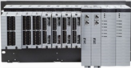
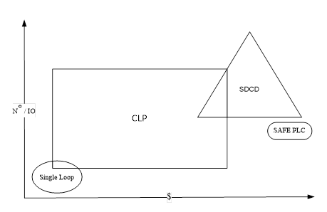
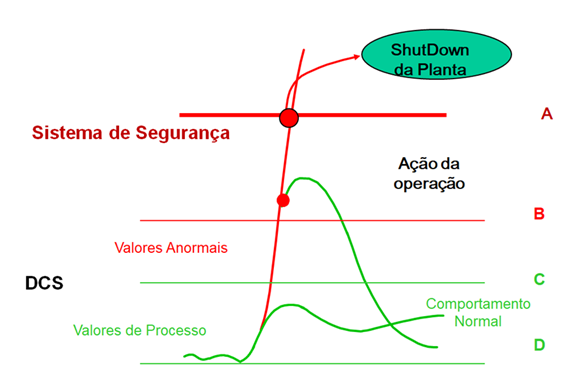

# CLP - Exercícios

### Questão 1 - Assinale a alternativa que está errada no que tange aos usos dos SDCDs:

(a) Os SDCDs se caracterizam pela robustez  e por possuir software de supervisão incorporado.

(b) Os SDCDs são muito utilizados em processos petroquímicos.

(c) Os SDCDs são muito utilizados em controle regulatório.

(d) Os SDCDs possuem redundância quase sempre.

(e) Os SDCDs são muito utilizados em controle de intertravamentos.

### Questão 2 - Assinale a alternativa que está errada no que tange aos usos dos SDCDs:

(a) Os SDCDs permitem troca de cartões “a quente”.

(b) Os SDCDs permitem automações de muito grande porte.

(c) Os SDCDs se comunicam facilmente com instrumentos de campo pois muitas vezes os fabricantes de SDCDs também fabricam instrumentos.

(d) Os SDCDs são mais rápidos que CLPs.

(e) Os SDCDs possuem filosofia de controle distribuído.

### Questão 3 - Dada a figura  considere o seguinte problema de especificação:
Um gestor precisa analisar qual a melhor opção de controlador para utilização em uma planta produtora de tri-nitro-tolueno (TNT) que é matéria prima para a indústria de explosivos. Ao considerar-se o fator custo tem-se o seguinte orçamento inicial: CLP (SIL2) (Safety Integrity Level) R$ 200.000, SDCD R$500.000, SAFE-PLC R$1.000.000. Considerando-se que a planta possui principalmente intertravamentos, qual é a melhor escolha e por que

### Questão 4 - A figura abaixo mostra as linhas de proteção de um processo. Os níveis A, B, C e D correspondem respectivamente a:

(a) Nível muito alto de alarme; Nível alto de alarme; Nível baixo de alarme; Nível muito baixo de alarme

(b) Nível muito alto de alarme; Nível alto de alarme; Nível baixo de alarme; Nível muito Nível de controle

(c) Nível muito alto de alarme; Nível alto de alarme; Nível de controle; Nível muito baixo de alarme

(d) Nível de Trip; Nível alto de alarme; Nível baixo de alarme; Nível muito baixo de alarme

(e) Nível de Trip; Nível alto de alarme; Nível de controle; Nível de controle

### Questão 5 - Assinale a alternativa falsa em relação aos Safe PLCs  

(a) Os Os Safe PLCs frequentemente alcançam SIL 3.

(b) Os Safe PLCs em geral possuem Auto- diagnostico completo para minimizar falhas perigosas não detectadas.

(c) Os Safe PLCs não colaboram para melhorar o controle de um processo, apenas para tornar o processo mais seguro e disponível.

(d) Os Safe PLCs em geral são muito redundantes podendo ter inclusive redundância tripla.

(e) Os Safe PLCs nunca são programados em ladder.

### Questão 6 -  Assinalar a principal diferença que os SDCDs possuem em relação aos CLPs:

(a) Não possuem um controle centralizado, os CLPs possuem um dispositivo central e eventualmente IOs em “remotas”, o processamento é todo realizado no dispositivo central. Os SDCDs por sua vez distribuem o processamento em diversas “estações ”.

(b) Os SDCDs possuem redundância enquanto os CLPs nunca tem essa funcionalidade.

(c) SDCDs possuem hardware mais frágil que CLPs o que justifica seu custo menor.

(d) Tanto os SDCDs quanto os CLPs podem ser programados com as linguagens da IEC 61131-3

(e) Saque dos cartões “a quente”, ou seja pode-se trocar cartões do SDCD sem desliga-lo enquanto não é possível fazer isso em um CLP.

---

Respostas:

(1)
a. Os SDCDs se caracterizam pela robustez e por possuir software de supervisão incorporado: Correto. Os SDCDs foram concebidos para alta confiabilidade industrial e já integram de fábrica ferramentas de supervisão (HMI/SCADA). 
b. Os SDCDs são muito utilizados em processos petroquímicos: Correto. Refinarias, indústrias químicas e petroquímicas são o habitat clássico dos SDCDs devido à grande quantidade de malhas contínuas. 
c. Os SDCDs são muito utilizados em controle regulatório: Correto. A principal função de um SDCD é o controle regulatório de processos contínuos (como controle de vazão, pressão, temperatura através de malhas PID).    
d. Os SDCDs possuem redundância quase sempre: Correto. Para garantir a altíssima disponibilidade exigida em processos contínuos críticos, controladores, fontes e redes de comunicação em um SDCD são projetados com redundância.    
e. Os SDCDs são muito utilizados em controle de intertravamentos: Incorreto / Menos adequado (em termos conceituais de projeto puro). Embora os SDCDs modernos consigam executar pequenas lógicas e intertravamentos de processo básicos, os intertravamentos de segurança críticos (como sistemas de desligamento de emergência — ESD e SIS) são tradicionalmente e por norma técnica segregados e atribuídos a CLPs de Segurança (Safety PLCs), pois exigem tempos de resposta determinísticos rápidos e certificações de Nível de Integridade de Segurança (SIL) estritos separados do sistema básico de controle de processos (BPCS).

(2)
(a) Os SDCDs permitem troca de cartões “a quente”: Correta. A capacidade de substituição de módulos de E/S sem desligar o sistema (hot-swapping) é um recurso padrão em SDCDs para garantir alta disponibilidade. 
(b) Os SDCDs permitem automações de muito grande porte: Correta. Eles são nativamente arquitetados para gerenciar milhares de pontos de I/O em plantas industriais gigantescas, como refinarias e indústrias petroquímicas. 
(c) Os SDCDs se comunicam facilmente com instrumentos de campo pois muitas vezes os fabricantes de SDCDs também fabricam instrumentos: Correta. Grandes fornecedores globais de SDCD (como Emerson, Yokogawa, ABB, Siemens) também desenvolvem linhas completas de instrumentação de campo, facilitando a integração via protocolos de comunicação industriais. 
(d) Os SDCDs são mais rápidos que CLPs — Incorreta. Os CLPs (Controladores Lógicos Programáveis) foram projetados especificamente para controle discreto, sequencial e de alta velocidade (com tempos de varredura ou scan times na ordem de milissegundos). Já os SDCDs priorizam a robustez, a coordenação de planta inteira e o controle regulatório contínuo de centenas ou milhares de malhas (como PID), operando com ciclos de varredura mais amplos ou blocos orientados a processos, não sendo focados em velocidade bruta de processamento lógico comparada aos CLPs. 
(e) Os SDCDs possuem filosofia de controle distribuído: Correta. Essa é a própria definição arquitetural do sistema, onde o processamento de controle é descentralizado em vários controladores espalhados pela planta, em vez de centralizado em um único ponto. 

(3)
A planta de TNT combina energia química elevada, reações nitrantes exotérmicas e produto explosivo, de modo que as consequências de uma falha são catastróficas. Como a planta é composta principalmente por intertravamentos, a função central do sistema é a de um SIS (Sistema Instrumentado de Segurança): detectar desvios e levar o processo a estado seguro de forma rápida, determinística e com probabilidade de falha na demanda (PFD) compatível com o SIL exigido pela análise de risco (LOPA/HAZOP, IEC 61511). Segundo a IEC 61511, esse sistema deve ser independente da camada de controle (BPCS).

**Análise de cada opção**

- **Single Loop (controlador de malha única):** adequado a poucas malhas PID independentes, com baixo número de I/O e baixo custo, conforme o gráfico. Não possui lógica de intertravamento complexa, não é certificado para segurança funcional e não escala para uma planta com muitos intertravamentos. **Inadequado.**

- **CLP (SIL 2), R$ 200.000:** é a opção mais barata entre as de maior capacidade, com boa flexibilidade para lógica discreta e ampla faixa de I/O. Porém, só pode executar SIFs que exijam até SIL 2, e a arquitetura típica de um CLP de uso geral/SIL 2 oferece cobertura de diagnóstico e tolerância a falhas menores. Em uma planta de explosivos é provável que existam SIFs de SIL 3, e o CLP não as atenderia. **Insuficiente para as funções mais críticas; poderia ser considerado apenas para intertravamentos de menor criticidade, se a análise de risco assim permitir.**

- **SDCD, R$ 500.000:** vocacionado a controle contínuo e regulatório (muitas malhas PID, controle avançado), com IHM integrada, gerenciamento de alarmes e grande capacidade de I/O, como mostra o gráfico. É a escolha para processos contínuos de grande porte, mas o foco aqui não é controle regulatório, e o SDCD normalmente é parte do BPCS, que deve ficar separado do SIS. Pagar pela sofisticação do controle contínuo sem obter certificação de segurança funcional não resolve o problema principal. **Inadequado como solução de segurança.**

- **SAFE-PLC, R$ 1.000.000:** projetado e certificado segundo a IEC 61508 para SIL 3, com diagnóstico contínuo, tolerância a falhas e arquiteturas redundantes (1oo2, 2oo3), resposta rápida e determinística, e comportamento em estado seguro (fail-safe) em caso de falha. É a única opção que atende às SIFs mais críticas e mantém a independência exigida em relação ao controle. **Adequado.**

**Conclusão**

Em uma planta de TNT dominada por intertravamentos, o critério decisivo é a integridade de segurança, e não o custo inicial nem a capacidade de controle regulatório. O sobrecusto do SAFE-PLC (R$ 1.000.000 contra R$ 200.000 do CLP SIL 2) é pequeno frente ao custo humano, ambiental e patrimonial de uma explosão, além de reduzir o risco residual a níveis toleráveis. O SIL final de cada função deve ser confirmado pela análise de risco.

(4)Análise Detalhada dos Níveis na Figura:

Nível A — Nível de Trip (ou Nível de Desarme / Intertravamento de Segurança):Fica na faixa do Sistema de Segurança (SIS).   Ao atingir essa linha vermelha superior, o sistema atua de forma automática executando o ShutDown da Planta (desarme de emergência).   

Nível B — Nível alto de alarme (Alarme de Alerta/Ação do Operador):Fica na faixa de Valores Anormais mantida pelo DCS.   Quando o processo ultrapassa a linha limite de controle e atinge essa faixa, um alarme é gerado para permitir a Ação da operação (intervenção manual do operador) para trazer a variável de volta à faixa segura.   

Níveis C e D — Nível de controle (Faixa de Operação Normal):Compreendem a faixa entre os limites operacionais normalizados controlados pelo DCS (Comportamento Normal / Valores de Processo).   A malha de controle regulatório atua dentro desses limites superior (C) e inferior (D) para manter a variável no ponto de ajuste (setpoint).  

(5)
Os Safe PLCs são programados normalmente nas linguagens da IEC 61131-3, e o Ladder (LD) é amplamente utilizado, assim como FBD (diagrama de blocos de função). Os fabricantes de CLPs de segurança (Siemens S7-1500F, Rockwell GuardLogix, HIMA, Pilz, entre outros) oferecem Ladder e FBD com bibliotecas de blocos certificados, e a própria IEC 61511 recomenda linguagens de variabilidade limitada, como LD e FBD, para aplicações de segurança. Dizer que “nunca” são programados em ladder é, portanto, incorreto.

Análise das demais (verdadeiras):

(a) Verdadeira: Safe PLCs são projetados e certificados para SIL 3 (IEC 61508), e é essa a faixa típica de aplicação. 

(b) Verdadeira: o autodiagnóstico contínuo (watchdog, comparação entre canais, testes de memória e de I/O) é característica central, para detectar falhas perigosas e aumentar a cobertura de diagnóstico (DC). 

(c) Verdadeira: a função do Safe PLC é segurança e disponibilidade (levar o processo a estado seguro e evitar paradas espúrias), e não otimizar o controle regulatório, que cabe ao BPCS (CLP/SDCD). 

(d) Verdadeira: é comum haver arquiteturas redundantes, como 1oo2 e 2oo3 (TMR, redundância modular tripla).

(6)

(a) A diferença arquitetural fundamental está na distribuição do processamento. No CLP, a lógica é executada em uma CPU central, e as remotas de I/O apenas coletam e enviam sinais. No SDCD, o processamento é distribuído entre vários controladores (estações de processo) interligados por rede, de modo que a falha ou a manutenção de um nó não paralisa os demais, e a base de dados e a IHM são integradas ao sistema.

(b) Falsa: CLPs também possuem versões redundantes (CPU, fonte e rede redundantes), então a redundância não é exclusiva do SDCD.

(c) Falsa: o SDCD é, em geral, mais caro que o CLP, não mais barato, e seu hardware é robusto, de nível industrial.

(d) Verdadeira como afirmação, mas não é diferença: é uma característica comum aos dois, e a pergunta pede o que os distingue.

(e) Falsa: a troca de cartões a quente (hot swap) também existe em CLPs de médio e grande porte, portanto não é exclusiva do SDCD.