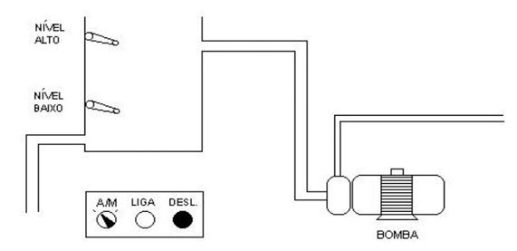
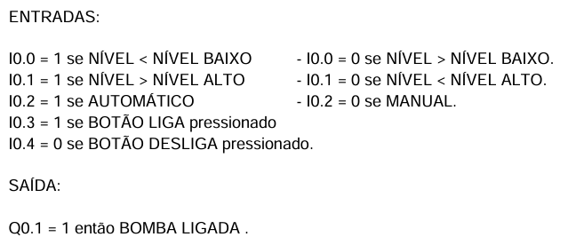
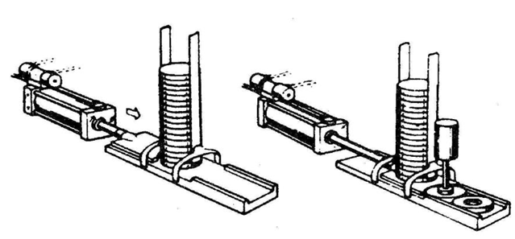
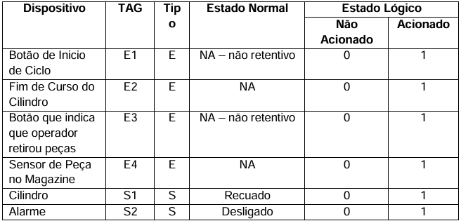

# Experimento 3 — Problemas práticos reais: controle de bomba e alimentador de peças


## 1. Objetivos

- Transformar problemas práticos reais em soluções de automação baseadas em CLP.
- Consolidar as instruções do tipo relé (contatos, bobinas, `SET`/`RESET`).
- Utilizar **temporizadores** (`TON`) e **contadores** (`CTU`).
- Tratar alarmes, intertravamentos e contatos NA × NF.

## 2. Pré-requisitos

Experimentos 1 e 2. Instruções `TON` e `CTU` (a apostila descreve o `TON` com os parâmetros `IN`, `PT`, `Q` e `ET`).

---

## 3. Problema 1 — Bomba com modo manual e automático

Desenvolver um projeto de controle na linguagem LADDER para a seguinte instalação: 



Controlar a bomba de um reservatório em dois modos, selecionados por uma chave. Através do programa o utilizador deve ser capaz de selecionar o modo se funcionamento: Automático ou Manual. 

* Em MANUAL, a Bomba poderá ser ligada pressionando-se o botão LIGA e desliga pressionando-se o botão desliga. Neste modo, as bóias de Nível não tem nenhuma ação.

* Em AUTOMÁTICO, a bomba será ligada 10 Seg. após a detecção de NÍVEL BAIXO e desligada 10 Seg. após a detecção de NÍVEL ALTO . 





## 4. Problema 2 — Alimentador de peças com magazine

 Um sistema  para alimentação de peças a partir de um magazine (deposito vertical) deve funcionar da seguinte forma: 



### 4.1 Especificação

a) O cilindro (S1) encontra-se inicialmente recuado e o sensor de peça no magazine (E3) indica a presença de peça. 

b) Uma vez que as condições iniciais (item a) são verificadas, e o botão de início de ciclo (E1) é pressionado, o cilindro (S1) avança, empurrando a peça, até que o sensor de final de curso do cilindro (E2) seja acionado, iniciando o recuo do cilindro S1. Uma vez recuado o cilindro (S1) o sistema volta a condição inicial. 

c) Caso seja pressionado o botão de início de ciclo (E1) e não haja peça no magazine, um alarme sonoro (S2) deve ser ativado em quanto o botão de início de ciclo (E1) for pressionado. 

d) Caso, a partir do acionamento do botão E1 (considerando que exista peça), o cilindro leve mais que 10 segundos para alcançar o fim de curso, um alarme (S3) deve ser acionado. 

e) Cada vez que o cilindro alcança o fim de curso, um contador deve ser incrementado. Após 10 peças, um alarme deve ser acionado para que o operador retire o cesto de peças e zere o contador. Enquanto o contador não for zerado, o ciclo da máquina deve ser bloqueado. 



Pede-se:

a) O programa em linguagem ladder que implementa a lógica descrita.

b) Uma tabela com todos os endereços utilizados com suas descrições (inclusive TMR e CNT).

c) Devido a um problema técnico, o sensor E4 foi substituído por um do tipo NF(Normal fechado). Refaça o item a utilizando o novo E4.


# Desenvolvimento dos experimentos

O trabalho tem dois exercícios independentes, cada um com seu programa. Os dois reaproveitam os mesmos endereços de E/S porque são montados em bancadas ou projetos separados.


## 1. Descrição do processo

### 1.1. Experimento 3.1 — Controle de bomba com modo manual e automático

#### 1.1.1 Objetivos
Transformar um problema prático real em uma solução de automação baseada em CLP.
Consolidar as instruções do tipo relé (contatos, bobinas, SET/RESET).
Utilizar temporizadores (TON) e detecção de troca de modo.
Tratar intertravamentos, emergência e contatos NA × NF.

#### 1.1.2. Pré-requisitos

Experimentos 1 e 2. Instrução TON (parâmetros IN, PT, Q e ET).


#### 1.1.3. Problema — Bomba com modo manual e automático

Controlar a bomba de um reservatório em dois modos, selecionados por uma chave (AUTO). O reservatório tem duas boias: nível baixo e nível alto.

Manual: a bomba liga com o botão LIGA e desliga com o botão DESLIGA. A boia de nível alto, quando vai a 1, desliga a bomba e bloqueia o LIGA, para evitar transbordamento por esquecimento do operador. A boia de nível baixo não tem ação.
Automático: a bomba liga 10 s após a detecção de NÍVEL BAIXO e desliga 10 s após a detecção de NÍVEL ALTO.
Desenvolvimento do experimento


#### 1.1.4. Descrição do processo

Uma bomba enche um tanque com duas boias de nível (baixo e alto), uma chave automático/manual, os botões LIGA e DESLIGA e um botão de emergência.

Situação	Comportamento
Manual, LIGA	Liga a bomba, se NIVEL_ALTO = 0
Manual, DESLIGA	Desliga a bomba
Manual, NIVEL_ALTO = 1	Desliga a bomba na hora e bloqueia o LIGA enquanto o nível estiver alto
Manual, NIVEL_BAIXO	Sem ação
Automático, NIVEL_BAIXO = 1 por 10 s	Liga a bomba
Automático, NIVEL_ALTO = 1 por 10 s	Desliga a bomba
Automático, condição some antes de 10 s	A contagem recomeça
Troca de modo, qualquer sentido	A bomba para na hora
Troca para automático (inclusive a primeira vez)	Abre uma contagem de 10 s e a bomba começa a encher
Troca para manual	A bomba fica parada até apertar LIGA
EME em manual	Desliga a bomba
EME em automático	Desliga a bomba. Ao soltar, refaz a contagem de 10 s e então parte


1. Hipóteses adotadas

    DESLIGA e EME são normalmente fechados (1 = normal, 0 = pressionado).
Em automático, o botão DESLIGA não tem ação. Para parar, use a chave para manual ou a EME.
Se o nível já estiver alto quando a contagem de partida terminar, o desligamento por nível alto (também de 10 s) cancela a partida.
AUTO_ME deve ser não retentivo. Assim, se o CLP energizar com a chave em automático, a partida abre a contagem de 10 s.
O botão de emergência desliga a bomba nos dois modos.

2. Entradas
<pre>
Endereço	TAG	           Descrição
%I0.0	    NIVEL_BAIXO	   1 = nível na boia baixa ou abaixo
%I0.1	    NIVEL_ALTO	   1 = nível na boia alta ou acima
%I0.2	    AUTO	   1 = automático, 0 = manual
%I0.3	    LIGA           Botão liga
%I0.4	    DESLIGA        Botão desliga (NF)
%I0.5	    EME	           Botão de emergência (NF)
</pre>

3. Saídas
<pre>
Endereço     TAG     Descrição
%Q0.1        BOMBA   Comando da bomba (contator KM1)
</pre>

4. Outros recursos

<pre>
Recurso	        TAG	    Descrição
%M10.0	        AUT_ON	    Estado da bomba no modo automático (memorizado)
%M10.1	        RETOMA	    Aguardando a contagem de partida (troca para automático ou EME)
%M10.2	        AUTO_ME	    Memória do modo anterior (não retentiva)
%M10.3	        TROCA_MODO  Pulso de uma varredura na troca de modo
DB "T_LIGA"	T_LIGA	    TON, PT = T#10s (liga, nível baixo)
DB "T_DESL"	T_DESL	    TON, PT = T#10s (desliga, nível alto)
DB "T_RETOMA"	T_RETOMA    TON, PT = T#10s (partida após troca para automático ou EME)
</pre>

5. Configuração no TIA Portal
Crie o projeto, adicione a CPU S7-1500 e os módulos de entrada e saída digitais.
Cadastre as tags das seções 2, 3 e 4 na tabela de tags. Os bits de memória usam MB10 (MB0 e MB1 ficam reservados se a memória de sistema estiver habilitada).
Desmarque a retentividade de AUTO_ME.
Insira os blocos TON com DB de instância e presets T#10s. Cada bloco deve ser chamado a cada varredura, em uma network própria.
O endereço de bit no TIA vai de 0 a 7 (byte.bit).
Compile, carregue na CPU ou no PLCSIM e coloque em RUN.
Para o diagrama de ligação elétrica, veja o manual em PDF.

6. Código ladder

Legenda: ] [ contato NA, ]/[ contato NF, ( ) bobina, ( S ) set, ( R ) reset. Monte cada bloco em uma network, na ordem apresentada.

<pre>
NETWORK 1 – Pulso de troca de modo (AUTO diferente do modo anterior)
   "AUTO"   "AUTO_ME"                "TROCA_MODO"
 |--] [-------]/[--------+-----------( )
   "AUTO"   "AUTO_ME"    |
 |--]/[-------] [--------+

NETWORK 2 – Memória do modo anterior
   "AUTO"                            "AUTO_ME"
 |--] [-----------------------------( )

NETWORK 3 – Retardo de 10 s para ligar (automático, nível baixo, EME solta)
   "AUTO"  "NIVEL_BAIXO"  "EME"
 |--] [------] [-----------] [------[ "T_LIGA" TON  IN  Q ]
                                       PT := T#10s

NETWORK 4 – Retardo de 10 s para desligar (automático, nível alto)
   "AUTO"  "NIVEL_ALTO"
 |--] [------] [-------------------[ "T_DESL" TON  IN  Q ]
                                       PT := T#10s

NETWORK 5 – Contagem de partida (troca para automático ou EME solta)
   "AUTO"  "RETOMA"  "EME"
 |--] [------] [-------] [----------[ "T_RETOMA" TON  IN  Q ]
                                       PT := T#10s

NETWORK 6 – Em manual, AUT_ON acompanha a bomba (liga)
   "AUTO"    "BOMBA"                 "AUT_ON"
 |--]/[--------] [------------------( S )

NETWORK 7 – Em manual, AUT_ON acompanha a bomba (desliga)
   "AUTO"    "BOMBA"                 "AUT_ON"
 |--]/[--------]/[-----------------( R )

NETWORK 8 – Nível baixo por 10 s liga a bomba em automático
   "T_LIGA".Q                        "AUT_ON"
 |-----] [--------------------------( S )

NETWORK 9 – Fim da contagem de partida
   "T_RETOMA".Q                      "AUT_ON"
 |-----] [---------------+-----------( S )
                          |          "RETOMA"
                          +-----------( R )

NETWORK 10 – Nível alto por 10 s desliga a bomba em automático
   "T_DESL".Q                        "AUT_ON"
 |-----] [--------------------------( R )

NETWORK 11 – EME em automático com a bomba ligada: arma a contagem de partida
   "AUTO"    "EME"     "AUT_ON"      "RETOMA"
 |--] [-------]/[-------] [----------( S )

NETWORK 12 – EME em automático: para a bomba
   "AUTO"    "EME"                   "AUT_ON"
 |--] [-------]/[-------------------( R )

NETWORK 13 – Troca para automático: arma a contagem de partida
   "TROCA_MODO"  "AUTO"              "RETOMA"
 |-----] [---------] [---------------( S )

NETWORK 14 – Troca para manual: cancela a contagem de partida
   "TROCA_MODO"  "AUTO"              "RETOMA"
 |-----] [---------]/[--------------( R )

NETWORK 15 – Troca de modo: para a bomba
   "TROCA_MODO"                      "AUT_ON"
 |-----] [--------------------------( R )

NETWORK 16 – Comando da bomba
   "TROCA_MODO"  "AUTO"  "AUT_ON"
 |-----]/[-------+--] [----] [-------------------------+
 |                |                                     |
 |                |  "AUTO" "LIGA"    "DESLIGA" "NIVEL_ALTO"      "EME"
 |                +--]/[---+--] [--+----] [--------]/[--+-----] [---( ) "BOMBA"
 |                         | "BOMBA"|
 |                         +--] [---+
</pre>

7. Programação estruturada (SCL)

O mesmo programa como bloco de função FB_Bomba (SCL). Os temporizadores são multi-instância (TON_TIME).

Interface do bloco

<pre>
Seção	Nome	        Tipo	Descrição
Input	NivelBaixo	Bool	Boia baixa
Input	NivelAlto	Bool	Boia alta
Input	Auto	        Bool	1 = automático
Input	Liga	        Bool	Botão liga
Input	Desliga	        Bool	Botão desliga (NF)
Input	Eme	        Bool	Emergência (NF)
Output	Bomba	        Bool	Comando da bomba
Static	AutOn, Retoma,
        AutoMe, TrocaModo	Bool	Memórias (AutoMe não retentiva)
Static	tLiga, tDesl,
        tRetoma         TON_TIME Temporizadores de 10 s
pascal
FUNCTION_BLOCK "FB_Bomba"
VAR_INPUT
    NivelBaixo : Bool;
    NivelAlto  : Bool;
    Auto       : Bool;
    Liga       : Bool;
    Desliga    : Bool;   // NF: 1 = solto
    Eme        : Bool;   // NF: 1 = solta
END_VAR
VAR_OUTPUT
    Bomba : Bool;
END_VAR
VAR
    AutOn      : Bool;
    Retoma     : Bool;
    AutoMe     : Bool;   // nao retentiva
    TrocaModo  : Bool;
    tLiga      : TON_TIME;
    tDesl      : TON_TIME;
    tRetoma    : TON_TIME;
END_VAR

BEGIN
    // Pulso de troca de modo e memoria do modo anterior
    #TrocaModo := #Auto XOR #AutoMe;
    #AutoMe := #Auto;

    // Temporizadores de 10 s
    #tLiga(IN := #Auto AND #NivelBaixo AND #Eme, PT := T#10s);
    #tDesl(IN := #Auto AND #NivelAlto, PT := T#10s);
    #tRetoma(IN := #Auto AND #Retoma AND #Eme, PT := T#10s);

    // Em manual, AUT_ON acompanha a bomba
    IF NOT #Auto THEN
        #AutOn := #Bomba;
    END_IF;

    // Eventos do automatico
    IF #tLiga.Q THEN
        #AutOn := TRUE;
    END_IF;
    IF #tRetoma.Q THEN
        #AutOn := TRUE;
        #Retoma := FALSE;
    END_IF;
    IF #tDesl.Q THEN
        #AutOn := FALSE;
    END_IF;

    // EME em automatico: para; se estava ligada, arma a contagem de partida
    IF #Auto AND NOT #Eme THEN
        IF #AutOn THEN
            #Retoma := TRUE;
        END_IF;
        #AutOn := FALSE;
    END_IF;

    // Troca de modo: para; indo para automatico, arma a contagem de partida
    IF #TrocaModo THEN
        #Retoma := #Auto;
        #AutOn := FALSE;
    END_IF;

    // Comando da bomba
    #Bomba := NOT #TrocaModo
              AND ((#Auto AND #AutOn)
                   OR (NOT #Auto AND (#Liga OR #Bomba) AND #Desliga AND NOT #NivelAlto))
              AND #Eme;
END_FUNCTION_BLOCK
</pre>

Chamada no OB1:

<pre>
pascal
"FB_Bomba_DB"(NivelBaixo := "NIVEL_BAIXO",
              NivelAlto  := "NIVEL_ALTO",
              Auto       := "AUTO",
              Liga       := "LIGA",
              Desliga    := "DESLIGA",
              Eme        := "EME",
              Bomba      => "BOMBA");
</pre>

8. Observações e teste

A contagem dos temporizadores é zerada quando a condição termina. Uma oscilação de nível com menos de 10 s não liga nem desliga a bomba.
Em automático, o nível ainda varia durante os 10 s de atraso, então a bomba pode ligar abaixo da boia baixa e desligar acima da boia alta.

Os botões de emergência reais devem ser cabeados também em hardware (relé de segurança). O ladder não substitui a proteção exigida pela NR-12 e pela ISO 13850.
Teste no PLCSIM:

Automático: acione AUTO. Depois de 10 s a bomba liga. NIVEL_ALTO em 1 por 10 s desliga.

Manual: LIGA liga e DESLIGA desliga. Com NIVEL_ALTO em 1, a bomba desliga na hora e o LIGA não funciona.

Com a bomba ligada, troque o modo: a bomba para. Para automático, liga após 10 s. Para manual, só com LIGA.
EME em 0 desliga em qualquer modo. Em automático, ao soltar, a bomba parte após 10 s.

#### 1.1.5. Recursos

| [Guia em PDF](experimento-03a-bomba.pdf) | 
| [Simulador em HTML](https://mitoedson.github.io/Automacao-de-Sistemas-Industriais/simulador/simulacao_bomba.html) |


### 1.2.  Alimentador de peças com magazine


### 1.2.1. Objetivos

- Transformar um problema prático real em uma solução de automação baseada em CLP.
- Consolidar as instruções do tipo relé (contatos, bobinas, `SET`/`RESET`).
- Utilizar **temporizadores** (`TON`) e **contadores** (`CTU`).
- Tratar alarmes, intertravamentos e contatos NA × NF.

### 1.2.2. Pré-requisitos

Experimentos 1 e 2 e o exercício 1 do Experimento 3. Instruções `TON` (parâmetros `IN`, `PT`, `Q` e `ET`) e `CTU` (parâmetros `CU`, `R`, `PV`, `Q` e `CV`).


### 1.2.3. Problema — Alimentador de peças com magazine

Um sistema para alimentação de peças a partir de um magazine (depósito vertical) deve funcionar da seguinte forma:

a) O cilindro (S1) encontra-se inicialmente recuado e o sensor de peça no magazine indica a presença de peça.

b) Uma vez verificadas as condições iniciais, e pressionado o botão de início de ciclo (E1), o cilindro (S1) avança, empurrando a peça, até que o sensor de final de curso (E2) seja acionado, iniciando o recuo do cilindro. Uma vez recuado, o sistema volta à condição inicial.

c) Se E1 for pressionado e não houver peça no magazine, um alarme sonoro (S2) deve ser ativado enquanto E1 estiver pressionado.

d) Se, a partir do acionamento de E1 (com peça), o cilindro levar mais de 10 segundos para alcançar o fim de curso, um alarme (S3) deve ser acionado.

e) Cada vez que o cilindro alcança o fim de curso, um contador deve ser incrementado. Após 10 peças, um alarme deve ser acionado para que o operador retire o cesto de peças e zere o contador. Enquanto o contador não for zerado, o ciclo da máquina deve ser bloqueado.

Pede-se:

1. O programa em linguagem ladder que implementa a lógica descrita.
2. Uma tabela com todos os endereços utilizados com suas descrições (inclusive TMR e CNT).
3. Devido a um problema técnico, o sensor de peça foi substituído por um do tipo NF (normalmente fechado). Refaça o item 1 usando o novo sensor.


### 1.2.4. Descrição do processo

Um cilindro (S1) empurra uma peça de um magazine vertical. O cilindro começa recuado. Com o botão de início (E1) pressionado e peça no magazine, ele avança até o fim de curso (E2) e recua, voltando à condição inicial.

- Se E1 for pressionado e não houver peça, o alarme sonoro S2 toca enquanto E1 estiver pressionado.
- Se o cilindro levar mais de 10 s para chegar ao fim de curso, ele recua e o alarme S3 é acionado.
- A cada fim de curso, um contador é incrementado. Ao chegar a 10 peças, o alarme S4 é acionado para o operador retirar o cesto e zerar o contador. Enquanto o contador não for zerado, o ciclo fica bloqueado.
- No item c do enunciado, o sensor E4 é trocado por um do tipo NF. Só a network 2 muda.

| Situação | Comportamento |
|---|---|
| E1 com peça, cilindro recuado, sem alarmes | O cilindro avança (S1 = 1) |
| E2 acionado | O cilindro recua e o contador sobe |
| E1 sem peça | S2 soa enquanto E1 estiver pressionado |
| Avanço com mais de 10 s | S3 aciona, o cilindro recua e o ciclo é bloqueado até E3 |
| 10 peças contadas | S4 aciona e o ciclo é bloqueado até E3 |
| E3 | Zera o contador e reconhece o alarme S3 |
| EME | Zera as etapas, o cilindro recua e o ciclo é bloqueado |
| Rearme | Soltar EME e soltar E1 |

**Hipóteses adotadas**

- O enunciado cita E3 e E4 de forma inconsistente. Segue-se a tabela: E3 é o botão "operador retirou peças" (zera o contador) e E4 é o sensor de peça no magazine.
- O enunciado não numera os alarmes de tempo e de cesto cheio. Foram adotados S3 (tempo excedido) e S4 (cesto cheio).
- O botão E3 também reconhece o alarme de tempo excedido (S3).
- O início do ciclo exige uma nova pressão de E1 (borda de subida), para um botão mantido apertado não repetir o ciclo.
- S1 energizada avança o cilindro; desenergizada, ele recua (válvula de simples solenoide com retorno por mola).
- E2 está em 1 quando o cilindro está avançado. EME é normalmente fechado (1 = normal, 0 = pressionado).

### 1.2.5. Entradas

| Endereço | TAG | Descrição |
|---|---|---|
| %I0.0 | E1_START | Botão de início de ciclo (NA, não retentivo) |
| %I0.1 | E2_FIM_CURSO | Fim de curso do cilindro (avançado) |
| %I0.2 | E3_RESET | Botão: operador retirou as peças (zera contador e reconhece alarme de tempo) |
| %I0.3 | E4_PECA | Sensor de peça no magazine (NA: 1 = há peça. No item c, NF: 0 = há peça) |
| %I0.4 | EME | Botão de emergência (NF) |

### 1.2.6. Saídas

| Endereço | TAG | Descrição |
|---|---|---|
| %Q0.0 | S1_CILINDRO | Avanço do cilindro |
| %Q0.1 | S2_ALM_SEM_PECA | Alarme sonoro: sem peça |
| %Q0.2 | S3_ALM_TEMPO | Alarme: cilindro demorou mais de 10 s |
| %Q0.3 | S4_ALM_CESTO | Alarme: 10 peças, retirar o cesto |

### 1.2.7. Outros recursos

| Recurso | TAG | Descrição |
|---|---|---|
| %M10.0 a %M10.2 | ETAPA_0 a ETAPA_2 | Repouso, cilindro avançando, cilindro recuando |
| %M10.3 | EMERG | Emergência memorizada |
| %M10.4 | PECA | Há peça no magazine (vem de E4) |
| %M10.5 | ALM_TEMPO | Alarme de tempo excedido memorizado |
| %M10.6 | E1_PULSO | Pulso de uma varredura na pressão de E1 |
| %M11.0 | M_E1_ME | Memória de borda de E1 |
| DB "C_PECAS" | C_PECAS | CTU, PV = 10 (peças) |
| DB "T_AVANCO" | T_AVANCO | TON, PT = T#10s |
| FirstScan | FirstScan | Bit de primeiro ciclo da memória de sistema |

### 1.2.8. Configuração no TIA Portal

1. Nas propriedades da CPU, em *Geral → Memória de sistema e de clock*, habilite a memória de sistema (por padrão MB1, com `FirstScan` em %M1.0) e cadastre o bit como `FirstScan`. MB0 e MB1 ficam reservados, por isso os bits usam MB10 e MB11.
2. Cadastre as tags das seções 2, 3 e 4 na tabela de tags.
3. Insira o bloco TON e o CTU com DB de instância e os presets da seção 4. Cada bloco deve ser chamado a cada varredura, em uma network própria.
4. O endereço de bit no TIA vai de 0 a 7 (`byte.bit`).
5. Para o diagrama de ligação elétrica, veja o manual em PDF.

### 1.2.9. Código ladder

Legenda: `] [` contato NA, `]/[` contato NF, `( )` bobina, `( S )` set, `( R )` reset, `P` contato de borda de subida. Monte cada bloco em uma network, na ordem apresentada.

```
NETWORK 1 – Inicialização
   "FirstScan"                      "ETAPA_0"
 |----] [------+-------------------( S )
                |                   "ETAPA_1"
                +-------------------( R )
                |                   "ETAPA_2"
                +-------------------( R )

NETWORK 2 – Peça no magazine (E4 tipo NA: 1 = há peça)
   "E4_PECA"                        "PECA"
 |----] [---------------------------( )

   Variante do item c (E4 tipo NF: 0 = há peça): troque o contato
   "E4_PECA"
 |----]/[---------------------------( ) "PECA"

NETWORK 3 – Emergência (EME pressionado)
   "EME"                            "EMERG"
 |----]/[---------+-----------------( S )
                  |                 "ETAPA_0"
                  +-----------------( R )
                  |                 "ETAPA_1"
                  +-----------------( R )
                  |                 "ETAPA_2"
                  +-----------------( R )

NETWORK 4 – Rearme: EME liberado e E1 solto
   "EMERG"   "EME"     "E1_START"             "EMERG"
 |----] [-----] [------]/[---------+---------( R )
                                   |         "ETAPA_0"
                                   +---------( S )

NETWORK 5 – Pulso de E1 (borda de subida)
   "E1_START"  "M_E1_ME"            "E1_PULSO"
 |----] P [---------------------------( )

NETWORK 6 – Contador de peças (vem antes das transições)
   "ETAPA_1"  "E2_FIM_CURSO"
 |----] [--------] [---------------[ "C_PECAS" CTU  CU ]
   "E3_RESET"                          PV := 10
 |----] [---------------------------[               R  ]

NETWORK 7 – Supervisão de 10 s do avanço
   "ETAPA_1"
 |----] [---------------------------[ "T_AVANCO" TON  IN  Q ]
                                        PT := T#10s

NETWORK 8 – Reconhece o alarme de tempo (E3)
   "E3_RESET"                       "ALM_TEMPO"
 |----] [---------------------------( R )

NETWORK 9 – Início do ciclo
   "ETAPA_0" "E1_PULSO" "PECA" "E2_FIM_CURSO" "C_PECAS".Q "ALM_TEMPO" "EME"      "ETAPA_1"
 |----] [------] [------] [-------]/[-----------]/[---------]/[--------] [-----+---( S )
                                                                              |   "ETAPA_0"
                                                                              +---( R )

NETWORK 10 – Cilindro chegou ao fim de curso
   "ETAPA_1"  "E2_FIM_CURSO"           "ETAPA_2"
 |----] [--------] [-----+-------------( S )
                         |             "ETAPA_1"
                         +-------------( R )

NETWORK 11 – Tempo de 10 s excedido: recua e aciona o alarme
   "ETAPA_1"  "T_AVANCO".Q             "ETAPA_0"
 |----] [--------] [-----+-------------( S )
                         |             "ETAPA_1"
                         +-------------( R )
                         |             "ALM_TEMPO"
                         +-------------( S )

NETWORK 12 – Cilindro recuou
   "ETAPA_2"  "E2_FIM_CURSO"           "ETAPA_0"
 |----] [--------]/[-----+-------------( S )
                         |             "ETAPA_2"
                         +-------------( R )

NETWORK 13 – S1: avanço do cilindro
   "ETAPA_1"    "EME"                  "S1_CILINDRO"
 |----] [---------] [------------------( )

NETWORK 14 – S2: alarme sem peça (E1 pressionado e magazine vazio)
   "ETAPA_0" "E1_START" "PECA"  "EME"  "S2_ALM_SEM_PECA"
 |----] [------] [------]/[-----] [-----( )

NETWORK 15 – S3: alarme de tempo excedido
   "ALM_TEMPO"                      "S3_ALM_TEMPO"
 |----] [---------------------------( )

NETWORK 16 – S4: cesto cheio (10 peças)
   "C_PECAS".Q                      "S4_ALM_CESTO"
 |----] [---------------------------( )
```

### 1.2.10. Programação estruturada (SCL)

O mesmo programa como bloco de função `FB_Magazine` (SCL). As etapas ficam em uma variável inteira (`Etapa`: 0 repouso, 1 avançando, 2 recuando, 9 emergência), o contador é `CTU_INT` e o temporizador é `TON_TIME`, ambos multi-instância. O parâmetro `E4Nf` seleciona o tipo do sensor de peça: `FALSE` para NA (itens a e b) e `TRUE` para NF (item c).

**Interface do bloco**

| Seção | Nome | Tipo | Descrição |
|---|---|---|---|
| Input | E1Start | Bool | Botão de início de ciclo (NA) |
| Input | E2FimCurso | Bool | Fim de curso do cilindro |
| Input | E3Reset | Bool | Operador retirou as peças |
| Input | E4Peca | Bool | Sensor de peça no magazine |
| Input | E4Nf | Bool | TRUE se o sensor for NF (item c) |
| Input | Eme | Bool | Emergência (NF) |
| Output | S1Cilindro | Bool | Avanço do cilindro |
| Output | S2AlmSemPeca | Bool | Alarme sem peça |
| Output | S3AlmTempo | Bool | Alarme de tempo excedido |
| Output | S4AlmCesto | Bool | Alarme de cesto cheio |
| Static | Etapa | Int | Etapa atual |
| Static | Emerg, Peca, AlmTempo, E1Pulso, E1Me, Primeiro | Bool | Memórias (Primeiro inicia em TRUE) |
| Static | cPecas | CTU_INT | Contador de peças |
| Static | tAvanco | TON_TIME | Supervisão de 10 s do avanço |

```pascal
FUNCTION_BLOCK "FB_Magazine"
VAR_INPUT
    E1Start    : Bool;
    E2FimCurso : Bool;
    E3Reset    : Bool;
    E4Peca     : Bool;
    E4Nf       : Bool;   // FALSE = sensor NA, TRUE = sensor NF (item c)
    Eme        : Bool;   // NF: 1 = solta
END_VAR
VAR_OUTPUT
    S1Cilindro    : Bool;
    S2AlmSemPeca  : Bool;
    S3AlmTempo    : Bool;
    S4AlmCesto    : Bool;
END_VAR
VAR
    Etapa     : Int;     // 0 repouso, 1 avancando, 2 recuando, 9 emergencia
    Emerg     : Bool;
    Peca      : Bool;
    AlmTempo  : Bool;
    E1Pulso   : Bool;
    E1Me      : Bool;
    Primeiro  : Bool := TRUE;
    cPecas    : CTU_INT;
    tAvanco   : TON_TIME;
END_VAR

BEGIN
    // Inicializacao
    IF #Primeiro THEN
        #Etapa := 0;
        #Primeiro := FALSE;
    END_IF;

    // Peca no magazine (NA: 1 = ha peca; NF: 0 = ha peca)
    #Peca := #E4Peca XOR #E4Nf;

    // Emergencia e rearme
    IF NOT #Eme THEN
        #Emerg := TRUE;
        #Etapa := 9;
    END_IF;
    IF #Emerg AND #Eme AND NOT #E1Start THEN
        #Emerg := FALSE;
        #Etapa := 0;
    END_IF;

    // Pulso de E1 (borda de subida)
    #E1Pulso := #E1Start AND NOT #E1Me;
    #E1Me := #E1Start;

    // Contador (antes das transicoes), supervisao de 10 s e reconhecimento
    #cPecas(CU := (#Etapa = 1) AND #E2FimCurso, R := #E3Reset, PV := 10);
    #tAvanco(IN := (#Etapa = 1), PT := T#10s);
    IF #E3Reset THEN
        #AlmTempo := FALSE;
    END_IF;

    // Transicoes
    CASE #Etapa OF
        0:  // repouso: inicio de ciclo
            IF #E1Pulso AND #Peca AND NOT #E2FimCurso AND NOT #cPecas.Q
               AND NOT #AlmTempo AND #Eme THEN
                #Etapa := 1;
            END_IF;
        1:  // avancando
            IF #E2FimCurso THEN
                #Etapa := 2;
            ELSIF #tAvanco.Q THEN
                #Etapa := 0;
                #AlmTempo := TRUE;
            END_IF;
        2:  // recuando
            IF NOT #E2FimCurso THEN
                #Etapa := 0;
            END_IF;
    END_CASE;

    // Saidas
    #S1Cilindro := (#Etapa = 1) AND #Eme;
    #S2AlmSemPeca := (#Etapa = 0) AND #E1Start AND NOT #Peca AND #Eme;
    #S3AlmTempo := #AlmTempo;
    #S4AlmCesto := #cPecas.Q;
END_FUNCTION_BLOCK
```

Chamada no OB1:

```pascal
"FB_Magazine_DB"(E1Start     := "E1_START",
                 E2FimCurso  := "E2_FIM_CURSO",
                 E3Reset     := "E3_RESET",
                 E4Peca      := "E4_PECA",
                 E4Nf        := FALSE,      // TRUE com o sensor NF (item c)
                 Eme         := "EME",
                 S1Cilindro  => "S1_CILINDRO",
                 S2AlmSemPeca => "S2_ALM_SEM_PECA",
                 S3AlmTempo  => "S3_ALM_TEMPO",
                 S4AlmCesto  => "S4_ALM_CESTO");
```

### 1.2.12. Observações e teste

- **Contador.** O contador (network 6) vem antes das transições para contar na varredura em que o fim de curso é atingido.
- **Tempo.** Se o cilindro não chegar ao fim de curso em 10 s, ele recua, o alarme S3 é acionado e o ciclo fica bloqueado até E3.
- Os botões de emergência reais devem ser cabeados também em hardware (relé de segurança). O ladder não substitui a proteção exigida pela NR-12 e pela ISO 13850.
- **Teste no PLCSIM:**
  1. Com E4 em 1, pulse E1: o cilindro avança. Ligue E2 e depois desligue: ele recua e o contador sobe.
  2. Com E4 em 0, segure E1: S2 deve tocar.
  3. Não ligue E2 por 10 s: S3 deve acionar e o cilindro recuar.
  4. Dez ciclos: S4 aciona e o ciclo é bloqueado até pulsar E3.
  5. Item c (sensor NF): com a variante da network 2, E4 em 0 significa peça presente e E4 em 1 significa magazine vazio.


### 1.2.13. Recursos

| [Guia em PDF](experimento-03a-bomba.pdf) | 
 [Guia em PDF](experimento-03-bomba-e-magazine.pdf) | 
 [Simulador em HTML](https://mitoedson.github.io/Automacao-de-Sistemas-Industriais/simulador/simulacao_bomba.html) |
 [Simulador em HTML](https://mitoedson.github.io/Automacao-de-Sistemas-Industriais/simulador/simulacao_magazine.html) |


