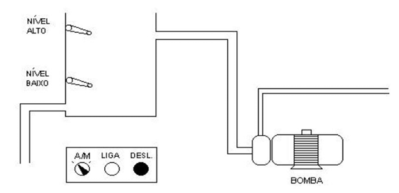
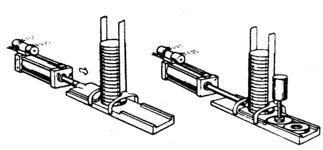

# Experimento 3 — Problemas práticos reais: controle de bomba e alimentador de peças

> **Laboratório de Automação — UFABC** · CLP Siemens S7-1500 (CPU 1516F-3 PN/DP)


## 1. Objetivos

- Transformar problemas práticos reais em soluções de automação baseadas em CLP.
- Consolidar as instruções do tipo relé (contatos, bobinas, `SET`/`RESET`).
- Utilizar **temporizadores** (`TON`) e **contadores** (`CTU`).
- Tratar alarmes, intertravamentos e contatos NA × NF.

## 2. Pré-requisitos

Experimentos 1 e 2. Instruções `TON` e `CTU` (a apostila descreve o `TON` com os parâmetros `IN`, `PT`, `Q` e `ET`).

---

## 3. Problema 1 — Bomba com modo manual e automático

Desenvolver um projeto de controle na linguagem LADDER para a seguinte instalação: 



Controlar a bomba de um reservatório em dois modos, selecionados por uma chave. Através do programa o utilizador deve ser capaz de selecionar o modo se funcionamento: Automático ou Manual. 

* Em MANUAL, a Bomba poderá ser ligada pressionando-se o botão LIGA e desliga pressionando-se o botão desliga. Neste modo, as bóias de Nível não tem nenhuma ação.

* Em AUTOMÁTICO, a bomba será ligada 10 Seg. após a detecção de NÍVEL BAIXO e desligada 10 Seg. após a detecção de NÍVEL ALTO . 


### 3.1 Endereçamento (dado no enunciado)

| Endereço | Estado lógico |
|---|---|
| `%I0.0` | **1** se NÍVEL < NÍVEL BAIXO; 0  se NÍVEL > NÍVEL BAIXO |
| `%I0.1` | **1** se NÍVEL > NÍVEL ALTO; 0 se NÍVEL < NÍVEL ALTO |
| `%I0.2` | **1** = AUTOMÁTICO; **0** = MANUAL |
| `%I0.3` | **1** se botão LIGA pressionado |
| `%I0.4` | **0** se botão DESLIGA pressionado (contato **NF**) |
| `%Q0.1` | **1** = BOMBA LIGADA |

> ⚠️ `%I0.4` é lido em **0 quando o botão é pressionado**. No ladder, a condição “DESLIGA pressionado” é um contato **NF** `[/I0.4]`.

**Memórias e temporizadores auxiliares**

| Símbolo | Endereço | Função |
|---|---|---|
| `BOMBA_ON` | `%M1.0` | estado retido da bomba |
| `T_BAIXO` | `TON` (DB de instância) | atraso de 10 s para ligar |
| `T_ALTO` | `TON` (DB de instância) | atraso de 10 s para desligar |

### 3.2 Solução de referência

```
Rede 1 — Temporizador de nível baixo (somente automático)
  [ I0.2 ]·[ I0.0 ]  → TON T_BAIXO ( IN, PT = T#10s )

Rede 2 — Temporizador de nível alto (somente automático)
  [ I0.2 ]·[ I0.1 ]  → TON T_ALTO  ( IN, PT = T#10s )

Rede 3 — Condição de ligar
  ( [/I0.2 ]·[ I0.3 ] )  ‖  [ T_BAIXO.Q ]            →( SET  M1.0 )

Rede 4 — Condição de desligar (domina sobre ligar)
  ( [/I0.2 ]·[/I0.4 ] )  ‖  [ T_ALTO.Q ]             →( RESET M1.0 )

Rede 5 — Saída
  [ M1.0 ]                                           →( Q0.1 )
```

> **Dica:** posicione o `RESET` **depois** do `SET` na rede. Como o CLP executa as redes em ordem, a última instrução vence: assim o **desligar tem prioridade**.
> Alternativa: usar o bloco `RS` (reset dominante) no lugar de `SET`/`RESET`.

### 3.3 Testes sugeridos

| # | Modo | Condição | Resultado esperado |
|---|---|---|---|
| 1 | Manual | LIGA pressionado | bomba liga e permanece ligada |
| 2 | Manual | DESLIGA pressionado | bomba desliga |
| 3 | Manual | nível baixo/alto ativo | **nenhuma ação** das boias |
| 4 | Automático | `I0.0 = 1` por menos de 10 s e depois `0` | bomba **não** liga (TON reinicia) |
| 5 | Automático | `I0.0 = 1` por mais de 10 s | bomba liga após 10 s |
| 6 | Automático | `I0.1 = 1` por mais de 10 s | bomba desliga após 10 s |

### 3.4 Pontos de projeto a discutir

- O que deve acontecer com a bomba quando a chave muda de **manual para automático** com a bomba ligada? (A solução acima mantém o estado; uma alternativa é desligar a bomba ao trocar de modo.)
- Por que o botão DESLIGA costuma ser NF em instalações reais? (Condição de **falha segura**: cabo rompido = desliga.)


## 4. Problema 2 — Alimentador de peças com magazine

 Um sistema  para alimentação de peças a partir de um magazine (deposito vertical) deve funcionar da seguinte forma: 



### 4.1 Especificação

a) O cilindro (S1) encontra-se inicialmente recuado e o sensor de peça no magazine (E3) indica a presença de peça. 

b) Uma vez que as condições iniciais (item a) são verificadas, e o botão de início de ciclo (E1) é pressionado, o cilindro (S1) avança, empurrando a peça, até que o sensor de final de curso do cilindro (E2) seja acionado, iniciando o recuo do cilindro S1. Uma vez recuado o cilindro (S1) o sistema volta a condição inicial. 

c) Caso seja pressionado o botão de início de ciclo (E1) e não haja peça no magazine, um alarme sonoro (S2) deve ser ativado em quanto o botão de início de ciclo (E1) for pressionado. 

d) Caso, a partir do acionamento do botão E1 (considerando que exista peça), o cilindro leve mais que 10 segundos para alcançar o fim de curso, um alarme (S3) deve ser acionado. 

e) Cada vez que o cilindro alcança o fim de curso, um contador deve ser incrementado. Após 10 peças, um alarme deve ser acionado para que o operador retire o cesto de peças e zere o contador. Enquanto o contador não for zerado, o ciclo da máquina deve ser bloqueado. 

### 4.2 Variáveis lógicas

> 📝 O enunciado da apostila cita o sensor de peça como “E3” no texto, mas a **tabela de variáveis** o chama de **E4** (e E3 é o botão de retirada de peças). Este roteiro segue a **tabela**.

| TAG | Tipo | Dispositivo | Normal | Acionado | Endereço |
|---|:-:|---|---|:-:|---|
| E1 | E | Botão de início de ciclo | NA, não retentivo | 1 | `%I0.0` |
| E2 | E | Fim de curso do cilindro | NA | 1 | `%I0.1` |
| E3 | E | Botão “operador retirou peças” | NA, não retentivo | 1 | `%I0.2` |
| E4 | E | Sensor de peça no magazine | NA | 1 | `%I0.3` |
| S1 | S | Cilindro (1 = avançado) | recuado = 0 | 1 | `%Q0.0` |
| S2 | S | Alarme: **sem peça** | desligado = 0 | 1 | `%Q0.1` |
| S3 | S | Alarme: **tempo excedido** | desligado = 0 | 1 | `%Q0.2` |
| S4* | S | Alarme: **cesto cheio (10 peças)** | desligado = 0 | 1 | `%Q0.3` |

\* O enunciado exige o alarme de cesto cheio mas não o nomeia: adotamos `S4`.

**Auxiliares**

| Símbolo | Endereço | Função |
|---|---|---|
| `P_E1` | `%M0.0` | pulso (borda) de E1 |
| `P_E2` | `%M0.1` | pulso (borda) de E2 |
| `P_E3` | `%M0.2` | pulso (borda) de E3 |
| `CICLO_OK` | `%M1.0` | condições para iniciar |
| `CHEIO` | `%M1.1` | contador chegou a 10 |
| `TMR_AV` | `TON` | supervisão de 10 s do avanço |
| `CNT_PCS` | `CTU` | contador de peças (PV = 10) |

### 4.3 Solução de referência

```
Rede 1 — Bordas
  [ I0.0 ] → P_TRIG → ( M0.0 )      // P_E1
  [ I0.1 ] → P_TRIG → ( M0.1 )      // P_E2
  [ I0.2 ] → P_TRIG → ( M0.2 )      // P_E3

Rede 2 — Contador de peças
  CTU CNT_PCS ( CU = M0.1 , R = M0.2 , PV = 10 )
  [ CNT_PCS.Q ]                                   →( M1.1 )   // CHEIO

Rede 3 — Condições iniciais
  [/Q0.0 ]·[ I0.3 ]·[/M1.1 ]                      →( M1.0 )   // recuado, com peça, não cheio

Rede 4 — Avança o cilindro
  [ M0.0 ]·[ M1.0 ]                               →( SET Q0.0 )

Rede 5 — Recua no fim de curso
  [ I0.1 ]                                        →( RESET Q0.0 )

Rede 6 — Alarme sem peça (enquanto E1 pressionado)
  [ I0.0 ]·[/I0.3 ]                               →( Q0.1 )

Rede 7 — Supervisão de tempo (10 s)
  [ Q0.0 ]·[/I0.1 ]  → TON TMR_AV ( IN, PT = T#10s )
  [ TMR_AV.Q ]                                    →( Q0.2 )

Rede 8 — Alarme de cesto cheio
  [ M1.1 ]                                        →( Q0.3 )
```

> **Por que usar bordas (`P_TRIG`) em E1 e E2?**
> - Em E1, para iniciar **um** ciclo por toque.
> - Em E2, para contar **uma** peça por avanço. O fim de curso pode continuar acionado enquanto o cilindro recua e, sem a borda, a contagem seria incrementada a cada varredura.

### 4.4 Item (c): sensor E4 substituído por tipo **NF**

Com o sensor **normalmente fechado**, o nível lógico é **invertido**: `E4 = 0` passa a significar **peça presente** e `E4 = 1` significa **sem peça**. Basta trocar o tipo de contato nas redes que usam `I0.3`:

| Rede | Antes (E4 NA) | Depois (E4 NF) |
|---|---|---|
| 3 | `[ I0.3 ]` (peça presente) | `[/I0.3 ]` |
| 6 | `[/I0.3 ]` (sem peça) | `[ I0.3 ]` |

> ⚠️ Com NF, o **cabo rompido** também aparece como “sem peça” e o alarme S2 sinaliza o problema. Essa é a vantagem de usar contatos NF em sensores de segurança.

### 4.5 Tabela de endereços (item b)

Entregue a tabela completa, **incluindo os endereços de TMR e CNT** (instâncias `TMR_AV` e `CNT_PCS`) e as memórias auxiliares do item 4.2.

### 4.6 Testes sugeridos

| # | Situação | Esperado |
|---|---|---|
| 1 | E4=1, E1 pressionado | S1 avança até E2 e recua |
| 2 | E4=0, E1 pressionado | S2 soa enquanto E1 estiver pressionado; S1 não avança |
| 3 | Não acionar E2 por >10 s | S3 liga |
| 4 | 10 ciclos | S4 liga e o ciclo é bloqueado |
| 5 | Pressionar E3 | contador zera, S4 desliga, ciclo liberado |
| 6 | Trocar E4 para NF e repetir | mesmo comportamento com a lógica ajustada |

## 5. Questões para o relatório

1. Qual a diferença entre `TON`, `TOF` e `TP`? Por que o `TON` é a escolha para a supervisão de tempo?
2. O que ocorre com `T_BAIXO` se o nível oscilar em torno do ponto de nível baixo? Como isso protege a bomba?
3. Como evitar que o cilindro fique avançado indefinidamente caso o alarme S3 dispare?
4. Quais as vantagens e desvantagens de sensores NA e NF?

## 6. Entregáveis

- Ladder comentado dos Problemas 1 e 2 (incluindo a versão com E4 NF).
- Tabela de endereços com TMR e CNT.
- Resultado dos testes das tabelas 3.3 e 4.6.
