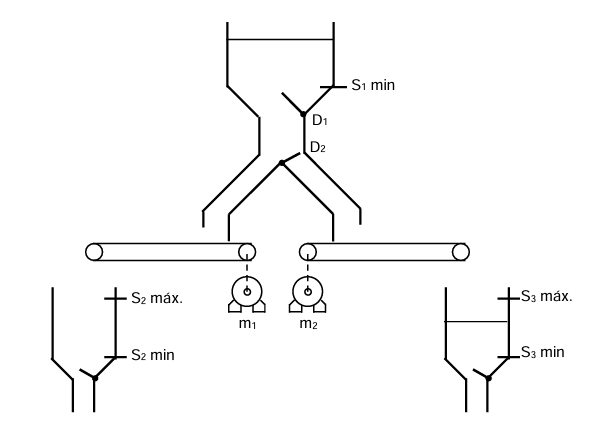
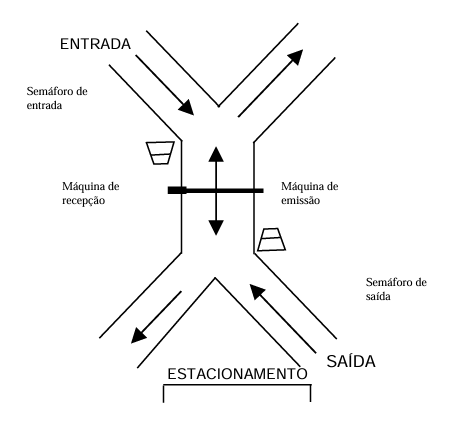

# Experimento 4 — Aprofundamento: carregamento de silos e controle de estacionamento

## 1. Objetivos

- Levantar entradas e saídas de um processo descrito em texto e produzir o **diagrama elétrico de interligação**.
- Escrever lógica de **intertravamento** e **seleção de destino** (silos).
- Projetar uma lógica com **estados**, **contagem crescente/decrescente** e **temporização** (estacionamento).

## 2. Pré-requisitos

Experimentos 1 a 3 (`SET`/`RESET`, `TON`, `CTU`; endereçamento de E/S).

---

## 3. Exercício 1 — Sistema de carregamento de silos

### 3.1 Descrição do processo



Considere o sistema automatizado para carregamento de silos de um entreposto agropecuário, conforme descrito a seguir. Esquematize o diagrama elétrico de interligação dos sensores, atuadores, chaves L/D e o controlador programável.

S1, S2 e S3: Silos <br>
D1: Damper de descarregamento do silo S1.<br> 
D2: Damper de desvio da caixa desviadora de 2 vias (permite a mudança do fluxo do material para S2 ou S3).<br> 
M1 e M2: Motores das correias transportadoras. <br>
S1 mín, S2 mín e S3 mín: Detectores de nível mínimo de material dos silos. <br>
S2 máx e S3 máx: Detectores de nível máximo de material dos silos. CS1 e CS2: Chaves fim-de-curso da caixa desviadora de 2 vias (indicam a posição da caixa). 

Operação do sistema: os transportadores de correias são ligados e desligados automaticamente, funcionando constantemente. O damper D1 do primeiro silo S1 despeja o material no desviador até que o detector de nível máximo de silo que está sendo carregado entre em ação e o desligue. O damper do primeiro silo é ligado novamente pela atuação do detector de nível mínimo de um dos dois silos.

O detector de nível mínimo do silo vazio também liga o damper de desvio D2 da caixa, desviando o material adequadamente para esse respectivo silo. Defina as variáveis de entrada e de saída no CLP e desenvolva o diagrama de fiação elétrica. 


## 4. Exercício 2 — Controle de acesso de estacionamento

### 4.1 Descrição do processo



Um estacionamento que possui somente uma via para entrada e saída de veículos requer o seguinte sistema de controle de acesso. O estacionamento tem capacidade para 100 veículos e emite o aviso de “lotado” quando está com todas as vagas preenchidas. O controle de tráfego é realizado por dois semáforos, dispostos nas vias de entrada e de saída do estacionamento e por uma cancela que se encontra no meio da via comum à entrada e saída. 

Ao chegar um veículo na via de entrada ou saída, o motorista deverá aguardar o sinal verde do semáforo (que indica que não há outro veículo na via) para então aproximar-se da cancela e retirar o tíquete, no caso de entrada, ou inseri-lo, no caso de saída. Essas operações são realizadas através de duas máquinas que se encontram sempre do lado esquerdo do veículo, em ambas as situações. Com a liberação ou recepção do tíquete, a cancela é levantada e o carro tem sua passagem liberada. É feita, então, a contagem crescente ou decrescente de veículos no estacionamento, para entrada e saída, respectivamente. 

A prioridade, na entrada ou na saída dos veículos, é estabelecida obedecendo-se a alguns critérios relacionados ao tempo de espera e à formação de fila na entrada ou na saída. A formação de uma longa fila é um fato indesejável para a operação do sistema. Dessa forma, sensores de posição colocados ao longo dos acessos de entrada e de saída detectam a presença de uma determinada quantidade de veículos nas duas vias. Atingido um certo número de veículos, o acesso (entrada ou saída) terá a prioridade sobre o acionamento da cancela.

O tempo de espera é outro requisito fundamental para a adequada operação do sistema. Sob esse aspecto, a prioridade descrita anteriormente pode ser alterada na situação em que uma grande quantidade de veículos deseje entrar ou sair. Nesse caso, o tempo de espera poderia ser muito prolongado. A fim de atender a esse requisito, para uma operação mais adequada, uma temporização nas ações de entrada ou saída é necessária. Esta é realizada através do controle de tempo dos semáforos. Assim, mesmo que haja uma grande quantidade de veículos para sair ou entrar, o tempo de espera no outro acesso não supera um valor preestabelecido (os motoristas não podem esperar muito tempo para entrar ou sair do estacionamento).

Desenvolver o programa ladder para o sistema descrito acima. 


# Desenvolvimento dos experimentos

## 1. Descrição do processo

### Exercício 1 — Carregamento de silos

Um silo de origem (S1) descarrega, pelo damper D1, sobre uma caixa desviadora de duas vias. O damper de desvio D2 posiciona a caixa para o silo S2 ou para o silo S3. Duas correias (M1 e M2) levam o material a cada silo. Cada silo de destino tem detectores de nível mínimo e máximo, e a caixa tem duas chaves fim de curso (CS1 e CS2) que indicam sua posição.

**Operação**

- O detector de nível mínimo do silo vazio liga o damper de desvio D2 e posiciona a caixa para esse silo.
- Com a caixa posicionada, o damper D1 abre e descarrega o material até o detector de nível máximo do silo em carga atuar.
- O damper D1 volta a abrir quando o detector de nível mínimo de um dos dois silos atua.
- As chaves L/D (liga e desliga) ligam e desligam o sistema.

**Hipóteses adotadas**

- Detectores de mínimo valem 1 quando o nível está no mínimo ou abaixo (silo vazio). Detectores de máximo valem 1 quando o nível está no máximo ou acima.
- D2 desligado posiciona a caixa para S2 (CS1 acende). D2 ligado posiciona para S3 (CS2 acende).
- O destino só muda quando D1 está fechado, para não trocar de silo no meio da carga. Se os dois silos estiverem vazios, S2 tem prioridade.
- "Funcionando constantemente": as correias M1 e M2 ficam ligadas enquanto o sistema estiver ligado. Para ligar só a correia do destino durante a carga, use `"CARGA" · ("DEST")` em M2 e `"CARGA" · /"DEST"` em M1.
- D1 também fecha quando o silo de origem (S1) chega ao nível mínimo.
- DESLIGA e EME são normalmente fechados (1 = normal, 0 = pressionado).

### Exercício 2 — Controle de acesso de estacionamento

Estacionamento com uma via de entrada e saída, 100 vagas, dois semáforos (entrada e saída), uma cancela na via comum e duas máquinas de tíquete: emissão (entrada) e recepção (saída). O aviso "lotado" aparece com todas as vagas ocupadas.

**Operação**

- Com a via livre, o semáforo do lado atendido fica verde. O motorista retira o tíquete (entrada) ou insere o tíquete (saída), a cancela levanta e o carro passa. A contagem sobe na entrada e desce na saída, depois da passagem. Então a cancela fecha e a via fica livre.
- A prioridade entre entrada e saída segue três regras, nesta ordem:
  1. Tempo de espera: quem espera mais de 20 s tem prioridade. Se ambos esperam, alterna.
  2. Fila longa: o lado com fila longa tem prioridade. Se ambos têm, passa à regra 3.
  3. Alternância: se ambos pedem, atende o oposto do último; se só um pede, atende esse.
- Com o estacionamento lotado, a entrada não é atendida. Com zero veículos, a saída não é atendida.

**Hipóteses adotadas**

- A fila longa é dada por sensores de posição ao longo de cada acesso (FILA_ENT e FILA_SAI).
- O sensor SPASS detecta o veículo sob a cancela, e a contagem ocorre quando ele sai.
- Se o motorista não retirar ou inserir o tíquete em 30 s, ou o carro não passar em 20 s, a cancela fecha sem contar.
- Em emergência, os dois semáforos ficam vermelhos e a cancela fica levantada, para não prender nenhum veículo.
- O contador começa em zero e deve ser retentivo. RESET_CONT é o botão do supervisor.

## 2. Entradas

**Exercício 1**

| Endereço | TAG | Descrição |
|---|---|---|
| %I0.0 | LIGA | Chave liga |
| %I0.1 | DESLIGA | Chave desliga (NF) |
| %I0.2 | S1_MIN | Silo S1 no nível mínimo (vazio) |
| %I0.3 | S2_MIN | Silo S2 no nível mínimo (vazio) |
| %I0.4 | S2_MAX | Silo S2 no nível máximo (cheio) |
| %I0.5 | S3_MIN | Silo S3 no nível mínimo (vazio) |
| %I0.6 | S3_MAX | Silo S3 no nível máximo (cheio) |
| %I0.7 | CS1 | Caixa posicionada para S2 |
| %I1.0 | CS2 | Caixa posicionada para S3 |
| %I1.1 | EME | Botão de emergência (NF) |

**Exercício 2**

| Endereço | TAG | Descrição |
|---|---|---|
| %I0.0 | SE_ENT | Veículo aguardando na entrada |
| %I0.1 | SE_SAI | Veículo aguardando na saída |
| %I0.2 | FILA_ENT | Fila longa na entrada |
| %I0.3 | FILA_SAI | Fila longa na saída |
| %I0.4 | TIQ_RET | Tíquete retirado (máquina de emissão) |
| %I0.5 | TIQ_INS | Tíquete inserido (máquina de recepção) |
| %I0.6 | SPASS | Veículo sob a cancela |
| %I0.7 | RESET_CONT | Zera o contador de veículos (supervisor) |
| %I1.0 | EME | Botão de emergência (NF) |

## 3. Saídas

**Exercício 1**

| Endereço | TAG | Descrição |
|---|---|---|
| %Q0.0 | D1 | Damper de descarregamento do silo S1 |
| %Q0.1 | D2 | Damper de desvio (0 = S2, 1 = S3) |
| %Q0.2 | M1 | Motor da correia 1 (silo S2) |
| %Q0.3 | M2 | Motor da correia 2 (silo S3) |

**Exercício 2**

| Endereço | TAG | Descrição |
|---|---|---|
| %Q0.0 | SEM_ENT_VD | Semáforo de entrada, verde |
| %Q0.1 | SEM_ENT_VM | Semáforo de entrada, vermelho |
| %Q0.2 | SEM_SAI_VD | Semáforo de saída, verde |
| %Q0.3 | SEM_SAI_VM | Semáforo de saída, vermelho |
| %Q0.4 | CANCELA | Comando de levantar a cancela |
| %Q0.5 | LOTADO | Aviso de estacionamento lotado |

## 4. Outros recursos

**Exercício 1**

| Recurso | TAG | Descrição |
|---|---|---|
| %M10.0 | SIST | Sistema ligado (memorizado) |
| %M10.1 | DEST | Destino da carga (0 = S2, 1 = S3) |
| %M10.2 | CARGA | Carga em andamento (memorizado) |

**Exercício 2**

| Recurso | TAG | Descrição |
|---|---|---|
| %M10.0 a %M10.5 | ETAPA_0 a ETAPA_5 | Livre, entrada aguarda tíquete, entrada passando, saída aguarda tíquete, saída passando, cancela fechando |
| %M10.6 | EMERG | Emergência memorizada |
| %M10.7 | ULT_ENT | Último atendido foi a entrada |
| %M11.0 / %M11.1 | REQ_ENT / REQ_SAI | Pedido de entrada e de saída |
| %M11.2 a %M11.5 | P1E, P1S, P2E, P2S | Decisão por tempo (P1) e por fila (P2) |
| %M11.6 / %M11.7 | ALT_E / ALT_S | Decisão por alternância |
| %M12.0 / %M12.1 | GO_ENT / GO_SAI | Decisão final: atende entrada ou saída |
| %M12.2 | PASS_FIM | Pulso: veículo saiu de sob a cancela |
| %M12.3 | M_SPASS_ME | Memória de borda de SPASS |
| %M13.0 / %M13.1 | FE / FS | Fila longa com pedido ativo (entrada, saída) |
| DB "C_VEIC" | C_VEIC | CTUD, PV = 100 (veículos) |
| DB "T_ESP_ENT", "T_ESP_SAI" | – | TON, PT = T#20s (espera máxima) |
| DB "T_TIQ" | T_TIQ | TON, PT = T#30s (tíquete) |
| DB "T_PASS" | T_PASS | TON, PT = T#20s (passagem) |
| DB "T_FECHA" | T_FECHA | TON, PT = T#3s (fechamento da cancela) |
| FirstScan | FirstScan | Bit de primeiro ciclo da memória de sistema |

## 5. Configuração no TIA Portal

1. Nas propriedades da CPU, em *Geral → Memória de sistema e de clock*, habilite a memória de sistema (por padrão MB1, com `FirstScan` em %M1.0) e cadastre o bit como `FirstScan`. MB0 e MB1 ficam reservados, por isso os bits usam MB10 e seguintes.
2. Cadastre as tags das seções 2, 3 e 4 na tabela de tags.
3. Insira os blocos TON, o CTUD e as memórias de borda com DB de instância e os presets da seção 4. Cada bloco deve ser chamado a cada varredura, em uma network própria. No exercício 2, deixe o DB de `"C_VEIC"` retentivo.
4. O endereço de bit no TIA vai de 0 a 7 (`byte.bit`).
5. Para o diagrama de ligação elétrica de cada exercício, veja o anexo do manual em PDF.

## 6. Código ladder

Legenda: `] [` contato NA, `]/[` contato NF, `( )` bobina, `( S )` set, `( R )` reset, `N` contato de borda de descida. Monte cada bloco em uma network, na ordem apresentada.

**Exercício 1 — Silos**

```
NETWORK 1 – Sistema ligado (chaves L/D, com selo)
   "LIGA"
 |----] [--+--+--------] [-----------] [-----( ) "SIST"
   "SIST"   |    "DESLIGA"   "EME"
 |----] [--+

NETWORK 2 – Destino S3 (só muda com D1 fechado)
   "CARGA"   "S3_MIN"               "DEST"
 |----]/[-----] [-------------------( S )

NETWORK 3 – Destino S2 (tem prioridade se os dois estão vazios)
   "CARGA"   "S2_MIN"               "DEST"
 |----]/[-----] [-------------------( R )

NETWORK 4 – Início da carga: silo vazio e origem com material
   "SIST"  "CARGA"  "S1_MIN"  "S2_MIN"                "CARGA"
 |----] [-----]/[------]/[------+--] [--+------------( S )
                                 |"S3_MIN"|
                                 +--] [--+

NETWORK 5 – Fim da carga: destino cheio, origem vazia ou sistema desligado
   "DEST"  "S2_MAX"
 |--]/[-----] [---------------------------+
                                           |
   "DEST"  "S3_MAX"                        |
 |--] [-----] [---------------------------+--------( R ) "CARGA"
                                           |
   "S1_MIN"                                |
 |--] [------------------------------------+
                                           |
   "SIST"                                  |
 |--]/[------------------------------------+

NETWORK 6 – D2: damper de desvio (0 = S2, 1 = S3)
   "DEST"      "SIST"               "D2"
 |----] [--------] [----------------( )

NETWORK 7 – D1: abre com a carga e a caixa posicionada
   "CARGA" "SIST"  "DEST"  "CS2"
 |----] [----] [-----] [----] [--+
 |                               |
 |  "CARGA" "SIST"  "DEST"  "CS1"|
 |----] [----] [-----]/[----] [--+----------( ) "D1"

NETWORK 8 – M1: correia 1
   "SIST"                           "M1"
 |----] [---------------------------( )

NETWORK 9 – M2: correia 2
   "SIST"                           "M2"
 |----] [---------------------------( )
```

**Exercício 2 — Estacionamento**

```
NETWORK 1 – Inicialização
   "FirstScan"                      "ETAPA_0"
 |----] [------+-------------------( S )
                |                   "ETAPA_1" ... "ETAPA_5"
                +-------------------( R )    (bobinas R em paralelo)

NETWORK 2 – Emergência (EME pressionado)
   "EME"                            "EMERG"
 |----]/[---------+-----------------( S )
                  |                 "ETAPA_0" ... "ETAPA_5"
                  +-----------------( R )    (bobinas R em paralelo)

NETWORK 3 – Rearme: EME liberado
   "EMERG"   "EME"                          "EMERG"
 |----] [-----] [----------------+---------( R )
                                 |         "ETAPA_0"
                                 +---------( S )

NETWORK 4 – Pedido de entrada (há veículo e não está lotado)
   "SE_ENT"  "C_VEIC".QU  "EME"     "REQ_ENT"
 |----] [------]/[---------] [------( )

NETWORK 5 – Pedido de saída (há veículo e há carros dentro)
   "SE_SAI"  "C_VEIC".QD  "EME"     "REQ_SAI"
 |----] [------]/[---------] [------( )

NETWORK 6 – Espera máxima da entrada (20 s)
   "REQ_ENT" "ETAPA_1" "ETAPA_2"
 |----] [-----]/[-------]/[-------[ "T_ESP_ENT" TON  IN  Q ]
                                       PT := T#20s

NETWORK 7 – Espera máxima da saída (20 s)
   "REQ_SAI" "ETAPA_3" "ETAPA_4"
 |----] [-----]/[-------]/[-------[ "T_ESP_SAI" TON  IN  Q ]
                                       PT := T#20s

NETWORK 8 – Fila longa de entrada com pedido
   "FILA_ENT"  "REQ_ENT"            "FE"
 |----] [--------] [-----------------( )

NETWORK 9 – Fila longa de saída com pedido
   "FILA_SAI"  "REQ_SAI"            "FS"
 |----] [--------] [-----------------( )

NETWORK 10 – P1E: só a entrada estourou o tempo
   "T_ESP_ENT".Q "T_ESP_SAI".Q      "P1E"
 |-------] [--------]/[--------------( )

NETWORK 11 – P1S: só a saída estourou o tempo
   "T_ESP_SAI".Q "T_ESP_ENT".Q      "P1S"
 |-------] [--------]/[--------------( )

NETWORK 12 – P2E: só a entrada tem fila longa
   "FE"      "FS"                   "P2E"
 |----] [-----]/[-------------------( )

NETWORK 13 – P2S: só a saída tem fila longa
   "FS"      "FE"                   "P2S"
 |----] [-----]/[-------------------( )

NETWORK 14 – ALT_E: alternância a favor da entrada
   "REQ_SAI"
 |----]/[---+----------------------( ) "ALT_E"
   "ULT_ENT"|
 |----]/[---+

NETWORK 15 – ALT_S: alternância a favor da saída
   "REQ_ENT"
 |----]/[---+----------------------( ) "ALT_S"
   "ULT_ENT"|
 |----] [---+

NETWORK 16 – GO_ENT: atende a entrada
   "REQ_ENT"   "P1E"
 |----] [-------+--] [---------------------------+
                |                                 |
                |  "P1E" "P1S" "P2E"              |
                +--]/[---]/[---] [----------------+--( ) "GO_ENT"
                |                                 |
                |  "P1E" "P1S" "P2E" "P2S" "ALT_E"|
                +--]/[---]/[---]/[---]/[---] [-----+

NETWORK 17 – GO_SAI: atende a saída
   "REQ_SAI"   "P1S"
 |----] [-------+--] [---------------------------+
                |                                 |
                |  "P1E" "P1S" "P2S"              |
                +--]/[---]/[---] [----------------+--( ) "GO_SAI"
                |                                 |
                |  "P1E" "P1S" "P2E" "P2S" "ALT_S"|
                +--]/[---]/[---]/[---]/[---] [-----+

NETWORK 18 – Pulso: veículo saiu de sob a cancela (borda de descida de SPASS)
   "SPASS"  "M_SPASS_ME"            "PASS_FIM"
 |----] N [--------------------------( )

NETWORK 19 – Contador de veículos (antes das transições)
   "ETAPA_2"  "PASS_FIM"
 |----] [--------] [---------------[ "C_VEIC" CTUD  CU ]
   "ETAPA_4"  "PASS_FIM"                PV := 100
 |----] [--------] [---------------[               CD ]
   "RESET_CONT"                        [               R  ]
 |----] [---------------------------[                  ]

NETWORK 20 – Espera do tíquete (30 s)
   "ETAPA_1"
 |----] [--+------------------------[ "T_TIQ" TON  IN  Q ]
   "ETAPA_3"|                           PT := T#30s
 |----] [--+

NETWORK 21 – Passagem pela cancela (20 s)
   "ETAPA_2"
 |----] [--+------------------------[ "T_PASS" TON  IN  Q ]
   "ETAPA_4"|                           PT := T#20s
 |----] [--+

NETWORK 22 – Fechamento da cancela (3 s)
   "ETAPA_5"
 |----] [---------------------------[ "T_FECHA" TON  IN  Q ]
                                        PT := T#3s

NETWORK 23 – Via livre atende a entrada
   "ETAPA_0"  "GO_ENT"                 "ETAPA_1"
 |----] [--------] [------+-----------( S )
                          |           "ETAPA_0"
                          +-----------( R )

NETWORK 24 – Via livre atende a saída
   "ETAPA_0"  "GO_SAI"                 "ETAPA_3"
 |----] [--------] [------+-----------( S )
                          |           "ETAPA_0"
                          +-----------( R )

NETWORK 25 – Entrada: tíquete retirado, cancela levanta
   "ETAPA_1"  "TIQ_RET"                "ETAPA_2"
 |----] [--------] [------+-----------( S )
                          |           "ETAPA_1"
                          +-----------( R )

NETWORK 26 – Entrada: tempo do tíquete esgotado
   "ETAPA_1"  "T_TIQ".Q                "ETAPA_0"
 |----] [--------] [------+-----------( S )
                          |           "ETAPA_1"
                          +-----------( R )

NETWORK 27 – Entrada: carro passou ou tempo esgotado, cancela fecha
   "ETAPA_2"  "PASS_FIM"
 |----] [-------+--] [-----+-----------( S ) "ETAPA_5"
                |"T_PASS".Q|
                +--] [-----+-----------( R ) "ETAPA_2"
                           +-----------( S ) "ULT_ENT"

NETWORK 28 – Saída: tíquete inserido, cancela levanta
   "ETAPA_3"  "TIQ_INS"                "ETAPA_4"
 |----] [--------] [------+-----------( S )
                          |           "ETAPA_3"
                          +-----------( R )

NETWORK 29 – Saída: tempo do tíquete esgotado
   "ETAPA_3"  "T_TIQ".Q                "ETAPA_0"
 |----] [--------] [------+-----------( S )
                          |           "ETAPA_3"
                          +-----------( R )

NETWORK 30 – Saída: carro passou ou tempo esgotado, cancela fecha
   "ETAPA_4"  "PASS_FIM"
 |----] [-------+--] [-----+-----------( S ) "ETAPA_5"
                |"T_PASS".Q|
                +--] [-----+-----------( R ) "ETAPA_4"
                           +-----------( R ) "ULT_ENT"

NETWORK 31 – Cancela fechou, via livre
   "ETAPA_5"  "T_FECHA".Q              "ETAPA_0"
 |----] [--------] [------+-----------( S )
                          |           "ETAPA_5"
                          +-----------( R )

NETWORK 32 – Semáforo de entrada, verde
   "ETAPA_1"                        "SEM_ENT_VD"
 |----] [---------------------------( )

NETWORK 33 – Semáforo de entrada, vermelho
   "ETAPA_1"                        "SEM_ENT_VM"
 |----]/[---------------------------( )

NETWORK 34 – Semáforo de saída, verde
   "ETAPA_3"                        "SEM_SAI_VD"
 |----] [---------------------------( )

NETWORK 35 – Semáforo de saída, vermelho
   "ETAPA_3"                        "SEM_SAI_VM"
 |----]/[---------------------------( )

NETWORK 36 – Cancela levantada (passagem ou emergência)
   "ETAPA_2"
 |----] [--+------------------------( ) "CANCELA"
   "ETAPA_4"|
 |----] [--+
   "EMERG"  |
 |----] [--+

NETWORK 37 – Aviso de lotado
   "C_VEIC".QU                      "LOTADO"
 |-------] [-------------------------( )
```

## 7. Observações e teste

- **Exercício 1.** O destino só muda com D1 fechado. D1 só abre com a caixa confirmada pelas chaves CS1 e CS2, e fecha se o silo de origem esvaziar.
- **Exercício 2.** As networks 10 a 17 formam a decisão de prioridade: espera máxima, fila longa e alternância. Elas atendem sempre um só lado, sem impasse.
- **Exercício 2.** O contador (network 19) vem antes das transições para contar na varredura em que o carro sai de sob a cancela.
- Os botões de emergência reais devem ser cabeados também em hardware (relé de segurança). O ladder não substitui a proteção exigida pela NR-12 e pela ISO 13850.
- **Teste no PLCSIM, exercício 1:**
  1. Ligue o sistema (LIGA) e mantenha DESLIGA e EME soltos. M1 e M2 ligam.
  2. S2_MIN em 1: D2 fica desligado, CS1 em 1 e D1 abre. S2_MAX em 1: D1 fecha.
  3. S3_MIN em 1 com S2 cheio: D2 liga, CS2 em 1 e D1 abre.
- **Teste no PLCSIM, exercício 2:**
  1. SE_ENT em 1: o semáforo de entrada fica verde. Pulse TIQ_RET: a cancela levanta. Ligue e desligue SPASS: o contador sobe e a cancela fecha em 3 s.
  2. SE_ENT e SE_SAI juntos: eles alternam. Com FILA_ENT em 1, a entrada passa na frente.
  3. Force o contador em 100: LOTADO acende e a entrada não é atendida.

  
  ### Recursos

| [Guia em PDF](experimento-4a-.pdf) | 
| [Simulador em HTML](https://mitoedson.github.io/Automacao-de-Sistemas-Industriais/simulador/simulacao-silos.html) |


| [Guia em PDF](experimento-4b-.pdf) | 
| [Simulador em HTML](https://mitoedson.github.io/Automacao-de-Sistemas-Industriais/simulador/simulacao-estacionamento.html) |
