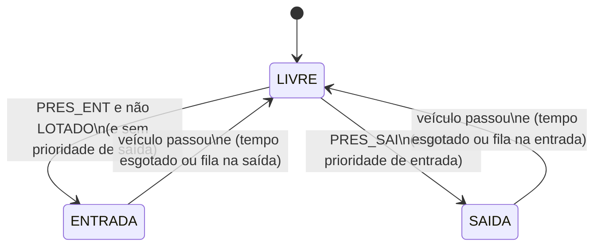

# Experimento 4 — Aprofundamento: carregamento de silos e controle de estacionamento

> **Laboratório de Automação — UFABC** · CLP Siemens S7-1500 (CPU 1516F-3 PN/DP)

**Equipe:**
1. ______________________________
2. ______________________________
3. ______________________________
4. ______________________________

---

## 1. Objetivos

- Levantar entradas e saídas de um processo descrito em texto e produzir o **diagrama elétrico de interligação**.
- Escrever lógica de **intertravamento** e **seleção de destino** (silos).
- Projetar uma lógica com **estados**, **contagem crescente/decrescente** e **temporização** (estacionamento).

## 2. Pré-requisitos

Experimentos 1 a 3 (`SET`/`RESET`, `TON`, `CTU`; endereçamento de E/S).

---

## 3. Exercício 1 — Sistema de carregamento de silos

### 3.1 Descrição do processo

Um entreposto agropecuário possui três silos (**S1, S2, S3**). O material sai do silo **S1** pelo **damper D1**, passa por uma **caixa desviadora de 2 vias** (**damper D2**), que o encaminha para **S2** ou **S3**. Dois transportadores de correia (**M1** e **M2**) levam o material.

| Elemento | Função |
|---|---|
| `S1`, `S2`, `S3` | Silos |
| `D1` | Damper de descarregamento do silo S1 |
| `D2` | Damper de desvio da caixa desviadora de 2 vias (S2 ou S3) |
| `M1`, `M2` | Motores das correias transportadoras |
| `S1min`, `S2min`, `S3min` | Detectores de nível **mínimo** |
| `S2max`, `S3max` | Detectores de nível **máximo** |
| `CS1`, `CS2` | Fins de curso da caixa desviadora (indicam a posição) |
| Chave L/D | Liga/Desliga do sistema |

**Operação**

1. As correias são ligadas e desligadas automaticamente e funcionam constantemente enquanto o sistema está ligado.
2. O damper **D1** despeja material no desviador **até** o detector de nível máximo do silo em carga atuar e desligá-lo.
3. D1 é ligado novamente pela atuação do detector de nível **mínimo** de um dos dois silos.
4. O detector de nível mínimo do silo vazio também aciona **D2**, desviando o material para esse silo.

### 3.2 Convenções adotadas (hipóteses do roteiro)

O enunciado deixa alguns pontos em aberto. Adotamos as seguintes convenções; **comente qualquer alteração no relatório**.

| Item | Convenção |
|---|---|
| Sensores de mínimo (`SxMIN`) | **1** quando o nível está **abaixo do mínimo** (silo precisa de material) |
| Sensores de máximo (`SxMAX`) | **1** quando o nível **atingiu o máximo** |
| `D2` desenergizado (0) | desvia para **S2**; fim de curso `CS1` confirma a posição |
| `D2` energizado (1) | desvia para **S3**; fim de curso `CS2` confirma a posição |
| Prioridade | Se S2 e S3 pedem material ao mesmo tempo, atende-se **S2 primeiro** |
| `S1MIN = 1` | S1 sem material: D1 fica **bloqueado** |

### 3.3 Tabela de entradas e saídas

| TAG | Tipo | Endereço | Descrição |
|---|---|---|---|
| `CH_LD` | Entrada | `%I0.0` | Chave Liga/Desliga geral |
| `S1MIN` | Entrada | `%I0.1` | S1 abaixo do mínimo |
| `S2MIN` | Entrada | `%I0.2` | S2 abaixo do mínimo |
| `S3MIN` | Entrada | `%I0.3` | S3 abaixo do mínimo |
| `S2MAX` | Entrada | `%I0.4` | S2 no nível máximo |
| `S3MAX` | Entrada | `%I0.5` | S3 no nível máximo |
| `CS1` | Entrada | `%I0.6` | Desviador na posição S2 |
| `CS2` | Entrada | `%I0.7` | Desviador na posição S3 |
| `M1` | Saída | `%Q0.0` | Correia 1 |
| `M2` | Saída | `%Q0.1` | Correia 2 |
| `D1` | Saída | `%Q0.2` | Damper de S1 |
| `D2` | Saída | `%Q0.3` | Damper do desviador |

**Memórias auxiliares:** `CARR_S2` (`%M0.0`) e `CARR_S3` (`%M0.1`) indicam qual silo está sendo carregado.

### 3.4 Diagrama de interligação elétrica (a desenhar)

Entregue o desenho completo do relatório. Roteiro mínimo:

| Parte | Ligação |
|---|---|
| Entradas digitais (DI 24 V DC) | Sensores e chaves entre **+24 V** e a entrada `%I0.x`, com a referência **M (0 V)** comum |
| Saídas digitais (DQ 24 V DC / 0,5 A) | Saída `%Q0.x` aciona a bobina de um **relé/contator de interface**; a outra ponta da bobina vai ao **0 V** |
| Cargas de potência | M1, M2, D1 e D2 alimentados pelos **contatos** dos relés/contatores, não diretamente pelo CLP |
| Proteções | Fusível/disjuntor da alimentação; diodo de roda livre em bobinas CC |

> ⚠️ Cada saída do módulo suporta no máximo **0,5 A**. Motores e dampers de potência devem ser comandados por **relés ou contatores de interface**.

### 3.5 Solução de referência

```
Rede 1 — Correias (funcionam com o sistema ligado)
  [ I0.0 ]                                      →( Q0.0 )   // M1
  [ I0.0 ]                                      →( Q0.1 )   // M2

Rede 2 — Seleciona carregamento de S2
  [ I0.2 ]·[/M0.1 ]                             →( SET   M0.0 )
  [ I0.4 ] ‖ [/I0.0 ]                           →( RESET M0.0 )

Rede 3 — Seleciona carregamento de S3
  [ I0.3 ]·[/M0.0 ]·[/I0.2 ]                    →( SET   M0.1 )
  [ I0.5 ] ‖ [/I0.0 ]                           →( RESET M0.1 )

Rede 4 — Posiciona o desviador
  [ M0.1 ]                                      →( Q0.3 )   // D2 = 1 → S3 ; D2 = 0 → S2

Rede 5 — Damper D1 (só com desviador na posição correta e S1 com material)
  [ I0.0 ]·[/I0.1 ]·( ( [ M0.0 ]·[ I0.6 ] ) ‖ ( [ M0.1 ]·[ I0.7 ] ) )   →( Q0.2 )
```

**Observações de projeto**

- Na rede 3, `[/I0.2]` evita que S3 “roube” a vez quando S2 e S3 estão vazios ao mesmo tempo (prioridade de S2).
- A rede 5 garante que o material **só cai quando o desviador já está na posição**, evitando contaminar o silo errado.
- Em operação real, acrescente um **temporizador de supervisão** para sinalizar falha se o desviador não chegar à posição.

### 3.6 Testes sugeridos

| # | Situação | Esperado |
|---|---|---|
| 1 | CH_LD=1, S2MIN=1 | D2=0; ao ativar `CS1`, D1 liga |
| 2 | Em carga de S2, S2MAX=1 | D1 desliga |
| 3 | S3MIN=1 (S2 cheio) | D2=1; ao ativar `CS2`, D1 liga |
| 4 | S2MIN=1 e S3MIN=1 | atende S2 primeiro, depois S3 |
| 5 | S1MIN=1 | D1 bloqueado |
| 6 | CH_LD=0 | tudo desligado |

---

## 4. Exercício 2 — Controle de acesso de estacionamento

### 4.1 Descrição do processo

Um estacionamento com **uma única via** de entrada e saída tem capacidade para **100 veículos** e exibe **“LOTADO”** quando as vagas acabam. O tráfego é controlado por **dois semáforos** (entrada e saída) e por **uma cancela** no meio da via comum.

1. O motorista aguarda o **sinal verde** do semáforo (via livre), aproxima-se da cancela, **retira o tíquete** (entrada) ou o **insere** (saída).
2. Com o tíquete liberado ou recebido, a **cancela levanta** e o veículo passa.
3. Depois da passagem, o **contador de veículos** é incrementado (entrada) ou decrementado (saída).
4. **Prioridade por fila:** sensores de posição detectam a formação de fila. Atingido certo número de veículos, aquele acesso passa a ter **prioridade**.
5. **Limite de espera:** para que o outro acesso não espere demais, a prioridade é **temporizada** pelo tempo de verde dos semáforos.

### 4.2 Tabela de entradas e saídas

| TAG | Tipo | Endereço | Descrição |
|---|---|---|---|
| `TKT_ENT` | Entrada | `%I0.0` | Tíquete retirado (pulso) |
| `TKT_SAI` | Entrada | `%I0.1` | Tíquete inserido (pulso) |
| `PRES_ENT` | Entrada | `%I0.2` | Veículo aguardando na entrada |
| `PRES_SAI` | Entrada | `%I0.3` | Veículo aguardando na saída |
| `FILA_ENT` | Entrada | `%I0.4` | Fila na entrada (N veículos) |
| `FILA_SAI` | Entrada | `%I0.5` | Fila na saída (N veículos) |
| `SENS_CANC` | Entrada | `%I0.6` | Veículo sob a cancela |
| `SEM_ENT_VD` | Saída | `%Q0.0` | Semáforo de entrada: verde |
| `SEM_ENT_VM` | Saída | `%Q0.1` | Semáforo de entrada: vermelho |
| `SEM_SAI_VD` | Saída | `%Q0.2` | Semáforo de saída: verde |
| `SEM_SAI_VM` | Saída | `%Q0.3` | Semáforo de saída: vermelho |
| `CANCELA` | Saída | `%Q0.4` | Cancela levantada |
| `LOTADO` | Saída | `%Q0.5` | Aviso “LOTADO” |

> Os sensores de presença (`PRES_*`) não aparecem no enunciado, mas são necessários para o sistema saber **se há veículo esperando**. Se a sua bancada não tiver todas essas entradas, simule-as com chaves ou use a *force table*.

### 4.3 Máquina de estados



| Estado | Semáforo entrada | Semáforo saída | Cancela |
|---|---|---|---|
| `LIVRE` | vermelho | vermelho | fechada |
| `ENTRADA` | **verde** | vermelho | abre com `TKT_ENT` |
| `SAIDA` | vermelho | **verde** | abre com `TKT_SAI` |

**Regras de prioridade (proposta)**

1. Se há fila só em um acesso, aquele acesso ganha a vez.
2. Se há fila nos dois, **alternar** o último que foi atendido.
3. Cada janela de verde dura no máximo `T_JANELA` (ex.: 20 s). Ao terminar, se o acesso oposto tem veículo esperando, o estado muda assim que o veículo atual terminar de passar.
4. Se está **LOTADO**, a entrada permanece vermelha e o aviso `LOTADO` fica aceso. A saída continua liberada.

### 4.4 Solução de referência (equações)

```
// Contador de vagas (CTUD, PV = 100)
CU  = N_TRIG( SENS_CANC ) · ESTADO_ENTRADA       // passagem concluída na entrada
CD  = N_TRIG( SENS_CANC ) · ESTADO_SAIDA         // passagem concluída na saída
LOTADO = (CV >= 100)                              // saída QU do contador

// Semáforos
SEM_ENT_VD = ESTADO_ENTRADA · ¬LOTADO
SEM_ENT_VM = ¬SEM_ENT_VD
SEM_SAI_VD = ESTADO_SAIDA
SEM_SAI_VM = ¬SEM_SAI_VD

// Cancela: abre com o tíquete válido do estado atual e fecha depois da passagem
SET   CANCELA : (TKT_ENT · ESTADO_ENTRADA) + (TKT_SAI · ESTADO_SAIDA)
RESET CANCELA : N_TRIG(SENS_CANC) · TON_FECHA.Q      // ex.: 2 s após liberar o sensor
```

> **Cuidado com o contador:** conte pela **borda de descida** do sensor sob a cancela, ou seja, depois que o veículo **terminou de passar**, para não contar um veículo que desistiu.

### 4.5 Testes sugeridos

| # | Situação | Esperado |
|---|---|---|
| 1 | `PRES_ENT=1` | semáforo de entrada fica verde |
| 2 | `TKT_ENT` + `SENS_CANC` (sobe e desce) | cancela levanta, fecha, contador +1 |
| 3 | `PRES_SAI=1` com entrada livre | semáforo de saída fica verde |
| 4 | `TKT_SAI` + `SENS_CANC` | contador −1 |
| 5 | Contador em 100 | `LOTADO` aceso, entrada vermelha |
| 6 | `FILA_SAI=1` durante entrada | após terminar a passagem, estado muda para saída |
| 7 | Ambos com fila por mais de `T_JANELA` | alternância de estados |

## 5. Questões para o relatório

1. Que tipo de falha pode ocorrer se os dois semáforos ficarem verdes ao mesmo tempo? Que intertravamento evita isso?
2. Por que usar uma **máquina de estados** em vez de várias redes independentes?
3. Que impacto o tempo `T_JANELA` tem na fila e na espera?
4. Como o desenho elétrico da interligação muda se os dampers forem de 220 Vac?

## 6. Entregáveis

- Tabela de E/S e **diagrama elétrico de interligação** (Exercício 1).
- Ladder comentado dos dois exercícios.
- Descrição das hipóteses adotadas e resultados dos testes.
