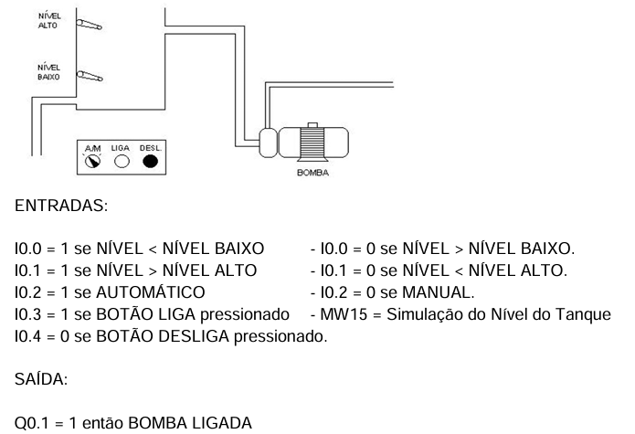

# Experimento 5 — Introdução da IHM: supervisão e controle do tanque

## Enunciado



A partir do problema do 3º trabalho de laboratório (controle de uma bomba de tanque), crie uma interface com a utilização da IHM em que seja possível monitorar o nível do tanque, selecionar o modo automático ou manual, especificar o delay em segundos com que a bomba liga ou desliga no modo automático e, no modo manual, incluir os botões liga e desliga. Utilize uma memória analógica para simular o nível do tanque.

O problema do 3º trabalho prevê dois modos de funcionamento:

- **Manual:** a bomba é ligada com o botão LIGA e desligada com o botão DESL. Neste modo, as bóias de nível não têm nenhuma ação.
- **Automático:** a bomba é ligada 10 s após a detecção de NÍVEL BAIXO e desligada 10 s após a detecção de NÍVEL ALTO.

Entradas e saída do enunciado:

| Endereço | Descrição |
|---|---|
| I0.0 | 1 se NÍVEL < NÍVEL BAIXO; 0 se NÍVEL > NÍVEL BAIXO |
| I0.1 | 1 se NÍVEL > NÍVEL ALTO; 0 se NÍVEL < NÍVEL ALTO |
| I0.2 | 1 se AUTOMÁTICO; 0 se MANUAL |
| I0.3 | 1 se botão LIGA pressionado (MW15 = simulação do nível do tanque) |
| I0.4 | 0 se botão DESLIGA pressionado |
| Q0.1 | 1 então BOMBA LIGADA |


## Desenvolvimento do experimento

### 1. Descrição do processo

O tanque tem uma bomba de enchimento, um dreno e dois sensores de nível (baixo e alto). Como não há tanque físico, o nível é simulado por uma memória inteira (`NIVEL`, de 0 a 50), que sobe 1 unidade por segundo com a bomba ligada e desce 1 unidade por segundo com o dreno aberto. O nível aparece na IHM em porcentagem (`NIVEL` × 2). Os sensores são gerados a partir do nível: o sensor de nível baixo fica em 1 abaixo de 10 e o de nível alto fica em 1 acima de 40, com histerese nos valores 10 e 40 conforme a bomba ou o dreno estejam ligados.

**Modo manual.** O botão LIGA liga a bomba, e o botão DESL. a desliga. A bomba também desliga sozinha quando o tanque chega a 50 ou quando o dreno é acionado, e nesse caso o comando volta ao estado "desligado".

**Modo automático.** Com o seletor em automático e o tanque abaixo de 50, o ciclo de enchimento fica ativo (`ENCHENDO`). A bomba liga após o atraso de partida (10 s). Quando o sensor de nível alto atua, o atraso de parada (11 s) começa a contar. A bomba desliga quando esse atraso termina ou quando o nível chega a 50, o que ocorrer primeiro.

**Dreno.** O botão ESVAZIAR abre o dreno enquanto houver nível, e o botão PARAR o fecha. O comando de parar prevalece. Ao chegar a 0, o dreno fecha, o botão ESVAZIAR é limpo, o comando de desligar é ativado, o LIGA é limpo e o seletor volta para manual. O dreno bloqueia a bomba.

**Mudança de modo.** Ao passar de manual para automático ou o contrário, a bomba desliga e o comando volta ao estado "desligado".

### 2. Entradas

Os nomes seguem o programa implementado (POU `PLC_PRG`). A coluna da direita traz o endereço correspondente no enunciado da apostila.

| Variável | TAG | Descrição | Apostila |
|---|---|---|---|
| I00 | SN_BAIXO | Sensor de nível baixo (1 = nível baixo), gerado pelo nível | I0.0 |
| I01 | SN_ALTO | Sensor de nível alto (1 = nível alto), gerado pelo nível | I0.1 |
| I02 | AUTO | Seletor: 1 = automático, 0 = manual | I0.2 |
| I03 | LIGA | Comando liga (1 = ativado) | I0.3 |
| I04 | DESL | Comando desliga (inicia em TRUE = desligado) | I0.4 |
| I05 | BT_ESV | Botão esvaziar | |
| I06 | BT_PARA_ESV | Botão interromper o esvaziamento | |

### 3. Saídas

| Variável | TAG | Descrição | Apostila |
|---|---|---|---|
| Q01 | BOMBA | 1 = bomba ligada | Q0.1 |
| Q02 | DRENO | 1 = dreno ligado | |
| Q03 | ENCHENDO | Ciclo automático de enchimento ativo | |

### 4. Outros recursos

| Variável | TAG | Tipo | Descrição |
|---|---|---|---|
| M01 | NIVEL | INT | Nível do tanque (0 a 50) |
| M02 | T_REST | INT | Tempo restante para encher, em segundos (50 − NIVEL) |
| M03 | ACC_MS | INT | Acumulador de milissegundos |
| M04 | CICLO_MS | INT | Ciclo da task em ms (valor inicial 20) |
| M05 | TICK | BOOL | Pulso de 1 s |
| M06 | TMP | INT | Auxiliar de cálculo |
| TON01 | T_PART | TON | Atraso de partida, PT = T#10S |
| TON02 | T_PARA | TON | Atraso de parada, PT = T#11S |
| AUTO_P | AUTO_P | R_TRIG | Borda de subida do seletor (manual para automático) |
| MAN_P | MAN_P | F_TRIG | Borda de descida do seletor (automático para manual) |
| LIGA_P | LIGA_P | R_TRIG | Borda de subida de LIGA |
| DESL_P | DESL_P | R_TRIG | Borda de subida de DESL |

### 5. Configuração do projeto

1. Crie o programa `PLC_PRG` em ladder e declare as variáveis das seções 2 a 4. `DESL` (I04) inicia em `TRUE` e `CICLO_MS` (M04) inicia em `20`.
2. Ajuste o ciclo da task para 20 ms, o mesmo valor de `CICLO_MS`. O relógio de 1 s conta o ciclo da task, e por isso os dois valores devem coincidir.
3. Monte as networks na ordem apresentada. A ordem importa: o Reset da bomba (network 24) vem depois do Set (network 23) para prevalecer, e o Reset do dreno (networks 12 e 13) vem depois do Set (network 10).
4. Na IHM, associe os elementos às variáveis:
   - seletor A/M a `AUTO` (I02);
   - botões LIGA e DESL. a `LIGA` (I03) e `DESL` (I04), com ação de ligar a variável ao pressionar;
   - botões de dreno a `BT_ESV` (I05) e `BT_PARA_ESV` (I06), com ação momentânea (1 enquanto pressionados);
   - lâmpadas a `SN_ALTO`, `SN_BAIXO`, `BOMBA` e `DRENO`;
   - indicador de capacidade a `NIVEL`, convertido em porcentagem.

### 6. Código ladder

Legenda: `] [` contato NA, `]/[` contato NF, `( )` bobina, `( S )` set, `( R )` reset. Cada item abaixo é uma network, na ordem do programa. Nas networks com comparação, o bloco de comparação fica em série com os contatos.

```
 1  Sensores simulados pela contagem
    NIVEL < 10                             I00 ( S )
 2  NIVEL = 10 ] [ Q02                     I00 ( S )
 3  NIVEL > 10                             I00 ( R )
 4  NIVEL = 10 ] [ Q01                     I00 ( R )
 5  NIVEL > 40                             I01 ( S )
 6  NIVEL = 40 ] [ Q01                     I01 ( S )
 7  NIVEL < 40                             I01 ( R )
 8  NIVEL = 40 ] [ Q02                     I01 ( R )

 9  Bordas do seletor
    I02 -> AUTO_P (R_TRIG) e MAN_P (F_TRIG)

10  Esvaziamento (parar prevalece)
    I05 ] [ NIVEL > 0                      Q02 ( S )
11  Q02 ] [ NIVEL <= 0                     I05 ( R ), I04 ( S ), I03 ( R ), I02 ( R )
12  I06 ] [                                Q02 ( R )
13  NIVEL <= 0                             Q02 ( R )

14  Ciclo automático de enchimento
    I02 ] [ Q02 ]/[ I05 ]/[ I06 ]/[ NIVEL < 50     Q03 ( S )
15  I02 ]/[   (em paralelo com Q02 ] [)    Q03 ( R )
16  TON02.Q ] [  ou  NIVEL >= 50           Q03 ( R )

17  Atraso de partida (10 s)
    I02 ] [ Q03 ] [ Q01 ]/[ Q02 ]/[        TON01, PT = T#10S
18  Atraso de parada: nível alto, depois do atraso
    I02 ] [ Q01 ] [ I01 ] [                TON02, PT = T#11S

19  Exclusão mútua LIGA / DESL (pulsos, por borda)
    I03 ] [                                LIGA_P (R_TRIG)
20  I04 ] [                                DESL_P (R_TRIG)
21  LIGA_P.Q ] [                           I04 ( R )
22  DESL_P.Q ] [                           I03 ( R )

23  Liga a bomba (automático e manual)
    (TON01.Q ] [  ou  I02 ]/[ I03 ] [) Q02 ]/[ NIVEL < 50     Q01 ( S )
24  Desliga a bomba (depois do Set, por isso prevalece)
    AUTO_P.Q  ou  MAN_P.Q  ou  Q02  ou  TON02.Q  ou  NIVEL >= 50  ou  (I02 ]/[ I04 ] [)     Q01 ( R )

25  Bomba parada em manual com LIGA ainda em 1
    I02 ]/[ Q01 ]/[ I03 ] [                I04 ( S ), I03 ( R )
26  Mudança de modo
    AUTO_P.Q ] [                           I04 ( S )
27  MAN_P.Q ] [                            I03 ( R )

28  Relógio de 1 s por acumulação (mantém o tempo parcial nas pausas)
    (Q01 ] [  ou  Q02 ] [)                 ACC_MS := ACC_MS + CICLO_MS
29  ACC_MS >= 1000                         M05 ( )
30  M05 ] [                                ACC_MS := ACC_MS - 1000

31  Enchimento: +1 por segundo, saturando em 50
    M05 ] [ Q01 ] [                        TMP := NIVEL + 1;  NIVEL := MIN(TMP, 50)
32  Esvaziamento: -1 por segundo, saturando em 0
    M05 ] [ Q02 ] [                        TMP := NIVEL - 1;  NIVEL := MAX(TMP, 0)

33  Tempo restante de enchimento
    T_REST := 50 - NIVEL
```

### 7. Observações e teste

- **Sensores simulados.** Os sensores I00 e I01 são gerados pelo nível (networks 1 a 8) e atuam como a bóia. Os valores 10 e 40 equivalem a 20 % e 80 % da capacidade.
- **Atraso de parada.** O nível sobe 1 unidade por segundo a partir de 40, e por isso chega a 50 após 10 s do sensor de nível alto. Como `T_PARA` está em 11 s, quem desliga a bomba nesse caso é o limite de nível (network 24). O TON02 só decide se o nível subir mais devagar.
- **Atrasos da IHM.** O enunciado pede que o atraso seja especificado na IHM. No programa atual, `T_PART` e `T_PARA` são constantes (`T#10S` e `T#11S`). Para atender ao enunciado, associe os campos da IHM a variáveis de tempo e ligue-as aos pinos `PT` dos dois TON.
- **Sensor de nível baixo.** `SN_BAIXO` (I00) só aciona a lâmpada: nenhuma network usa esse contato. A partida automática depende do ciclo `ENCHENDO` (network 14), que é ativado sempre que o modo é automático e o nível está abaixo de 50. Para partir só após a detecção de nível baixo, como diz o enunciado do 3º trabalho, acrescente o contato I00 em série na network 14 ou na network 17.
- **Fim do esvaziamento.** Ao chegar a 0, a network 11 coloca o seletor em manual (I02 = 0). Para um novo ciclo automático, o operador precisa selecioná-lo outra vez.
- **Botões do dreno.** `BT_ESV` e `BT_PARA_ESV` devem ser momentâneos. Com `BT_ESV` mantido em 1, o dreno religa assim que `BT_PARA_ESV` é solto.
- **Teste na IHM ou no simulador:**
  1. Manual: pressione LIGA. A bomba liga e o nível sobe 1 por segundo até 50, quando a bomba desliga sozinha.
  2. Manual, desligamento: pressione LIGA e depois DESL. A bomba desliga e o nível para.
  3. Automático: passe o seletor para automático com o tanque abaixo de 50. A bomba liga após 10 s, e o sensor de nível alto atua em 40.
  4. Dreno: pressione ESVAZIAR. O dreno abre, a bomba fica bloqueada e o nível desce até 0, quando o seletor volta para manual.
  5. Parar o dreno: durante o esvaziamento, pressione PARAR. O dreno fecha e o nível se mantém.


### Recursos

| [Guia em PDF](experimento-05_tanque-ihm.pdf) | 
| [Simulador em HTML](https://mitoedson.github.io/Automacao-de-Sistemas-Industriais/simulador/simulacao_tanque-ihm.html) |