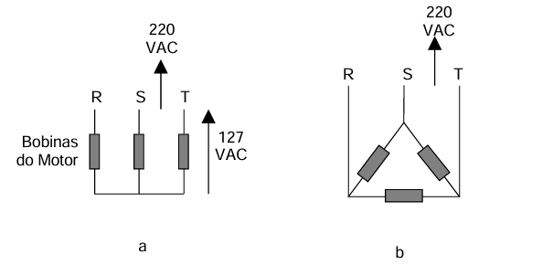
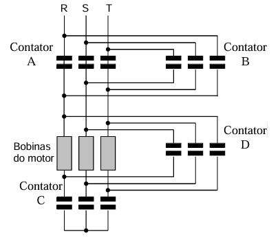
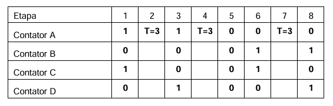
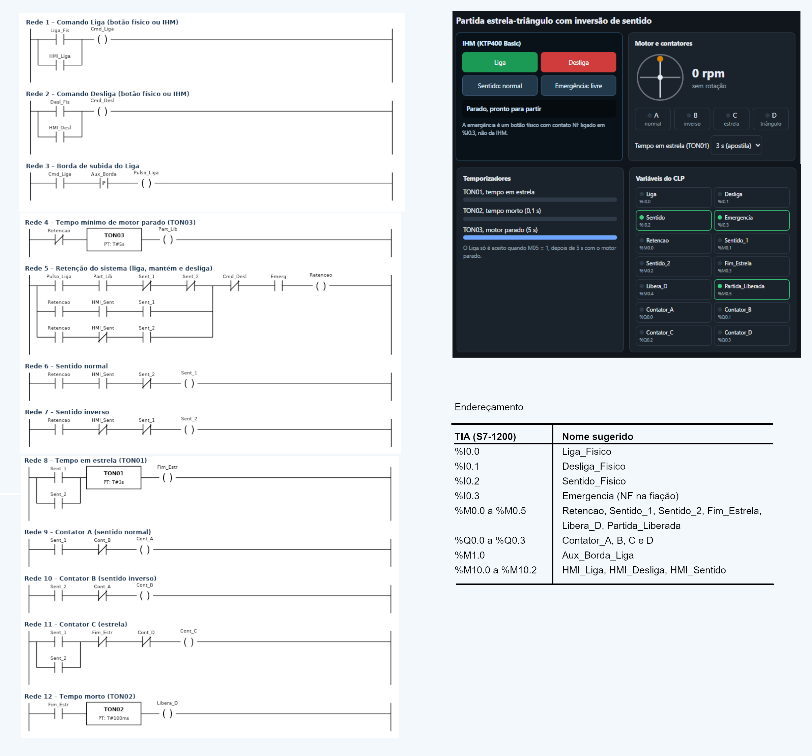

# Experimento 6 — Partida de motor trifásico: chave estrela-triângulo com inversão de sentido


Os motores elétricos mais comumente empregados no ambiente industrial é o tipo motor de indução trifásico tipo gaiola de esquilo, isso se dá principalmente devido a robustez desses motores que possuem poucas partes moveis, tornando-os muito confiáveis.

Apesar das suas vantagens esses motores possuem característica de grande corrente de partida, pois ao serem conectados diretamente à rede elétrica, absorvem uma corrente de partida na ordem de 4 a 10 vezes maior que a corrente nominal. 

Para motores de grande potência, as altas correntes, interagindo com a impedância equivalente entre o ponto de fornecimento, na entrada do ambiente industrial (subestação) e o barramento em que o motor está conectado, provocam reduções de tensão (“afundamentos de tensão”), temporárias durante o qual podem ocorrer alguns transtornos, tais como:

● Interferência no funcionamento de equipamentos instalados no mesmo sistema, devido à queda de tensão excessiva.

● Necessidade de super-dimensionar os sistemas de proteção, com consequente aumento de custos.

● Receber multas impostas pela companhia concessionária de energia elétrica, de forma a limitar a queda de tensão na rede.

Por isso, em geral, motores acima de 5 cv não são conectados diretamente durante sua partida. Com muita frequência são utilizados equipamentos ou arranjos de equipamentos para reduzir-se a corrente de partida utilizam métodos de partida eletromecânicos (com relés) ou eletrônicos (com dispositivos de partida soft-starter). 

O sistema de partida indireta mais usado é a partida estrela-triângulo que consiste em ligar, numa primeira instância, as bobinas do enrolamento do motor numa configuração estrela e, portanto, alimentando cada bobina com  1/(3)^(1/2)=  (0,5773) vezes a tensão nominal do motor (Figura 1a), quando o motor atingir aproximadamente a metade de sua rotação nominal, a ligação das bobinas é mudada para a configuração triângulo, com isso alimentando o motor com sua tensão nominal (Figura 1b), essa mudança pode ser feita por um operador, por relés 101 temporizados ou por contatores controlados como é o caso para esta experiência.  



Figura 1. – Tipos de Ligação: a) Ligação Estrela; b) Ligação Triângulo. 

Uma solução para o problema é a utilização de um quatro contatores como mostrado na figura 2, os contatores A, C e D são para mudar-se de delta para estrela enquanto o contator B é para inverter-se o sentido de rotação. A partida deverá ocorrer primeiramente em estágio estrela e permanecer nesse estado por 3 segundos, devendo então ir para o estágio em triângulo. 



Figura 2 – Esquema elétrico do motor e contatores  para partida Estrela / Triângulo. 

1.1 Descrição do problema de automação Nesta montagem deve-se acionar o motor através do botão Liga, deve ainda ser possível desligá-lo em qualquer instante que for necessário através do botão Desliga. O motor contara ainda com uma chave de sentido de rotação sendo que se arbitrou valor logico 1 para sentido normal e 0 para sentido inverso no caso do sentido de rotação ser mudado com o motor funcionando, o mesmo deverá parar. O motor independente do sentido deve acionar em estrela no sentido e após 3 segundos ir para triangulo. 

2. Diagrama Trajeto-Passo Abaixo, segue o diagrama trajeto-passo do processo analisado, seguido da descrição sobre o posicionamento de cada atuador: 



Figura 3: diagrama de passo

● Etapa 1: Sentido normal (A=1, B=0) parte em estrela.  1 

● Etapa 2: Tempo de 3 segundos para motor chegar a pelo menos 90% da rotação nominal. 

● Etapa 3: Sentido normal (A=1, B=0) chaveia para triangulo. 

● Etapa 4: Tempo de 3 segundos para motor chegar a pelo menos 90% da rotação nominal. 

● Etapa 5: Motor desligado(botão de desliga ou mudança de sentido).

● Etapa 6: Sentido inverso (A=0, B=1) parte em estrela.  

● Etapa 7: Tempo de 3 segundos para motor chegar a pelo menos 90% da rotação nominal. ● Etapa 8: Sentido inverso (A=0, B=1) chaveia para triangulo. 

## Desenvolvimento do experimento

### 1. Objetivos

- Entender por que motores de indução trifásicos de maior potência não partem diretamente da rede.
- Programar o **sequenciamento de partida estrela-triângulo** com quatro contatores.
- Implementar **inversão de sentido** com parada obrigatória na troca.
- Aplicar **intertravamentos** de segurança em lógica e em hardware.

> ⚠️ **Antes de energizar o motor:** valide toda a lógica **com LEDs ou apenas com as saídas do CLP**, sem a potência ligada. Um erro de intertravamento causa **curto-circuito entre fases** e danos aos equipamentos.

### 2. Pré-requisitos

Experimentos 1 a 3 (ladder, `SET`/`RESET`, `TON`, bordas) e noções de contatores e motor trifásico.

### 3. Fundamentos

#### 3.1 Por que não partir direto?

O motor de indução tipo **gaiola de esquilo** é robusto e confiável, mas, ao ser ligado diretamente à rede, absorve uma corrente de partida de **4 a 10 vezes** a nominal. Em motores de maior potência isso pode causar:

- **afundamentos de tensão** que perturbam outros equipamentos na mesma instalação;
- necessidade de **superdimensionar as proteções**, com aumento de custo;
- **multas** da concessionária, por violação dos limites de queda de tensão.

Por isso, em geral, motores acima de **5 cv** não partem diretamente e usam partida indireta (eletromecânica ou *soft-starter*).

#### 3.2 Partida estrela-triângulo

1. **Estrela (Y):** cada bobina recebe `V_linha / √3` (≈ 0,577 × V_linha). Ex.: rede de 220 V → 127 V por bobina. A corrente de partida cai (≈ 1/3 do valor em triângulo).
2. Quando o motor atinge aproximadamente a rotação nominal, as bobinas são reconfiguradas para **triângulo (Δ)** e passam a receber a tensão nominal de 220 V.

#### 3.3 Contatores usados

| Contator | Função | Saída do CLP |
|:-:|---|---|
| **A** | Linha — sentido **normal** | `%Q0.0` |
| **B** | Linha — sentido **inverso** | `%Q0.1` |
| **C** | Fechamento em **estrela** | `%Q0.2` |
| **D** | Fechamento em **triângulo** | `%Q0.3` |

> 🚫 **Nunca** acionar **A e B** juntos (curto entre fases) nem **C e D** juntos (curto no fechamento do enrolamento).

> 📝 O texto da apostila indica que “A, C e D mudam de triângulo para estrela e B inverte o sentido”. O **diagrama trajeto-passo** (item 5) define o papel de cada contator de forma consistente: **A = sentido normal, B = sentido inverso**. Confira com a figura 2 e com a ligação física do seu kit.

### 4. Descrição do problema de automação

- O motor é acionado pelo botão **LIGA** e pode ser desligado a qualquer instante pelo botão **DESLIGA**.
- Uma **chave de sentido** define a rotação: **1 = normal**, **0 = inverso**.
- Se o sentido for **alterado com o motor em funcionamento**, o motor deve **parar**.
- Em qualquer sentido, o motor parte em **estrela** e, após **3 s**, passa para **triângulo**.

#### 4.1 Entradas e saídas

| TAG | Tipo | Endereço | Descrição |
|---|---|---|---|
| `LIGA` | Entrada | `%I0.0` | Botão LIGA (NA, não retentivo) |
| `DESLIGA` | Entrada | `%I0.1` | Botão DESLIGA (NF: 0 quando pressionado) |
| `SENTIDO` | Entrada | `%I0.2` | Chave de sentido (1 = normal; 0 = inverso) |
| `CONT_A` | Saída | `%Q0.0` | Contator A (normal) |
| `CONT_B` | Saída | `%Q0.1` | Contator B (inverso) |
| `CONT_C` | Saída | `%Q0.2` | Contator C (estrela) |
| `CONT_D` | Saída | `%Q0.3` | Contator D (triângulo) |

> Se o botão DESLIGA do seu kit for NA, troque o contato `[/I0.1]` por `[ I0.1 ]` nas redes abaixo. Prefira **NF** (falha segura).

**Auxiliares:** `RODANDO` (`%M1.0`), `SENT_ANT` (`%M1.1`), `TROCA` (`%M1.2`), `T_ESTRELA` (`TON`, 3 s), `T_MORTO` (`TON`, 100 ms).

### 5. Diagrama trajeto-passo

| Etapa | 1 | 2 | 3 | 4 | 5 | 6 | 7 | 8 |
|---|:-:|:-:|:-:|:-:|:-:|:-:|:-:|:-:|
| Contator A | 1 | T=3 s | 1 | T=3 s | 0 | 0 | T=3 s | 0 |
| Contator B | 0 | | 0 | | 0 | 1 | | 1 |
| Contator C | 1 | | 0 | | 0 | 1 | | 0 |
| Contator D | 0 | | 1 | | 0 | 0 | | 1 |

| Etapa | Descrição |
|:-:|---|
| 1 | Sentido normal (A=1, B=0): parte em **estrela** |
| 2 | Espera de **3 s** (motor atinge pelo menos 90 % da rotação nominal) |
| 3 | Sentido normal: chaveia para **triângulo** |
| 4 | Tempo de **3 s** (descrito assim na apostila; o motor já está em regime, em triângulo, até o desligamento ou a troca de sentido) |
| 5 | Motor **desligado** (botão DESLIGA ou mudança de sentido) |
| 6 | Sentido inverso (A=0, B=1): parte em **estrela** |
| 7 | Espera de **3 s** |
| 8 | Sentido inverso: chaveia para **triângulo** |

### 6. Solução de referência

```
Rede 1 — Memória do sentido anterior e detecção de troca
  ( [ I0.2 ]·[/M1.1 ] ) ‖ ( [/I0.2 ]·[ M1.1 ] )             →( M1.2 )   // TROCA (sentido mudou)
  [ I0.2 ]                                                  →( M1.1 )   // SENT_ANT := SENTIDO

Rede 2 — Estado "rodando" (desligar domina sobre ligar)
  [ I0.0 ]·[/M1.2 ]                                         →( SET   M1.0 )
  [/I0.1 ] ‖ [ M1.2 ]                                       →( RESET M1.0 )

Rede 3 — Temporizador da fase estrela
  [ M1.0 ]                  → TON T_ESTRELA ( IN, PT = T#3s )

Rede 4 — Tempo morto entre estrela e triângulo
  [ T_ESTRELA.Q ]·[ M1.0 ]  → TON T_MORTO   ( IN, PT = T#100ms )

Rede 5 — Contatores de linha (sentido)
  [ M1.0 ]·[ I0.2 ]·[/Q0.1 ]                                →( Q0.0 )   // A: normal
  [ M1.0 ]·[/I0.2 ]·[/Q0.0 ]                                →( Q0.1 )   // B: inverso

Rede 6 — Estrela (partida)
  [ M1.0 ]·[/T_ESTRELA.Q ]·[/Q0.3 ]                         →( Q0.2 )   // C

Rede 7 — Triângulo (regime)
  [ M1.0 ]·[ T_MORTO.Q ]·[/Q0.2 ]                           →( Q0.3 )   // D
```

> **Por que o motor para na troca de sentido?** A rede 1 detecta a mudança da chave (XOR com o valor anterior). A rede 2 então derruba `M1.0`. Para voltar a rodar, é necessário **pressionar LIGA** de novo.

> **Por que um “tempo morto” de 100 ms?** Entre abrir C e fechar D, convém um pequeno intervalo para o arco do contator C se extinguir. Sem isso, os dois contatores poderiam coexistir por alguns milissegundos durante a troca. A apostila usa transição direta; o tempo morto é uma boa prática adicional.

> **Intertravamento duplo.** Os contatos `[/Q0.1]`, `[/Q0.0]`, `[/Q0.3]` e `[/Q0.2]` impedem A+B e C+D **na lógica**. Em instalações reais, use também **intertravamento por contato auxiliar NF** no próprio contator (hardware).

#### 6.1 Sobre as saídas do CLP

O módulo de saídas é de **24 V DC / 0,5 A**. Verifique no kit como as bobinas dos contatores são comandadas (diretamente ou por relés de interface) **antes** de ligar.

### 7. Procedimento

1. Montar o programa (redes 1 a 7), compilar e fazer o *download*.
2. **Teste a seco (sem potência):** observe os LEDs das saídas `Q0.0` a `Q0.3` e confira a sequência.
3. Só depois de validar a sequência, **peça ao professor/técnico** para liberar a potência.
4. Ligar a maleta com o motor e testar nos dois sentidos.

#### 7.1 Testes

| # | Ação | Resultado esperado |
|---|---|---|
| 1 | `SENTIDO=1`, LIGA | A e C ligam; após 3 s, C desliga e D liga (A mantido) |
| 2 | DESLIGA | todos desligam |
| 3 | `SENTIDO=0`, LIGA | B e C ligam; após 3 s, C desliga e D liga (B mantido) |
| 4 | Trocar `SENTIDO` com o motor rodando | todos desligam; é preciso pressionar LIGA para religar |
| 5 | Verificar na rede se A e B (ou C e D) ficam 1 ao mesmo tempo | nunca devem coincidir |
| 6 | Observar o tempo entre C e D | ≈ 3 s + 100 ms |


### 8. Sobre o experimento


<a href="Manual_Experimento6_Partida_Estrela_Triangulo.pdf">Manual Partida Estrela-Triângulo</a>

Ao ser ligado diretamente à rede, um motor de indução com rotor em gaiola absorve de 4 a 10 vezes a corrente nominal. Em motores maiores, isso causa afundamentos de tensão, exige proteções superdimensionadas e pode gerar multas da concessionária. Por isso, motores acima de cerca de 5 cv costumam usar partida indireta.

Na partida estrela-triângulo, as bobinas são ligadas primeiro em estrela e cada uma recebe cerca de 0,577 da tensão de linha (127 V em uma rede de 220 V). A corrente e o conjugado de partida caem a um terço dos valores da ligação em triângulo. Depois de um tempo fixo, o motor passa para triângulo e opera com a tensão nominal.

#### 8.1 Funcionamento

- O botão **Liga** aciona o motor e o botão **Desliga** o para a qualquer momento.
- Uma chave de sentido define a rotação: `1` para normal e `0` para inverso.
- Em qualquer sentido, o motor parte em **estrela** e passa para **triângulo** após **3 s**.
- Se o sentido mudar com o motor em marcha, o motor **para**. Para religar, é preciso pressionar Liga de novo.
- Uma botoeira de emergência desliga tudo.
- Após qualquer parada, há uma espera de **5 s** antes de aceitar nova partida, para o rotor parar e não haver reversão por contracorrente.

#### Contatores

| Contator | Função | Saída |
|:-:|---|---|
| A | Linha, sentido normal | `%Q0.0` |
| B | Linha, sentido inverso | `%Q0.1` |
| C | Fechamento em estrela | `%Q0.2` |
| D | Fechamento em triângulo | `%Q0.3` |

Nunca devem ficar ligados juntos **A e B**, nem **C e D**, pois ocorre curto-circuito.

#### Diagrama trajeto-passo

| Etapa | 1 | 2 | 3 | 4 | 5 | 6 | 7 | 8 |
|---|:-:|:-:|:-:|:-:|:-:|:-:|:-:|:-:|
| Situação | Normal, estrela | Espera 3 s | Normal, triângulo | Regime | Desligado | Inverso, estrela | Espera 3 s | Inverso, triângulo |
| A | 1 | 1 | 1 | 1 | 0 | 0 | 0 | 0 |
| B | 0 | 0 | 0 | 0 | 0 | 1 | 1 | 1 |
| C | 1 | 1 | 0 | 0 | 0 | 1 | 1 | 0 |
| D | 0 | 0 | 1 | 1 | 0 | 0 | 0 | 1 |

#### Lógica de controle

O programa tem 13 redes no OB1, com três temporizadores TON e uma detecção de borda no botão Liga.

| Recurso | Função |
|---|---|
| Retenção (selo) por sentido | Mantém o motor ligado só enquanto a chave estiver no sentido em uso. Mudar a chave abre o selo e desliga o motor. |
| `P_TRIG` no Liga | O Liga vale uma vez por pressão e o motor não religa sozinho se o botão ficar pressionado. |
| TON01, 3 s | Tempo em estrela. |
| TON02, 100 ms | Tempo morto entre abrir C e fechar D. |
| TON03, 5 s | Tempo mínimo de motor parado antes de nova partida. |
| Intertravamentos | Contatos NF cruzados entre A e B e entre C e D. |

Equações principais:

```
Retencao = ( Pulso_Liga·Part_Lib·/Sent_1·/Sent_2
           + Retencao·HMI_Sent·Sent_1
           + Retencao·/HMI_Sent·Sent_2 ) · /Cmd_Desl · Emerg
Cont_A = Sent_1 · /Cont_B        Cont_B = Sent_2 · /Cont_A
Cont_C = (Sent_1 + Sent_2) · /Fim_Estr · /Cont_D
Cont_D = (Sent_1 + Sent_2) · Libera_D · /Cont_C
```

#### Entradas e saídas

| Tag | Endereço | Descrição |
|---|---|---|
| `Liga_Fis` | `%I0.0` | Botão Liga (NA) |
| `Desl_Fis` | `%I0.1` | Botão Desliga (NA) |
| `Emerg` | `%I0.3` | Emergência (chave NF, entrada em 1 quando livre) |
| `Cont_A` a `Cont_D` | `%Q0.0` a `%Q0.3` | Contatores A, B, C e D |
| `HMI_Liga`, `HMI_Desl`, `HMI_Sent` | `%M10.0` a `%M10.2` | Comandos da IHM |

A tabela completa de variáveis está no manual. Os endereços são sugestões e podem ser trocados por outros livres no projeto. Se o botão Desliga da sua bancada for NF, troque o contato correspondente no ladder.

#### 8.2 Material necessário

- CLP Siemens S7-1200 e IHM KTP400 Basic
- TIA Portal (STEP 7 e WinCC)
- Motor de indução trifásico com seis terminais acessíveis
- Quatro contatores, proteção do motor e botoeira de emergência NF
- Cabos Ethernet e computador na mesma sub-rede do CLP e da IHM

O roteiro original da UFABC usa o S7-1500. A lógica é a mesma nas duas plataformas.

#### 8.3 Como executar

1. Crie um projeto no TIA Portal e adicione o CLP e a IHM.
2. Configure os endereços IP na mesma sub-rede.
3. Crie as variáveis e as 13 redes no OB1, na ordem do manual.
4. Monte a tela da IHM com os botões Liga e Desliga, a chave de sentido e as lâmpadas dos contatores.
5. Compile e faça o download.
6. Teste só com os LEDs das saídas e só depois, com autorização, energize o motor.

#### 8.4 Roteiro de testes

| # | Ação | Resultado esperado |
|:-:|---|---|
| 1 | Sentido normal, Liga | A e C ligam. Após 3 s, C desliga e D liga. |
| 2 | Sentido inverso, Liga | B e C ligam. Após 3 s, C desliga e D liga. |
| 3 | Desliga em qualquer etapa | Todos desligam. |
| 4 | Mudar o sentido com o motor em marcha | Todos desligam, sem reversão. |
| 5 | Religar em menos de 5 s após a parada | O Liga é ignorado. |
| 6 | Emergência | Todos desligam. |

#### 8.5 Simulação

O repositório inclui uma [simulação em HTML](https://mitoedson.github.io/Automacao-de-Sistemas-Industriais/simulador/simulacao_estrela_triangulo.html) que executa a mesma lógica do ladder, com IHM virtual, rotor animado, contatores, temporizadores e variáveis. Basta abrir o arquivo no navegador, sem instalar nada. Também pode ser publicada com o GitHub Pages.


### 9. Questões para o relatório

1. Por que a corrente de partida é de 4 a 10 vezes a nominal?
2. Qual a tensão em cada bobina em estrela, em uma rede de 220 V, e como fica o conjugado de partida?
3. Por que esperar cerca de 90% da rotação nominal antes de chavear?
4. Quais os riscos de ligar A e B juntos, ou C e D juntos?
5. Para que serve o TON03 e como escolher o valor?
6. Que alternativas existem à partida estrela-triângulo?

### Referências

- Roteiro de Prática de Laboratório de Automação (CLP), UFABC, 6º Trabalho de Laboratório.
- Manual de sistema do S7-1200 e ajuda do TIA Portal, Siemens.
