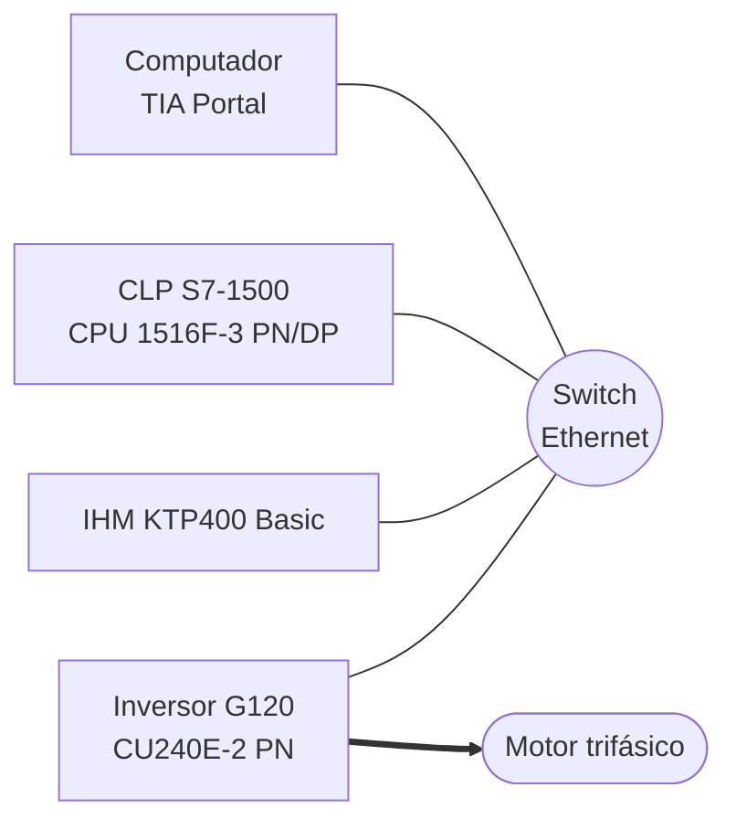

# Experimento 7 — Integração do CLP, inversor de frequência e IHM

> **Laboratório de Automação — UFABC** · CLP Siemens S7-1500 (CPU 1516F-3 PN/DP) + IHM KTP400 Basic + Inversor SINAMICS G120 (CU240E-2 PN) + motor trifásico

**Equipe:**
1. ______________________________
2. ______________________________
3. ______________________________
4. ______________________________

---

## 1. Objetivos

Integrar todos os conhecimentos dos experimentos anteriores, criando uma **IHM** que permita:

- **A –** Iniciar e parar o motor.
- **B –** Monitorar a velocidade do motor.
- **C –** Alterar a velocidade do motor.
- **D –** Alterar o sentido de rotação.
- **E –** Inserir um **timer em segundos** que desligue o motor automaticamente.

## 2. Pré-requisitos

- Experimentos 5 (IHM) e 6 (motor trifásico).
- Leitura na apostila das seções: *Inversor de frequência* (IP, *driver*, ligação elétrica, parametrização), *Comunicação entre os dispositivos*, *Busca de erros ou explicações* e *Exemplo da linguagem ladder*.

> ⚠️ **Segurança:** o **kit do inversor funciona apenas em 220 Vac**. Conferir tensão, ligações do motor e cabos **antes** de energizar. Não alterar conexões com o kit ligado. Parta sempre com velocidade baixa.

## 3. Arquitetura



Todos os dispositivos precisam estar **na mesma sub-rede** (por exemplo `192.168.0.x`, máscara `255.255.255.0`) com **IPs distintos**. Use o **switch da maleta do CLP** para ligar os quatro equipamentos.

| Dispositivo | IP (exemplo — defina o seu) |
|---|---|
| Computador | `192.168.0.99` |
| CLP | `192.168.0.1` |
| IHM | `192.168.0.2` |
| Inversor | `192.168.0.3` |

## 4. Configuração do projeto

### 4.1 Passo a passo

1. **Projeto:** abrir o projeto da CPU 1516-3 PN/DP (Experimento 5/6) ou criar um novo.
2. **Inversor:** *Add new device → Drives → SINAMICS G120 → CU240E-2 PN*; selecionar o **modelo e a versão de firmware** impressos no equipamento.
3. **Unidade de potência:** adicionar a unidade de potência (PM) correspondente à direita da unidade de controle.
4. **IP do inversor:** atribuir o IP na interface PROFINET e, em *Online access → Accessible devices → Start search*, **carregar o IP** para o equipamento (*Load*), salvando na EEPROM.
5. **Parametrização:** em *Parameter → Commissioning Wizard*, definir:
   - *Data sets*: **Command data set = 0** e **Drive data set = 0**;
   - *Control type*: **[0] V/f com característica linear**;
   - **dados de placa do motor** (tensão, corrente, potência, rotação, frequência);
   - tipo de sinal de comando/setpoint pela rede.
6. **Rede:** em *Devices & networks → Network view*, ligar o CLP, a IHM e o inversor à mesma sub-rede PROFINET e **atribuir o inversor ao CLP** como *IO device* (desmarcar a opção *PLC_1 Profinet* do inversor, conforme a apostila).
7. **Objeto tecnológico:** *Technology objects → Add new object → Motion Control → **SpeedAxis*** (ex.: `SpeedAxis_1`). Em *Hardware interface*, selecionar o **drive**. Definir a unidade de velocidade (**rpm**) e os limites máximos.

### 4.2 Solução de problemas comuns

| Sintoma | Causa provável | Ação |
|---|---|---|
| Erro **r807.0** “*The Master control is active*” ao carregar | O inversor está sob controle do **painel do kit** (mestre local) | Em *Drive → Parameters → Functional view* (**online**), desativar a função de comando pelo painel para o CLP ser o mestre |
| Inversor não aparece em *Accessible devices* | IP/ máscara diferentes ou cabo errado | Conferir sub-rede e cabeamento; usar o *switch* |
| Eixo não habilita | Telegrama/parametrização incompatível | Rever *Commissioning Wizard* e a atribuição do drive ao eixo |

> Use *Help → Show help* do TIA Portal e pesquise o **código de erro** para identificar a causa.

## 5. Variáveis do projeto

### 5.1 *Tags* do CLP

| Tag | Tipo | Endereço | Função |
|---|---|---|---|
| `Cmd_Liga` | Bool | `%M30.0` | Botão **LIGA** (IHM) |
| `Cmd_Desl` | Bool | `%M30.1` | Botão **DESLIGA** (IHM) |
| `Cmd_Aplicar` | Bool | `%M30.2` | Botão **APLICAR** (IHM): envia velocidade/sentido |
| `Sentido_Rev` | Bool | `%M30.3` | 0 = horário, 1 = anti-horário (IHM) |
| `Vel_SP` | Real | `%MD40` | Velocidade desejada (rpm) — campo de entrada |
| `Tempo_s` | Int | `%MW44` | Timer de desligamento (s); 0 = desativado |
| `Vel_Real` | LReal | `"SpeedAxis_1".ActualVelocity` | Velocidade lida do inversor |
| `Motor_On` | Bool | `%M31.0` | Estado retido (motor em operação) |
| `Pulso_Exec` | Bool | `%M31.1` | Pulso de 1 ciclo para `MC_MoveVelocity` |
| `Pulso_Parar` | Bool | `%M31.2` | Pulso de 1 ciclo para `MC_Halt` |

> ✏️ Ajuste os endereços para não colidir com outras áreas de memória já usadas no seu projeto (`MD40` ocupa `MB40` a `MB43`; `MW44` ocupa `MB44` e `MB45`).

### 5.2 Blocos de movimento usados

| Bloco | Função | Entradas principais |
|---|---|---|
| `MC_Power` | Habilita o eixo/inversor | `Axis`, `Enable`, `StopMode` |
| `MC_MoveVelocity` | Define velocidade e sentido | `Axis`, `Execute`, `Velocity`, `Direction` |
| `MC_Halt` | Parada com rampa | `Axis`, `Execute` |

> `Direction` em `MC_MoveVelocity` aceita (na versão atual): **0** = sentido do sinal da velocidade, **1** = positivo, **2** = negativo. Confirme na ajuda do TIA Portal para a versão instalada.
> Os blocos reagem à **borda de subida de `Execute`**: para alterar velocidade ou sentido é necessário gerar **um novo pulso** (`Cmd_Aplicar`).

## 6. Programa do CLP

```
Rede 1 — Estado do motor
  [ Cmd_Liga ]                                     →( SET   Motor_On )
  [ Cmd_Desl ] ‖ [ T_AUTO.Q ]                      →( RESET Motor_On )

Rede 2 — Habilita o inversor (permanece habilitado até o eixo parar)
  ( [ Motor_On ] ‖ [ Vel_Real > 1.0 ] )
     → MC_Power ( Axis := "SpeedAxis_1", Enable, StopMode := 0 )

Rede 3 — Pulso de execução (ao ligar ou ao aplicar nova velocidade/sentido)
  ( [ Cmd_Liga ] ‖ [ Cmd_Aplicar ] ) → P_TRIG → ( Pulso_Exec )

Rede 4 — Define velocidade e sentido
  [ MC_Power.Status ]·[ Pulso_Exec ]
     → MC_MoveVelocity ( Axis := "SpeedAxis_1",
                         Execute := Pulso_Exec,
                         Velocity := Vel_SP,
                         Direction := IF Sentido_Rev THEN 2 ELSE 1 )

Rede 5 — Parada com rampa
  ( [ Cmd_Desl ] ‖ [ T_AUTO.Q ] ) → P_TRIG → ( Pulso_Parar )
  [ Pulso_Parar ] → MC_Halt ( Axis := "SpeedAxis_1", Execute := Pulso_Parar )

Rede 6 — Timer de desligamento automático
  [ Motor_On ]·[ Tempo_s > 0 ]
     → TON T_AUTO ( IN, PT := DINT_TO_TIME( INT_TO_DINT(Tempo_s) * 1000 ) )

Rede 7 — Limitação do setpoint (segurança)
  [ Vel_SP > Vel_Max ] → MOVE Vel_Max → Vel_SP      // Vel_Max = ex.: 1000 rpm
```

**Lógica por *requisito* (A a E)**

| Requisito | Como é atendido |
|---|---|
| **A** – Iniciar e parar | `Cmd_Liga`/`Cmd_Desl` → `Motor_On` → `MC_Power` + `MC_Halt` (o eixo só é desabilitado depois de parar) |
| **B** – Monitorar velocidade | Campo de saída na IHM ligado a `"SpeedAxis_1".ActualVelocity` |
| **C** – Alterar velocidade | Campo de entrada `Vel_SP` + botão **APLICAR** (pulso em `MC_MoveVelocity`) |
| **D** – Alterar sentido | Chave `Sentido_Rev` + **APLICAR** (a rampa do inversor leva o eixo a zero e inverte) |
| **E** – Timer em segundos | `Tempo_s` → `TON T_AUTO` → desliga o motor ao final |

> 💡 **Alternativa mais simples para parar:** executar `MC_MoveVelocity` com `Velocity = 0` (como no exemplo da apostila, que usa a velocidade 0 rpm para parar). `MC_Halt` é mais apropriado porque aplica a rampa configurada e deixa claro no código a intenção de **parar**.

> 💡 O exemplo da apostila para **4 velocidades** (250, 500, 750 e 1000 rpm) usa uma `MOVE` de um valor para uma memória de setpoint e um *clock* (*pulso*) para executar o bloco de velocidade. Aproveite essa técnica na rede 3 se preferir um disparo periódico.

## 7. Configuração da IHM

### 7.1 Layout sugerido

```
┌──────────────────────────────────────────────┐
│  MOTOR – INVERSOR DE FREQUÊNCIA              │
├──────────────────────────────────────────────┤
│  Velocidade atual:  [ 750.0 ] rpm   ●        │  ← campo de saída (B) + indicador de estado
│                                              │
│  Velocidade desejada (rpm): [ 750 ]          │  ← campo de entrada (C)
│  Sentido:  [ HORÁRIO | ANTI-HORÁRIO ]        │  ← chave (D)
│  Desligar em (s):          [  30 ]           │  ← campo de entrada (E)
│                                              │
│  [ LIGA ]   [ DESLIGA ]   [ APLICAR ]        │  ← botões (A / C / D)
└──────────────────────────────────────────────┘
```

| Objeto | Tipo | Tag | Observações |
|---|---|---|---|
| Velocidade atual | *I/O field* (saída) | `"SpeedAxis_1".ActualVelocity` | formato `9999.9`, atualização rápida |
| Velocidade desejada | *I/O field* (entrada) | `Vel_SP` | limite 0 a `Vel_Max` |
| Sentido | *Switch* | `Sentido_Rev` | “HORÁRIO / ANTI-HORÁRIO” |
| Desligar em (s) | *I/O field* (entrada) | `Tempo_s` | limite 0–3600; 0 = desativa |
| LIGA | *Button* | `Cmd_Liga` | *Press → SetBit*, *Release → ResetBit* |
| DESLIGA | *Button* | `Cmd_Desl` | idem |
| APLICAR | *Button* | `Cmd_Aplicar` | idem |
| Motor em operação | Indicador | `Motor_On` | verde = rodando |

> Se a velocidade for um tipo `LReal` e o campo de IHM exigir `Real`, crie uma *tag* intermediária do tipo `Real` no CLP (conversão com `CONVERT`) para exibição.

## 8. Roteiro de testes

| # | Ação | Resultado esperado |
|---|---|---|
| 1 | Comunicação | IHM e CLP sem alarme de conexão; inversor *online* no TIA Portal |
| 2 | `Vel_SP = 250`, sentido horário, LIGA | motor parte e estabiliza em ≈ 250 rpm; a IHM mostra a velocidade |
| 3 | Alterar `Vel_SP` para 500 e APLICAR | motor acelera para ≈ 500 rpm |
| 4 | Inverter o sentido e APLICAR | motor desacelera, para e gira no sentido oposto |
| 5 | `Tempo_s = 20` e LIGA | motor desliga automaticamente após 20 s |
| 6 | `Tempo_s = 0` | motor roda até comando manual |
| 7 | DESLIGA | motor para com rampa |
| 8 | `Vel_SP` acima de `Vel_Max` | valor limitado ao máximo |

## 9. Questões para o relatório

1. Qual a diferença entre comandar o inversor por entradas digitais/analógicas e por **PROFINET**? Quais vantagens da rede?
2. Por que `MC_MoveVelocity` precisa de um pulso (`Execute`) para aceitar um novo setpoint?
3. O que é o *Master control* do inversor e por que causou o erro r807.0?
4. Por que a **rampa** de aceleração/desaceleração é importante para o motor e para a carga?
5. Como integrar a lógica do Experimento 6 (sentido com parada obrigatória) a este sistema?

## 10. Entregáveis

- Projeto TIA Portal (CLP + IHM + inversor) e *tags*.
- Capturas das telas da IHM e do ladder.
- Evidências dos testes e respostas às questões.
