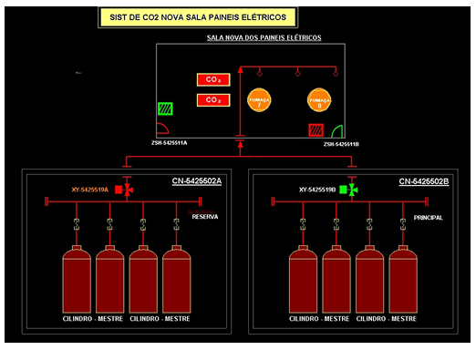

# Experimento 9 - Combate a incêndio com CO2 em sala de CCM

## Descrição do projeto

Sistema de combate a incêndio de sala de centro de controle de motores (CCM) (https://pt.wikipedia.org/wiki/Centro_de_Controle_de_Motores) 

Em uma plataforma de petróleo uma sala de CCM possui o seguinte sistema de combate a incêndios: A sala possui uma porta que é hermeticamente fechada e tem fechamento por mola.  

O funcionamento do sistema é da seguinte maneira: 

1. Existem dois sensores de fumaça (DS-1223551 e DS-1223552) se ambos estiverem acionados então gera alarme ESD2. 108 

2. Por uma chave manual (HS-5425510) seleciona-se a bateria de CO2 ativa, ou seja, se HS-5425510 =1 então a bateria CN-5425502A está selecionada, HS-5425510 =0 então a bateria CN-5425502B está selecionada. 

3. A sala possui um sistema de ar condicionado que funciona da seguinte maneira: 

    a. A saída AC-525231-A aciona o ar condicionado A e a saída AC-525231-B aciona o ar condicionado B 
  
    b. Para AC-525231-A = 0 o ar condicionado A desliga para AC-525231-B = 0 o ar condicionado B desliga 
  
    c. Existem dois dampers (A e B) cujos sensores de aberto são respectivamente ZSH-5252511-A e ZSH-5252511-B (sendo que quando o ZSH-5252511-A =1 ou ZSH-5252511-B = 1 então damper aberto). Esses dampers funcionam com o ar condicionado sendo que AC-525231-A ao ser acionado abre ZSH5252511-A e  AC-525231-B ao ser acionado abre ZSH-5252511-B 
  
    d. Caso um damper não abra em até 10 segundos após o seu respectivo ar condicionado ser acionado então se gera um alarme de divergência ZSH5252511-A_ALR ou ZSH-5252511-B_ALR 

4. Existem duas válvulas que abrem o reservatório de CO2  -  XV-5425519-A e XV5425519-B que funcionam da seguinte maneira: 

    i. Apenas um conjunto pode ser acionado de cada vez, para HS-5425510 =1 é possível acionar a XV-5425519-A e respectivamente para HS-5425510 =0 é possível acionar a XV-5425519-B 
  
    ii. As válvulas de CO2 abrem seguindo a lógica: ESD2 =1 ou HS-5425506 (BOTOEIRA LOCAL DE DISPARO DE CO2(quebrar o vidro)) então = [aciona os seguintes equipamentos DY-525201(fecha damper) e DY-525202(fecha damper) e YA-5425515(ALARME SONORO) e YB-5425517-B(ALARME VISUAL)  AC525231-A = 0 e AC-525231-B = 0]; após 30s abre a válvula de CO2  

### Como o sistema funciona

1. **Detecção:** dois sensores de fumaça (`DS_1223551` e `DS_1223552`). Os dois acionados geram o alarme **ESD2**.
2. **Seleção da bateria:** a chave `HS_5425510` escolhe a bateria de CO2 (1 = bateria A, 0 = bateria B).
3. **Ar condicionado e dampers:** cada ar condicionado tem um damper com sensor de aberto. Se o damper não abrir em **10 s**, gera-se um alarme de divergência.
4. **Disparo:** ESD2 ou a botoeira local `HS_5425506` (quebrar o vidro) provocam, de imediato, o fechamento dos dampers de exaustão, os alarmes sonoro e visual e o desligamento dos dois ar condicionados.
5. **Descarga:** **30 s** depois do disparo abre a válvula de CO2 da bateria selecionada. Só uma válvula pode abrir por vez.

### Simulador

O simulador reproduz o programa rung a rung, com contatos e bobinas que acendem quando conduzem, e os temporizadores correndo.

Baixe o repositório e abra o [simulador](<https://mitoedson.github.io/Automacao-de-Sistemas-Industriais/simulador/simulacao_ccm_co2.html)>) no navegador. É um arquivo único, sem dependências.

**O que testar nele**

- Botão *Simular incêndio* (aciona os dois sensores) e observe o disparo, o atraso de 30 s e a abertura da válvula.
- Ligar um sensor só: não deve haver ESD2.
- Trocar `HS_5425510` antes do disparo e ver qual válvula abre.
- Marcar *Falha damper A* ou *B*, ligar o ar condicionado e esperar o alarme de divergência após 10 s.
- Velocidade 5× para acelerar os temporizadores.

### Lista de IO (CPU 1214C DC/DC/DC)

Os endereços são uma sugestão. Confira com a fiação do seu kit.

#### Entradas

| Endereço | Tag | Descrição |
|---|---|---|
| `%I0.0` | `DS_1223551` | Sensor de fumaça 1 |
| `%I0.1` | `DS_1223552` | Sensor de fumaça 2 |
| `%I0.2` | `HS_5425510` | Seletora de bateria (1 = A, 0 = B) |
| `%I0.3` | `HS_5425506` | Botoeira de disparo de CO2 |
| `%I0.4` | `ZSH_5252511_A` | Damper A aberto |
| `%I0.5` | `ZSH_5252511_B` | Damper B aberto |
| `%I0.6` | `LIGA_AC_A` * | Liga ar condicionado A |
| `%I0.7` | `LIGA_AC_B` * | Liga ar condicionado B |
| `%I1.0` | `RESET` * | Rearme do disparo |

#### Saídas

| Endereço | Tag | Descrição |
|---|---|---|
| `%Q0.0` | `AC_525231_A` | Ar condicionado A |
| `%Q0.1` | `AC_525231_B` | Ar condicionado B |
| `%Q0.2` | `XV_5425519_A` | Válvula de CO2, bateria A |
| `%Q0.3` | `XV_5425519_B` | Válvula de CO2, bateria B |
| `%Q0.4` | `DY_525201` | Fecha damper A |
| `%Q0.5` | `DY_525202` | Fecha damper B |
| `%Q0.6` | `YA_5425515` | Alarme sonoro |
| `%Q0.7` | `YB_5425517_B` | Alarme visual |
| `%Q1.0` | `ZSH_5252511_A_ALR` | Divergência do damper A |
| `%Q1.1` | `ZSH_5252511_B_ALR` | Divergência do damper B |

#### Memórias e temporizadores

| Endereço / DB | Uso |
|---|---|
| `%M0.0` (`ESD2`) | Dois sensores de fumaça acionados |
| `%M0.1` (`DISPARO`) | Disparo selado (ESD2 ou botoeira) |
| `T1_Atraso_CO2` | TON, `PT = T#30s` |
| `T2_Damper_A` | TON, `PT = T#10s` |
| `T3_Damper_B` | TON, `PT = T#10s` |

\* Sinais **acrescentados**, pois o enunciado não diz quem comanda o ar condicionado nem como o disparo é rearmado.

#### Programa ladder (resumo das 12 networks)

| # | Função | Lógica |
|---|---|---|
| 1 | ESD2 | `DS_1223551` E `DS_1223552` energizam `%M0.0` |
| 2 | Disparo com selo | (`ESD2` OU `HS_5425506` OU `DISPARO`) E NÃO `RESET` energizam `%M0.1` |
| 3 | Ações imediatas | `DISPARO` liga `DY_525201`, `DY_525202`, `YA_5425515`, `YB_5425517_B` |
| 4 | Atraso de 30 s | `DISPARO` aciona o TON `T1_Atraso_CO2` |
| 5 | Válvula A | `T1.Q` E `HS_5425510` E NÃO `XV_5425519_B` energizam `XV_5425519_A` |
| 6 | Válvula B | `T1.Q` E NÃO `HS_5425510` E NÃO `XV_5425519_A` energizam `XV_5425519_B` |
| 7 | Ar condicionado A | `LIGA_AC_A` E NÃO `DISPARO` energizam `AC_525231_A` |
| 8 | Ar condicionado B | `LIGA_AC_B` E NÃO `DISPARO` energizam `AC_525231_B` |
| 9 | Tempo do damper A | `AC_525231_A` E NÃO `ZSH_5252511_A` aciona o TON `T2_Damper_A` |
| 10 | Alarme A | `T2.Q` energiza `ZSH_5252511_A_ALR` |
| 11 | Tempo do damper B | `AC_525231_B` E NÃO `ZSH_5252511_B` aciona o TON `T3_Damper_B` |
| 12 | Alarme B | `T3.Q` energiza `ZSH_5252511_B_ALR` |

Os diagramas desenhados de cada network estão no [guia em PDF](Guia_9_Trabalho_CO2_CCM_S7-1200.pdf), seção 6.

#### Como replicar no TIA Portal

1. Crie o projeto e adicione a CPU S7-1200 idêntica à do módulo (confira a referência e o firmware).
2. Ajuste o IP da CPU na mesma faixa do PC.
3. Cadastre as tags da lista de IO na tabela de tags padrão.
4. No `Main [OB1]`, monte as 12 networks em LAD. Para os TON, escolha *Single instance* e renomeie os DBs como na tabela acima.
5. Compile, carregue na CPU (ou no S7-PLCSIM) e monitore online.

O passo a passo completo e o roteiro de 10 testes estão no PDF.

#### Decisões de projeto e limitações

- **Selo do disparo:** uma vez disparado, o sistema só é liberado por `RESET`. Isso evita cancelar a descarga se a fumaça sumir durante os 30 s. Para a versão literal do enunciado, remova o selo e o `RESET` da network 2.
- **Porta da sala:** os sensores `ZSH-5425511A/B` aparecem na figura do enunciado, mas não no texto, e **não foram usados**.
- **Troca de bateria durante a descarga:** o programa acompanha `HS_5425510` em tempo real, então trocar a chave com a válvula aberta troca a válvula selecionada. Memorizar a escolha no instante do disparo é uma melhoria possível.
- **Dampers no simulador:** por padrão, o simulador abre o damper junto com o ar condicionado correspondente. Desmarque a opção para acioná-los manualmente.
- **Endereços:** sugeridos para a CPU 1214C DC/DC/DC. Ajuste conforme o kit do laboratório.

### Recursos

| Material | O que é | Link |
|---|---|---|
| Guia em PDF | Passo a passo para replicar o experimento: IO, TIA Portal, ladder, testes e solução de problemas | [`Guia_9_Trabalho_CO2_CCM_S7-1200.pdf`](Guia_9_Trabalho_CO2_CCM_S7-1200.pdf) |
| Simulador em HTML | Simulação interativa da lógica no navegador, sem precisar de CLP | [`simulador/simulacao_ccm_co2.html`](https://mitoedson.github.io/Automacao-de-Sistemas-Industriais/simulador/simulacao_ccm_co2.html) |

### Créditos

Baseado no roteiro do **9º Trabalho de Laboratório** da Universidade Federal do ABC (UFABC). O texto do enunciado original pertence aos seus autores. Este repositório contém a solução, o guia e o simulador desenvolvidos pela equipe.
