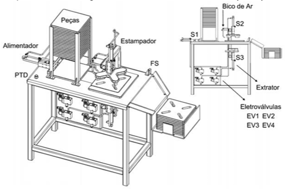

# Experimento 10 — Estampagem de peças plásticas




## Enunciado

Um equipamento para estampar peças plásticas é formado por um dispositivo de carregamento de peças (por gravidade), um cilindro 1 (alimentador), um cilindro 2 (estampador) e um cilindro 3 (extrator). Todos os três cilindros são de ação simples com retorno por mola, e têm seu avanço comandado pelas eletroválvulas EV1, EV2 e EV3 respectivamente.

A máxima excursão de cada cilindro é monitorada pela atuação dos sensores S1, S2 e S3 do tipo reed-switch. A expulsão da peça é realizada por um sopro de ar comprimido, obtido a partir do acionamento da eletroválvula EV4, e efetivamente monitorada pela atuação do fotossensor (FS).

O funcionamento prevê como condição inicial que os cilindros não estejam avançados, ou seja, essa condição traduz que todas as eletroválvulas estejam desligadas.

Assim, com a chave de partida (PTD) acionada e estando a máquina na condição inicial, deve-se iniciar a operação. A seqüência consiste em, primeiramente, colocar uma peça no molde, recuar o êmbolo do cilindro alimentador, prensar o estampo sobre a peça (deve-se aguardar um tempo de dois segundos com a peça sendo prensada), atuar o extrator e o bico de ar para retirada da peça pronta.


## Desenvolvimento do experimento

### 1. Descrição do processo

O equipamento tem um alimentador (cilindro 1), um estampador (cilindro 2) e um extrator (cilindro 3). Todos são de ação simples com retorno por mola e avançam pelas eletroválvulas EV1, EV2 e EV3. A expulsão da peça é feita por um sopro de ar (EV4) e confirmada pelo fotossensor FS.

O ciclo só parte com a chave PTD acionada, o botão de emergência liberado e a máquina na condição inicial (todas as eletroválvulas desligadas e S1, S2 e S3 em 0). A sequência é:

1. O alimentador avança (EV1) até acionar S1, colocando a peça no molde.
2. O alimentador recua (EV1 desliga) até S1 = 0.
3. O estampador avança (EV2) até S2 e prensa a peça por 2 s.
4. O estampador recua até S2 = 0.
5. O extrator avança (EV3) até S3.
6. O bico de ar (EV4) é acionado até o fotossensor FS confirmar a expulsão da peça.
7. EV3 e EV4 desligam, o extrator recua até S3 = 0 e a máquina volta à condição inicial.

**Emergência e falhas.** Ao pressionar o botão de emergência (EME), todas as etapas são desativadas e todas as eletroválvulas desligam. Como os cilindros têm retorno por mola, a máquina vai ao estado seguro. A máquina só volta à condição inicial depois que EME é liberado **e** PTD é desligada (rearme consciente, para não partir sozinha). Um temporizador de supervisão do ciclo leva ao mesmo estado de emergência se o ciclo demorar mais do que o esperado, por exemplo se um sensor falhar.

### 2. Entradas

| Endereço | TAG | Descrição |
|---|---|---|
| %I0.0 | PTD | Chave de partida |
| %I0.1 | S1 | Reed-switch, alimentador avançado |
| %I0.2 | S2 | Reed-switch, estampador avançado |
| %I0.3 | S3 | Reed-switch, extrator avançado |
| %I0.4 | FS | Fotossensor, peça expulsa |
| %I0.5 | EME | Botão de emergência, contato NF (1 = normal, 0 = pressionado ou fio rompido) |

### 3. Saídas

| Endereço | TAG | Descrição |
|---|---|---|
| %Q0.0 | EV1 | Avanço do alimentador |
| %Q0.1 | EV2 | Avanço do estampador |
| %Q0.2 | EV3 | Avanço do extrator |
| %Q0.3 | EV4 | Bico de ar |

### 4. Outros recursos

| Recurso | TAG | Descrição |
|---|---|---|
| %M0.0 | ETAPA_0 | Repouso (condição inicial) |
| %M0.1 | ETAPA_1 | Alimentador avançando |
| %M0.2 | ETAPA_2 | Alimentador recuando |
| %M0.3 | ETAPA_3 | Estampador avançando |
| %M0.4 | ETAPA_4 | Prensagem (2 s) |
| %M0.5 | ETAPA_5 | Estampador recuando |
| %M0.6 | ETAPA_6 | Extrator avançando |
| %M0.7 | ETAPA_7 | Extrator avançado e sopro de ar |
| %M1.0 | ETAPA_8 | Extrator recuando |
| %M1.1 | EMERG | Estado de emergência ou falha (memorizado) |
| %M1.2 | M_PTD_P | Bit auxiliar de borda de PTD (só para a variante de ciclo único) |
| DB "T_PRENSA" | T_PRENSA | TON, PT = T#2s (prensagem) |
| DB "T_CICLO" | T_CICLO | TON, PT = T#20s (supervisão do ciclo, ajustável) |
| FirstScan | FirstScan | Bit de primeiro ciclo da memória de sistema da CPU |

### 5. Configuração no TIA Portal

1. Nas propriedades da CPU, em *Geral → Memória de sistema e de clock*, habilite a memória de sistema. Por padrão ela usa o MB1, e o bit `FirstScan` fica em %M1.0. Cadastre esse bit na tabela de tags com o nome `FirstScan`.
2. Os bytes MB0 (clock) e MB1 (sistema) ficam reservados, e por isso as etapas usam MB10 e MB11.
3. Cadastre todas as tags das seções 2, 3 e 4 na tabela de tags padrão.
4. Insira dois blocos TON (`T_PRENSA` e `T_CICLO`) com instâncias de DB individuais, como DB de instância única ou múltipla.
5. A instrução TON deve ser chamada a cada varredura, em uma network própria, como nos exemplos abaixo.

### 6. Código ladder

Legenda: `] [` contato NA, `]/[` contato NF, `( )` bobina, `( S )` set, `( R )` reset. As etapas usam bobinas Set/Reset: cada transição liga a etapa seguinte e desliga a atual. Cada bloco abaixo deve ser montado em uma network do TIA Portal, na ordem apresentada. A emergência e o rearme ficam antes das transições para terem prioridade na varredura.

```
NETWORK 1 – Inicialização
   "FirstScan"                  "ETAPA_0"
 |----] [------+----------------( S )
               |                "ETAPA_1"
               +----------------( R )
               |                "ETAPA_2" ... "ETAPA_8"
               +----------------( R )    (bobinas R em paralelo)

NETWORK 2 – Supervisão do tempo de ciclo
ETAPA_0=Reset, e EMERG (%M1.1)=0, aciona contador de 20s
 
   "ETAPA_0"   "EMERG"
 |----]/[-------]/[------------[ "T_CICLO" TON  IN  Q ]
                                     PT := T#20s

NETWORK 3 – Emergência (EME pressionado) ou falha (tempo de ciclo excedido)
Entrada EME=0 ou "T_CICLO".Q=1, então EMERG=Set, ETAPA_0=Reset, ETAPA_1...ETAPA_8=Reset

   "EME"                    "EMERG"
 |----]/[---------+----------( S )
                  |         "ETAPA_0"
   "T_CICLO".Q    +----------( R )
 |----] [---------+         "ETAPA_1" ... "ETAPA_8"
                  +----------( R )  (bobinas R em paralelo)

NETWORK 4 – Rearme: EME liberado e PTD desligada
   "EMERG"   "EME"     "PTD"          "EMERG"
 |----] [-----] [------]/[------+------( R )
                                   |  "ETAPA_0"
                                   +---( S )

NETWORK 5 – Partida: PTD acionada, sem emergência e cilindros recuados
   "ETAPA_0"  "PTD"   "EME"  "EMERG"  "S1"    "S2"    "S3"        "ETAPA_1"
 |----] [------] [-----] [-----]/[-----]/[-----]/[-----]/[-----+---( S )
                                                               |   "ETAPA_0"
                                                               +---( R )

NETWORK 6 – Alimentador avançou (S1)
   "ETAPA_1"   "S1"                    "ETAPA_2"
 |----] [------] [---------+-----------( S )
                           |           "ETAPA_1"
                           +-----------( R )

NETWORK 7 – Alimentador recuou (S1 = 0)
   "ETAPA_2"   "S1"                    "ETAPA_3"
 |----] [------]/[---------+-----------( S )
                           |           "ETAPA_2"
                           +-----------( R )

NETWORK 8 – Estampador avançou (S2)
   "ETAPA_3"   "S2"                    "ETAPA_4"
 |----] [------] [---------+-----------( S )
                           |           "ETAPA_3"
                           +-----------( R )

NETWORK 9 – Fim da prensagem de 2 s
   "ETAPA_4"   "T_PRENSA".Q            "ETAPA_5"
 |----] [------] [---------+-----------( S )
                           |           "ETAPA_4"
                           +-----------( R )

NETWORK 10 – Estampador recuou (S2 = 0)
   "ETAPA_5"   "S2"                    "ETAPA_6"
 |----] [------]/[---------+-----------( S )
                           |           "ETAPA_5"
                           +-----------( R )

NETWORK 11 – Extrator avançou (S3)
   "ETAPA_6"   "S3"                    "ETAPA_7"
 |----] [------] [---------+-----------( S )
                           |           "ETAPA_6"
                           +-----------( R )

NETWORK 12 – Peça expulsa (FS)
   "ETAPA_7"   "FS"                    "ETAPA_8"
 |----] [------] [---------+-----------( S )
                           |           "ETAPA_7"
                           +-----------( R )

NETWORK 13 – Extrator recuou (S3 = 0), volta ao repouso
   "ETAPA_8"   "S3"                    "ETAPA_0"
 |----] [------]/[---------+-----------( S )
                           |           "ETAPA_8"
                           +-----------( R )

NETWORK 14 – Temporizador da prensagem
   "ETAPA_4"
 |----] [---------------[ "T_PRENSA" TON  IN  Q ]
                            PT := T#2s

NETWORK 15 – EV1 (alimentador)
   "ETAPA_1"     "EME"              "EV1"
 |----] [---------] [---------------( )

NETWORK 16 – EV2 (estampador)
   "ETAPA_3"
 |----] [--+------+------] [--------( ) "EV2"
   "ETAPA_4"      |    "EME"
 |----] [--+------+

NETWORK 17 – EV3 (extrator)
   "ETAPA_6"
 |----] [--+------+------] [--------( ) "EV3"
   "ETAPA_7"      |    "EME"
 |----] [--+------+

NETWORK 18 – EV4 (bico de ar)
   "ETAPA_7"     "EME"              "EV4"
 |----] [---------] [---------------( )
```

Nas networks 15 a 18, o contato de EME em série em cada saída é uma segunda barreira: as eletroválvulas desligam mesmo que alguma etapa fique ativa por erro de programação.

### 7. Observações e teste

- **Ciclo único.** Se PTD continuar acionada no fim do ciclo, a máquina reinicia sozinha. Para ciclo único, na network 5 troque o contato `"PTD"` por um contato de borda de subida `P` com o bit auxiliar `"M_PTD_P"`. O rearme da network 4 continua exigindo PTD desligada.
- **Prensagem.** O tempo de 2 s é o `"T_PRENSA"`, que só conta na etapa 4, com EV2 mantida acionada.
- **Supervisão.** O `"T_CICLO"` (20 s) deve ser maior que o ciclo normal mais lento. Ajuste o `PT` depois de medir o ciclo. Para supervisão por etapa, que localiza a falha com mais precisão, use um TON por etapa de espera (por exemplo 5 s) e some todos os `.Q` na network 3.
- **Reset em bloco.** Nas networks 1 e 3, no lugar das bobinas R em paralelo você pode usar `RESET_BF` para ETAPA_1 a ETAPA_7 (`%M10.1`, N = 7), que ficam no mesmo byte, e uma bobina R separada para ETAPA_8 (`%M11.0`).
- **Sinalização opcional.** Uma lâmpada em `"EMERG"` ajuda o operador a saber que a máquina está em emergência ou falha.
- **Segurança.** O botão de emergência real deve ser cabeado também em hardware (relé de segurança cortando a alimentação das válvulas). O ladder acima sinaliza a emergência e organiza o rearme, mas não substitui a proteção exigida pela NR-12 e pela ISO 13850.
- **Teste no PLCSIM**, forçando as entradas na tabela de monitoramento:
  1. Ciclo normal: ligue EME (1) e PTD, depois S1 (liga e desliga), S2 (liga, aguarde 2 s e desligue), S3 (liga), FS e por fim S3 desligando. A cada passo, a saída correspondente deve acender ou apagar.
  2. Emergência: em cada etapa, ponha EME em 0. Todas as saídas devem apagar e a máquina não deve religar ao soltar EME com PTD ligada.
  3. Rearme: libere EME e desligue PTD. A máquina volta à ETAPA_0, e só parte com um novo acionamento de PTD.
  4. Falha: inicie o ciclo e não acione S1. Após 20 s, `"EMERG"` deve acionar e as saídas desligar.