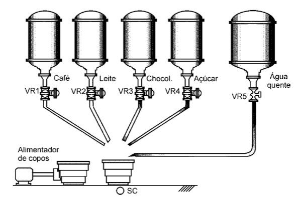

# Experimento 11 — Máquina dispensadora de bebidas quentes

Trata-se de uma máquina dispensadora de bebidas quentes que pode fornecer as seguintes opções ao usuário: B1 - café puro, B2 - café com leite e B3 - chocolate quente, escolhida por uma chave seletora (B) de três posições.

O sistema é dotado de cinco reservatórios: R1 - café solúvel, R2 - leite em pó, R3 - chocolate, R4 - açúcar e R5 - água quente.  A dosagem de cada produto no copo descartável é feita pela abertura temporizada de válvulas VR1, VR2, VR3, VR4 e VR5 respectivamente.

Há também um dispositivo eletromecânico (AC) para alimentação de copo descartável, o qual posiciona corretamente apenas um copo a cada vez que for atuado. O sistema prevê ainda três níveis de liberação de açúcar: A1 - amargo, A2 - doce, A3 - extradoce, ajustado por uma chave seletora (A) de três posições.

Como condição inicial de funcionamento, um copo deve ser posicionado corretamente, o qual é monitorado pelo sensor SC. Como condição de finalização, o copo cheio deve ser retirado. 49 Assim, com a condição inicial satisfeita, um nível de açúcar e um tipo de bebida pré-selecionados, com o pressionar da botoeira de partida inicia-se o processo de preparo pela abertura temporizada das eletroválvulas. 

Primeiro ocorre a liberação de açúcar com os tempos de abertura de VR4 por 4 segundos para doce, 6 segundos para extradoce e sem liberação para amargo. Após o que, inicia-se então o preparo de uma das seguintes receitas (cada uma com as dosagens na ordem exata em que são apresentadas): Café puro: 3 segundos de café e 5 segundos de água quente. Café com leite: 2 seg. de café, 3 seg. de leite e 7 seg. de água quente. Chocolate: 2 seg. de leite, 3 seg. de chocolate e 6 seg. de água quente. 