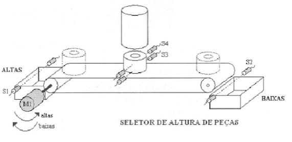

# Experimento 12 — Seletora de peças 



Você foi contratado para fazer a programação de um novo equipamento adquirido. A máquina é uma seletora de peças e sua programação funciona da seguinte forma: Ao pressionar o botão de START uma peça cai no meio da esteira, após 2 segundos para estabilizar a peça os sensores S4 e S3 verificam a altura da peça e as separa entre altas e baixas.

Quando a peça passar pelo sensor da caixa apropriado o ciclo finaliza e a esteira para, dando condição para um novo ciclo. A lâmpada liga quando o ciclo estiver em funcionamento e o botão STOP finaliza o ciclo. Crie uma lista de entradas e saídas para esse processo e faça a programação em ladder. Observe que o motor da esteira gira para duas direções. 

## Desenvolvimento: Seletora de peças por altura

Máquina seletora de peças. Ao pressionar o botão START, uma peça cai no meio da esteira. Após 2 s para estabilizar, os sensores S4 e S3 verificam a altura da peça e a separam entre altas e baixas. Quando a peça passa pelo sensor da caixa apropriada, o ciclo termina e a esteira para, dando condição para um novo ciclo. A lâmpada liga quando o ciclo está em funcionamento e o botão STOP finaliza o ciclo. O motor da esteira gira nos dois sentidos.

## 1. Descrição do processo

**Hipóteses adotadas**

- S3 fica na altura da peça baixa e S4 na altura da peça alta. Peça baixa: S3 = 1 e S4 = 0. Peça alta: S3 = 1 e S4 = 1.
- S1 é o sensor da caixa de ALTAS e S2 o da caixa de BAIXAS.
- STOP e EME são normalmente fechados (0 quando pressionados).
- A queda da peça é comandada por uma saída (Y_PECA) e termina quando S3 detecta a peça.

**Sequência**

1. START solta a peça (Y_PECA) até S3 detectá-la.
2. Aguarda 2 s de estabilização.
3. S4 = 1 (peça alta): esteira no sentido ALTAS até S1. S4 = 0 (peça baixa): esteira no sentido BAIXAS até S2.
4. O motor para e o ciclo termina. A lâmpada fica ligada durante todo o ciclo.

**STOP** finaliza o ciclo e volta ao repouso. **Emergência (EME)** desativa todas as etapas e desliga todas as saídas. Um temporizador de supervisão do ciclo leva ao mesmo estado se o ciclo demorar mais do que o esperado. O rearme exige EME liberado e START solto.

## 2. Entradas

| Endereço | TAG | Descrição |
|---|---|---|
| %I0.0 | START | Botão de partida (NA) |
| %I0.1 | STOP | Botão de parada (NF) |
| %I0.2 | S1 | Peça na caixa de altas |
| %I0.3 | S2 | Peça na caixa de baixas |
| %I0.4 | S3 | Sensor de altura inferior (presença de peça) |
| %I0.5 | S4 | Sensor de altura superior (peça alta) |
| %I0.6 | EME | Botão de emergência (NF) |

## 3. Saídas

| Endereço | TAG | Descrição |
|---|---|---|
| %Q0.0 | M1_ALTAS | Motor da esteira, sentido altas |
| %Q0.1 | M1_BAIXAS | Motor da esteira, sentido baixas |
| %Q0.2 | LAMP | Lâmpada de ciclo em funcionamento |
| %Q0.3 | Y_PECA | Libera a queda da peça |

## 4. Outros recursos

| Recurso | TAG | Descrição |
|---|---|---|
| %M10.0 | ETAPA_0 | Repouso |
| %M10.1 | ETAPA_1 | Peça caindo na esteira |
| %M10.2 | ETAPA_2 | Estabilização da peça (2 s) |
| %M10.3 | ETAPA_3 | Esteira levando a peça alta |
| %M10.4 | ETAPA_4 | Esteira levando a peça baixa |
| %M10.5 | EMERG | Emergência ou falha (memorizado) |
| DB "T_ESTAB" | T_ESTAB | TON, PT = T#2s |
| DB "T_CICLO" | T_CICLO | TON, PT = T#20s (supervisão do ciclo, ajustável) |
| FirstScan | FirstScan | Bit de primeiro ciclo da memória de sistema da CPU |

## 5. Configuração no TIA Portal

1. Nas propriedades da CPU, em *Geral → Memória de sistema e de clock*, habilite a memória de sistema (por padrão MB1, com `FirstScan` em %M1.0) e cadastre o bit como `FirstScan`. MB0 e MB1 ficam reservados, por isso as etapas usam MB10.
2. Cadastre as tags das seções 2, 3 e 4 na tabela de tags.
3. Insira dois blocos TON ("T_ESTAB" e "T_CICLO") com DB de instância, chamados a cada varredura em networks próprias.

## 6. Código ladder

Legenda: `] [` contato NA, `]/[` contato NF, `( )` bobina, `( S )` set, `( R )` reset. Monte cada bloco em uma network, na ordem apresentada. A emergência, o STOP e o rearme ficam antes das transições para terem prioridade na varredura.

```
NETWORK 1 – Inicialização
   "FirstScan"                      "ETAPA_0"
 |----] [------+-------------------( S )
                |                   "ETAPA_1" ... "ETAPA_4"
                +-------------------( R )    (bobinas R em paralelo)

NETWORK 2 – Supervisão do tempo de ciclo
   "ETAPA_0"      "EMERG"
 |----]/[---------]/[---------------[ "T_CICLO" TON  IN  Q ]
                                       PT := T#20s

NETWORK 3 – Emergência (EME pressionado) ou falha (tempo de ciclo excedido)
   "EME"                            "EMERG"
 |----]/[---------+-----------------( S )
                  |                 "ETAPA_0" ... "ETAPA_4"
   "T_CICLO".Q    +-----------------( R )    (bobinas R em paralelo)
 |----] [---------+

NETWORK 4 – Rearme: EME liberado e START solto
   "EMERG"   "EME"     "START"                "EMERG"
 |----] [-----] [------]/[---------+---------( R )
                                   |         "ETAPA_0"
                                   +---------( S )

NETWORK 5 – STOP: finaliza o ciclo (STOP é NF, então 0 = pressionado)
   "STOP"    "EMERG"                          "ETAPA_0"
 |----]/[-----]/[-------------------+---------( S )
                                     |         "ETAPA_1" ... "ETAPA_4"
                                     +---------( R )    (bobinas R em paralelo)

NETWORK 6 – START: solta a peça
   "ETAPA_0"  "START"  "STOP"                 "ETAPA_1"
 |----] [------] [------] [----------+--------( S )
                                      |        "ETAPA_0"
                                      +--------( R )

NETWORK 7 – Peça chegou ao meio da esteira (S3)
   "ETAPA_1"   "S3"                    "ETAPA_2"
 |----] [------] [---------+-----------( S )
                           |           "ETAPA_1"
                           +-----------( R )

NETWORK 8 – Após 2 s, peça alta (S4 = 1) → sentido altas
   "ETAPA_2"  "T_ESTAB".Q  "S4"        "ETAPA_3"
 |----] [------] [---------] [----+----( S )
                                   |    "ETAPA_2"
                                   +----( R )

NETWORK 9 – Após 2 s, peça baixa (S4 = 0) → sentido baixas
   "ETAPA_2"  "T_ESTAB".Q  "S4"        "ETAPA_4"
 |----] [------] [---------]/[----+----( S )
                                   |    "ETAPA_2"
                                   +----( R )

NETWORK 10 – Peça chegou à caixa de altas (S1): fim do ciclo
   "ETAPA_3"   "S1"                    "ETAPA_0"
 |----] [------] [---------+-----------( S )
                           |           "ETAPA_3"
                           +-----------( R )

NETWORK 11 – Peça chegou à caixa de baixas (S2): fim do ciclo
   "ETAPA_4"   "S2"                    "ETAPA_0"
 |----] [------] [---------+-----------( S )
                           |           "ETAPA_4"
                           +-----------( R )

NETWORK 12 – Temporizador de estabilização
   "ETAPA_2"
 |----] [---------------[ "T_ESTAB" TON  IN  Q ]
                            PT := T#2s

NETWORK 13 – Libera a peça
   "ETAPA_1"     "EME"              "Y_PECA"
 |----] [---------] [---------------( )

NETWORK 14 – Motor, sentido altas (com intertravamento)
   "ETAPA_3"  "M1_BAIXAS"  "EME"      "M1_ALTAS"
 |----] [------]/[---------] [--------( )

NETWORK 15 – Motor, sentido baixas (com intertravamento)
   "ETAPA_4"  "M1_ALTAS"   "EME"      "M1_BAIXAS"
 |----] [------]/[---------] [--------( )

NETWORK 16 – Lâmpada: ligada durante todo o ciclo
   "ETAPA_0"   "EMERG"                "LAMP"
 |----]/[-------]/[-------------------( )
```

## 7. Observações e teste

- Os contatos `]/[ "M1_BAIXAS"` e `]/[ "M1_ALTAS"` são o intertravamento em software entre os dois sentidos. Na bancada, acrescente também o intertravamento elétrico entre os contatores.
- A network 5 (STOP) tem a guarda `]/[ "EMERG"` para que o STOP não cancele um estado de emergência.
- O `"T_CICLO"` (20 s) deve ser maior que o ciclo normal mais lento. Ajuste o `PT` depois de medir o ciclo.
- O botão de emergência real deve ser cabeado também em hardware (relé de segurança cortando a alimentação do motor). O ladder sinaliza a emergência e organiza o rearme, mas não substitui a proteção exigida pela NR-12 e pela ISO 13850.
- **Teste no PLCSIM**, forçando as entradas:
  1. Ciclo normal, peça alta: STOP e EME em 1, START, S3 em 1 e S4 em 1, aguarde 2 s e confira Q0.0. Ligue S1 e confira o fim do ciclo.
  2. Peça baixa: repita com S4 em 0 e confira Q0.1 e S2.
  3. STOP no meio do ciclo (STOP em 0): tudo para e a lâmpada apaga.
  4. Emergência (EME em 0), rearme (EME em 1 e START solto) e falha (não acione S3 e aguarde 20 s).

  
### Recursos

| Guia em PDF | 
| [Simulador em HTML](https://mitoedson.github.io/Automacao-de-Sistemas-Industriais/simulador/simulacao_seletora-pecas.html) |
