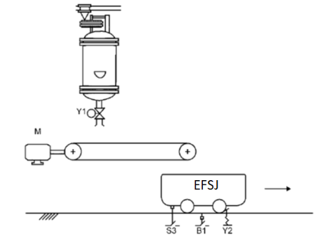

# Experimento 13 — Carregamento de vagões 



Um sistema para carregamento de vagões é composto pelos seguintes elementos: uma esteira acionada pelo motor M, uma eletroválvula Y1 para permitir saída de produtos do silo, um sensor S3 para detectar a presença de um vagão, um sensor balança B1 para indicar que o vagão está cheio e uma trava de vagão Y2, cujo destravamento é feito por eletroímã. A partir de um comando de partida (PTD), o sistema estará pronto para funcionar.

Com a chegada do primeiro vagão (indicado por S3), é acionado o motor da esteira, sendo que só será desligado após o último vagão ser carregado. A identificação do último vagão é feita por uma supervisão de tempo (15s) contado após a saída do vagão previamente carregado. Com o correto posicionamento do vagão e não estando cheio, tem início o seu enchimento dado pela abertura de Y1.

O travamento dos vagões na posição correta é feito por um atuador mecânico pela força de uma mola, e o seu destravamento exige a atuação elétrica do eletroímã Y2. Após o enchimento do vagão, fecha-se a eletroválvula e aguardam-se 7 segundos para o esvaziamento da esteira. A partir deste instante, o vagão é destravado. Crie uma lista de entradas e saídas para esse processo e faça a programação em ladder. 

## Desenvolvimento: Carregamento de vagões

Um sistema para carregamento de vagões é composto por uma esteira acionada pelo motor M, uma eletroválvula Y1 que permite a saída de produtos do silo, um sensor S3 para detectar a presença de um vagão, um sensor balança B1 que indica vagão cheio e uma trava de vagão Y2, cujo destravamento é feito por eletroímã.

## 1. Descrição do processo

1. Com a chave PTD acionada, o sistema fica pronto. A chegada do primeiro vagão (S3 = 1) liga a esteira, que só desliga depois do último vagão carregado.
2. O último vagão é identificado por uma supervisão de 15 s contada a partir da saída do vagão carregado. Se nenhum novo vagão chegar nesse tempo, a esteira desliga.
3. Com o vagão posicionado e não cheio, Y1 abre e inicia o enchimento.
4. Quando B1 indica vagão cheio, Y1 fecha e aguardam-se 7 s para o esvaziamento da esteira.
5. Em seguida, o eletroímã Y2 é energizado e destrava o vagão. A trava mecânica por mola só volta a segurar o próximo vagão quando Y2 é desligado, o que ocorre após a saída do vagão carregado.

**Emergência.** Ao pressionar o botão de emergência (EME), a esteira, Y1 e Y2 desligam. Com Y2 desligado, a trava mecânica segura o vagão na posição. Ao liberar EME, o sistema retoma sozinho conforme o estado dos sensores, desde que PTD continue acionada.

## 2. Entradas

| Endereço | TAG | Descrição |
|---|---|---|
| %I0.0 | PTD | Comando de partida (chave) |
| %I0.1 | S3 | Sensor de presença de vagão |
| %I0.2 | B1 | Balança, vagão cheio |
| %I0.3 | EME | Botão de emergência, contato NF (1 = normal, 0 = pressionado ou fio rompido) |

## 3. Saídas

| Endereço | TAG | Descrição |
|---|---|---|
| %Q0.0 | M | Motor da esteira |
| %Q0.1 | Y1 | Eletroválvula de saída do silo |
| %Q0.2 | Y2 | Eletroímã de destravamento do vagão |

## 4. Outros recursos

| Recurso | TAG | Descrição |
|---|---|---|
| %M10.0 | CHEIO | Vagão atual já carregado (memorizado até o vagão sair) |
| DB "T_ESVAZ" | T_ESVAZ | TON, PT = T#7s (esvaziamento da esteira) |
| DB "T_ULTIMO" | T_ULTIMO | TON, PT = T#15s (supervisão do último vagão) |

Este programa não usa etapas Set/Reset nem o bit `FirstScan`.

## 5. Configuração no TIA Portal

1. Cadastre as tags das seções 2, 3 e 4 na tabela de tags.
2. Insira dois blocos TON ("T_ESVAZ" e "T_ULTIMO") com DB de instância, chamados a cada varredura em networks próprias.
3. O endereço de bit no TIA vai de 0 a 7 (`byte.bit`). Mantenha o byte MB0 e o MB1 livres se a memória de sistema e de clock estiver habilitada, por isso o bit CHEIO está em %M10.0.

## 6. Código ladder

Legenda: `] [` contato NA, `]/[` contato NF, `( )` bobina, `( S )` set, `( R )` reset. A ordem das networks importa: a network 3 vem antes da 4 para que Y1 feche na mesma varredura em que B1 atua.

```
NETWORK 1 – Esteira com selo (corta com EME ou com o fim da supervisão de 15 s)
   "PTD"    "S3"                  "EME"   "T_ULTIMO".Q    "M"
 |--] [--+--] [--+----------------] [--------]/[-----------( )
         |  "M"  |
         +--] [--+

NETWORK 2 – Supervisão de 15 s (identifica o último vagão)
   "M"      "S3"
 |--] [------]/[---------------[ "T_ULTIMO" TON  IN  Q ]
                                    PT := T#15s

NETWORK 3 – Memoriza vagão cheio e libera quando ele sai
   "B1"     "S3"                  "CHEIO"
 |--] [------] [------------------( S )

   "S3"                           "CHEIO"
 |--]/[----------------------------( R )

NETWORK 4 – Enchimento (Y1)
   "PTD"   "M"    "S3"   "CHEIO"   "EME"       "Y1"
 |--] [----] [-----] [-----]/[-------] [---------( )

NETWORK 5 – Espera de 7 s depois de cheio
   "CHEIO"   "S3"
 |--] [-------] [---------------[ "T_ESVAZ" TON  IN  Q ]
                                    PT := T#7s

NETWORK 6 – Destravamento (Y2)
   "T_ESVAZ".Q   "EME"            "Y2"
 |-----] [---------] [-------------( )
```

## 7. Observações e teste

- Y2 permanece ligado enquanto `"CHEIO" · "S3"` for verdadeiro. Quando o vagão sai, S3 vai a 0, CHEIO é resetado, `"T_ESVAZ"` zera e Y2 desliga.
- A network 2 só conta com a esteira ligada e sem vagão sobre S3, ou seja, após a saída do vagão carregado. A chegada de um novo vagão antes dos 15 s zera a contagem.
- Se PTD for desligada, a esteira e Y1 desligam imediatamente.
- O botão de emergência real deve ser cabeado também em hardware (relé de segurança cortando a alimentação do motor e das válvulas). O ladder não substitui a proteção exigida pela NR-12 e pela ISO 13850.
- **Teste no PLCSIM**, forçando as entradas:
  1. Ligue PTD e EME. Ligue S3: a esteira liga e Y1 abre.
  2. Ligue B1: Y1 fecha. Aguarde 7 s: Y2 liga.
  3. Desligue S3 e B1: Y2 desliga e começam os 15 s. Se S3 não voltar nesse tempo, a esteira desliga.
  4. Com tudo em marcha, ponha EME em 0: motor, Y1 e Y2 devem desligar.

  
### Recursos

| Guia em PDF | 
| [Simulador em HTML](https://mitoedson.github.io/Automacao-de-Sistemas-Industriais/simulador/simulacao_carregamento-vagoes.html) |
