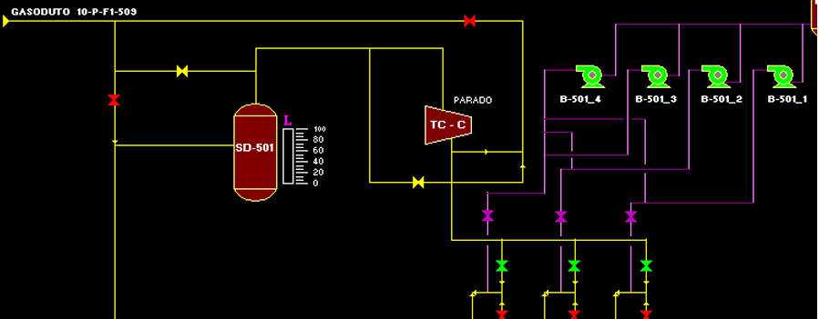

# Experimento 14 — Extração de óleo e gás

A figura acima descreve parte de um processo de extração de óleo e gás em alto mar.  

O tanque SD-501 possui um medidor de nível que fornece um sinal de 4 a 20mA a uma entrada analógica de CLP e seu tag é LTI_SD_501. Para controlar adequadamente o processo deverá ser implementada a seguinte lógica de funcionamento: 

1. Através do LTI_SD_501 gerar 4 alarmes(digitais) LTSD501_LL, LTSD501_LO, LTSD501_HI, LTSD501_HH 

    1.1. Esses alarmes precisam de um tempo de retardo de 3 segundos pois o tanque está em uma plataforma de petróleo do tipo flutuante sujeita a balanço. 

2. Cada bomba possui um acionamento manual e automático (cuja lógica em ladder deverá ser implementada) 

    2.1. B_501_1 – Possui B_501_1_AUTMAN(AUTO=1, MAN=0) chave de funcionamento de automático para manual, B_501_1_LIGA e B_501_1_DESLIGA Chaves de campo do tipo não retentivas ; B_501_1_LIGAAUT(Liga = 1) chave virtual (endereço de memória) que é utilizada na lógica de acionamento automático da bomba. 

    2.2. B_501_2 – Possui B_501_2_AUTMAN(AUTO=1, MAN=0) chave de funcionamento de automático para manual, B_501_2_LIGA e B_501_2_DESLIGA Chaves de campo do tipo não retentivas ; 54 B_501_2_LIGAAUT(Liga = 1) chave virtual (endereço de memória) que é utilizada na lógica de acionamento automático da bomba. 

    2.3. B_501_3 – Possui B_501_3_AUTMAN(AUTO=1, MAN=0) chave de funcionamento de automático para manual, B_501_3_LIGA e B_501_3_DESLIGA Chaves de campo do tipo não retentivas ; B_501_3_LIGAAUT(Liga = 1) chave virtual (endereço de memória) que é utilizada na lógica de acionamento automático da bomba. 

    2.4. B_501_4 – Possui B_501_4_AUTMAN(AUTO=1, MAN=0) chave de funcionamento de automático para manual, B_501_4_LIGA e B_501_4_DESLIGA Chaves de campo do tipo não retentivas ; B_501_4_LIGAAUT(Liga = 1) chave virtual (endereço de memória) que é utilizada na lógica de acionamento automático da bomba. 

3. Com os alarmes implemente a seguinte lógica de funcionamento das bombas B_501_1, B_501_2, B_501_3, B_501_4: 

    3.1. Caso nenhum alarme esteja acionado (situação normal de operação) a B_501_1 liga em automático. 

    3.2. Caso LTSD501_LL ou LTSD501_LO estiverem acionados todas as bombas devem desligar em automático. 

    3.3. Caso LTSD501_HI estiver acionado, as B_501_1 e B_501_2 são acionadas em automático.

    3.4. Caso LTSD501_HH estiver acionado, todas as bombas são ligadas em automático 

    