# Revisão

### Questão 1

Qual a alternativa errado no que tange ao modelo da Piramide de automação?

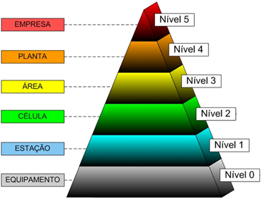

a) Nível 3  - Supervisão e Controle da Produção, dos Recursos e Otimização de Processo através de sistemas como MES (Manufacturing Execution System), LIMS (Laboratory Information Management System), PIMS (Plant Information Management System), AM (Asset Management) com a função de coordenar a produção, suportar as atividades produtivas e cuidar da obtenção e alocação de recursos para as atividades produtivas;

b) Quanto mais se vai subindo de nível no modelo, menos físico e mais software é agregado.

c) Nível 1  - Comando de Máquinas, Sequências e Movimentos através de Controladores Numéricos, CLPs (Controladores Lógico Programáveis), e controladores de processo;

d) Nível 2 - Gerenciamento Corporativo através de sistemas como ERP (Enterprise Resource Planning) com a função de aquisitar a missão da empresa e gerenciamento de corporação.

e) Quanto mais se vai subindo de nível no modelo, menos foco no "Chão de fabrica" e mais foco no modelo de negocio.

### Questão 2

Dada a tabela de Pontos fortes e atributos relativos de humanos e máquinas. Assinale a alternativa correta

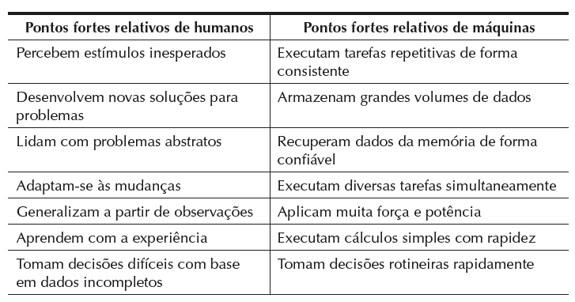

a) Sistemas automatizados. São aqueles nos quais um processo é executado por uma máquina sem a participação direta de um trabalhador humano. A automação é implementada por meio de um programa de instruções combinado a um programa de controle que executa as instruções.  Sempre existe distinção clara entre os sistemas trabalhador‑máquina e os sistemas automatizados.

b) Em determinados processos totalmente automatizados, um ou mais trabalhadores devem estar presentes para monitorar continuamente a operação e certificar‑se de que a máquina opera conforme as especificações. Exemplos desses tipos de processos automatizados incluem complexos processos químicos, refinarias de petróleo e usinas nucleares. Os trabalhadores não participam ativamente do processo, nunca intervindo.

c) Uma máquina totalmente automatizada tem a capacidade de operar por períodos longos sem a atenção humana. Essas maquinas precisam da atenção humana, de tempos em tempos para funcionar corretamente.

d) Pode-se distinguir dois níveis de automação: semiautomatizado e totalmente automatizado.  Uma máquina semiautomatizada executa parte do ciclo de trabalho sob algum tipo de controle de programa, e um trabalhador humano opera a máquina durante o restante do ciclo, carregando‑a e descarregando‑a ou executando algum outro tipo de tarefa a cada ciclo. Uma máquina totalmente automatizada se difere da anterior por sua capacidade de operar sempre sem a atenção humana.

e) Sistemas trabalhador‑máquina. Nesses tipos de sistemas, um trabalhador humano opera um equipamento motorizado, tal como uma máquina‑ferramenta ou outra máquina de produção.  Esses sistemas são totalmente inviáveis devido as caraterísticas humanas.

### Questão 3

Em relação às saídas digitais de um CLP, é correto afirmar que: 

a) São as mais empregadas em CLPs, possuindo apenas dois estados, acionada e desacionada:

b) A tensão de saída será sempre idêntica a de alimentação do CLP;

c) Podem ser utilizadas para o acionamento direto de quaisquer tipos de cargas elétricas, independentemente da potência;

d) Permitem a utilização de estratégias de controle avançadas, como a estratégia proporcional;

e) Não permitem o emprego de corrente continua.

### Questão 4

Assinale a alternativa que está errada no que tange aos usos dos SDCDs:

a) Os SDCDs são muito utilizados em controle de intertravamentos.

b) Os SDCDs são muito utilizados em processos petroquímicos.

c) Os SDCDs são muito utilizados em controle regulatório.

d) Os SDCDs se caracterizam pela robustez  e por possuir software de supervisão incorporado.

e) Os SDCDs possuem redundância quase sempre.

### Questão 5

Assinale a alternativa que está errada no que tange aos usos dos SDCDs:

a) Os SDCDs possuem filosofia de controle distribuído.

b) Os SDCDs permitem troca de cartões “a quente”.

c) Os SDCDs são mais rápidos que CLPs.

d) Os SDCDs se comunicam facilmente com instrumentos de campo pois muitas vezes os fabricantes de SDCDs também fabricam instrumentos.

e) Os SDCDs permitem automações de muito grande porte.

### Questão 6

Assinale a alternativa que está errada no que tange aos usos dos sensores:

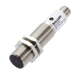

a) Os sensores indutivos não são adequados para detectar objetos plásticos

b) Os sensores indutivos podem detectar metais em esteiras.

c) Os sensores capacitivos podem detectar objetos plásticos em esteiras.

d) Os sensores controlam processos automatizados.

e) Os sensores capacitivos podem detectar metais ou dielétricos.

### Questão 7
Uma esteira em instalação portuária sujeita a poeira, possui imãs presos para ajudar a medir sua velocidade. Qual o sensor é mais adequado para essa finalidade:

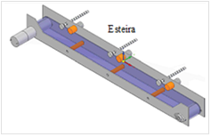

a) Sensores ultra-sônicos

b) Os sensores indutivos

c) Os sensores ópticos

d) Os sensores tipo “Reed Switches”.

e) Os sensores de contato.

### Questão 8
Qual não é considerado um atuador:

a) Uma válvula do tipo proporcional

b) Um inversor de frequência

c) Uma chave mecânica de contato.

d) Um motor elétrico.

e) Uma válvula do tipo on-off.

### Questão 9
Sensores do tipo “encoder” consistem normalmente de discos perfurados acoplados mecanicamente a um eixo é correto afirmar que: 

a) Esses sensores são utilizados para medição de posição e velocidades.

b) Esses sensores apenas são utilizados para medição de posição.

c) Esses sensores apenas são utilizados para medição de velocidades.

d) Esses sensores são inúteis para controle de elevadores.

e) Esses sensores fazem medidas indiretas dispensando contatos mecânicos.

### Questão 10
Os sistemas de produção podem ser divididos em duas categorias ou níveis. Essas são:

a) Sistemas de apoio à produção  e  Instalações: fábrica equipamentos

b) Máquina e Processo 

c) Atenção periódica do trabalhador  e  Máquina automatizada

d) Ferramentas manuais comumente usadas e Máquina automatizada

e) Ferramentas manuais comumente usadas  e Processo 

### Questão 11
Os tipos de tipos de instalações (Layouts) de produção indicados na figura são respectivamente:

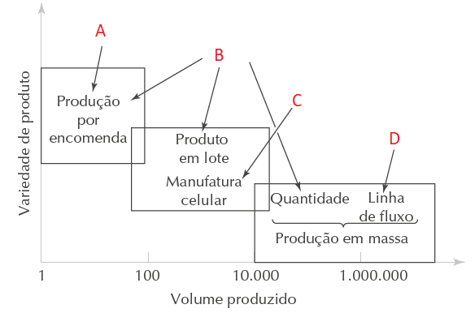

a. 
A) Layout de posição fixa 
B) Layout celular 
C) Layout por processo  
D) Layout por produto

b. 
A) Layout de posição fixa 
B) Layout por processo 
C) Layout celular 
D) Layout por produto

c. 
A) Layout de posição fixa 
B) Layout por processo 
C) Layout por produto 
D) Layout celular 

d. 
A) Layout por processo 
B) Layout de posição fixa  
C) Layout celular 
D) Layout por produto

e. 
A  Layout por produto  
B) Layout por processo 
C) Layout celular 
D) Layout de posição fixa

### Questão 12
Dado o gráfico abaixo é correto afirmar que:

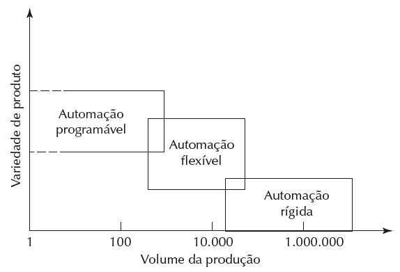

a) Automação rígida. Sistema no qual a sequência das operações de processamento (ou montagem) é definida pela configuração do equipamento. Normalmente, cada operação na sequência é simples e talvez envolva um movimento linear plano ou rotacional, ou uma combinação simples dos dois, tal como a alimentação de um carretel em rotação.

 A integração e a coordenação de muitas dessas operações em um único equipamento é o que torna o sistema complexo. Algumas características da automação rígida são:

 (1) Baixo investimento inicial em equipamentos com engenharia personalizada; 
 (2) Baixas taxas de produção; 
 (3) inflexibilidade relativa do equipamento na acomodação da variedade de produção.

b) Automação programável. Nesse tipo de automação, o equipamento de produção é projetado com a capacidade de modificar a sequência de operações de modo a acomodar diferentes configurações de produtos. A sequência de operações é controlada por um programa, um conjunto de instruções codificado de maneira que possa ser lido e interpretado pelo sistema. Novos programas podem ser preparados e inseridos nos equipamentos para fabricarem novos produtos. Algumas das características da automação programável incluem:

 (1) alto investimento em equipamentos de propósito geral; 
 (2) altas taxas de produção se comparada à automação rígida; 
 (3) flexibilidade para lidar com variações e alterações na configuração do produto; 
 (4) baixa adaptabilidade para a produção em lote

c) Automação rígida. Sistema no qual a sequência das operações de processamento (ou montagem) é definida pela configuração do equipamento. Normalmente, cada operação na sequência é simples e talvez envolva um movimento linear plano ou rotacional, ou uma combinação simples dos dois, tal como a alimentação de um carretel em rotação.  A integração e a coordenação de muitas dessas operações em um único equipamento é o que torna o sistema complexo. Algumas características da automação rígida são:

 (1) alto investimento inicial em equipamentos com engenharia personalizada; 
 (2) altas taxas de produção; 
 (3) inflexibilidade relativa do equipamento na acomodação da variedade de produção.

d) Automação flexível. É uma extensão da automação programável. Um sistema automatizado flexível é capaz de produzir uma variedade de peças (ou produtos), quase sem perda de tempo e com modificações de um modelo de peça para outro. Não existe perda de tempo de produção enquanto são reajustados o sistema e as configurações físicas (ferramentas, acessórios e configurações de máquina).

Assim, o sistema pode produzir diferentes variações e planos de peças e produtos sem exigir que eles sejam produzidos em lotes. O que viabiliza a automação flexível é que a diferença entre as peças processadas pelo sistema não são significativas e, portanto, o volume de alterações exigidas entre os modelos é mínimo. Dentre as características da automação flexível estão: 

(1) baixo investimento em um sistema com engenharia personalizada;  
(2) produção contínua de um conjunto restrito de produtos; 
(3) taxas baixas de produção; 
(4) inflexibilidade para lidar com variações no projeto do produto

e) A justificativa econômica da automação rígida está nos produtos que são fabricados em grandes quantidades e nas altas taxas de produção. O alto custo inicial do equipamento nunca poderá ser diluído na grande quantidade de unidades, o que torna o custo unitário menos atrativo se comparado a métodos alternativos de produção.

### Questão 13

Os Lay outs indicados na figura são respectivamente:

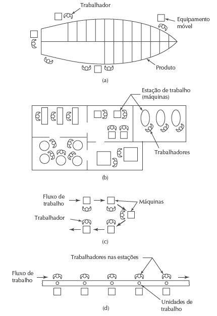

a. 
(a) layout por processo;  
(b) layout por produto 
(c) layout de posição fixa;  
(d) layout celular,

b. 
(a) layout de posição fixa; 
(b) layout por processo;  
(c) layout celular, 
(d) layout por produto

c. 
(a) layout por processo;  
(b) layout de posição fixa;  
(c) layout por produto 
(d) layout celular,

d. 
(a) layout por processo;  
(b) layout de posição fixa;  
(c) layout celular, 
(d) layout por produto

e. 
(a) layout de posição fixa; 
(b) layout por processo;  
(c) layout por produto 
(d) layout celular,

### Questão 14

Existem três categorias em termos da participação humana nos processos executados pelos sistemas de produção, assinale a falsa:

a) Sistemas  máquina-trabalhador: um trabalhador operando equipamento motorizado

b) Sistemas automatizados: um processo executado por uma máquina sem a participação direta de um trabalhador humano.

c) Sistemas de trabalho manual: um trabalhador executando uma ou mais tarefas sempre com a ajuda de ferramentas motorizadas

d) Sistemas trabalhador-máquina: um trabalhador operando equipamento motorizado

e) Sistemas de trabalho manual: um trabalhador executando uma ou mais tarefas sem a ajuda de ferramentas motorizadas, mas às vezes utilizando ferramentas manuais.

### Questão 15

O Manufacturing Execution System (MES), ou Sistema de Execução de Manufatura, é um software que monitora, rastreia, documenta e controla o chão de fábrica em tempo real. Ele conecta o planejamento (ERP) à execução física, otimizando processos, garantindo a qualidade e melhorando a eficiência (OEE) desde a matéria-prima até o produto final. O MES é considerado a ponte essencial entre o controle de automação (CLP) e os sistemas de gestão empresarial.

Assinale a alternativa correta sobre o MES

a) Ele é feito exclusivamente com o uso de hardware de automação como sensores e atuadores

b) Ele é realizado por meio de software exclusivamente programado em CLPs.

c) Ele está contido no quarto nível da pirâmide de automação onde ajuda no Planejamento da Produção Global da Empresa.

d) Ele está contido no quinto nível da pirâmide de automação onde ajuda no Gerenciamento Corporativo.

e) Ele está contido no terceiro nível da pirâmide de automação onde ajuda na Supervisão e Controle da Produção

### Questão 16
Assinale qual Não é uma razão para investir em automação de um processo

a) Reduzir o tempo da produção  

b) Aumentar a segurança do trabalhador

c) Realizar processos que não podem ser executados manualmente

d) Não melhorar a qualidade do produto

e) Reduzir os custos do trabalho

### Questão 17
A figura abaixo mostra as linhas de proteção de um processo, os níveis A;B;C;D correspondem respectivamente a:

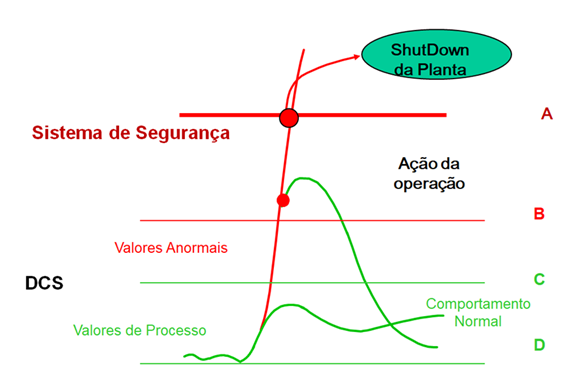

a) Nível de Trip; Nível alto de alarme; Nível baixo de alarme; Nível muito baixo de alarme

b) Nível muito alto de alarme; Nível alto de alarme; Nível de controle; Nível muito baixo de alarme

c) Nível muito alto de alarme; Nível alto de alarme; Nível baixo de alarme; Nível muito baixo de alarme

d) Nível muito alto de alarme; Nível alto de alarme; Nível baixo de alarme; Nível muito Nível de controle

e) Nível de Trip; Nível alto de alarme; Nível de controle; Nível de controle

### Questão 18
Assinale a alternativa falsa em relação aos Safe PLCs  

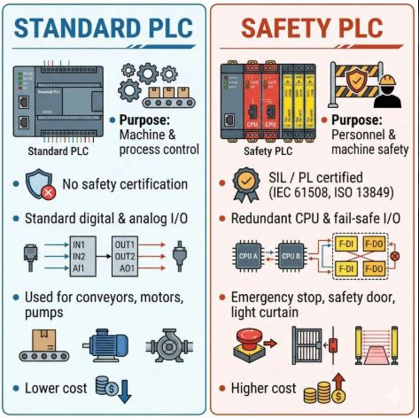

a) Os Safe PLCs nunca são programados em ladder.

b) Os Safe PLCs em geral são muito redundantes podendo ter inclusive redundância tripla.

c) OOs Safe PLCs em geral possuem Auto-diagnóstico completo para minimizar falhas perigosas não detectadas.

d) Os Os Safe PLCs frequentemente alcançam SIL 3.

e) Os Safe PLCs não colaboram para melhorar o controle de um processo, apenas para tornar o processo mais seguro e disponível.

### Questão 19
É incorreto assinalar:

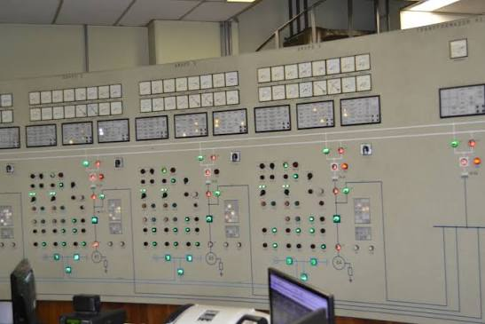

a) Painéis sinópticos, são muito flexíveis, portanto ainda são funcionais e são soluções robustas para visualização de sistemas industriais.

b) Painéis sinópticos, embora pouco flexíveis, ainda são funcionais e são soluções robustas para visualização de sistemas industriais.

c) Painéis sinópticos precisam de grandes espaços físicos para serem montados, dependendo do processo o que nem sempre está disponível

d) Painéis sinópticos precisam de grandes cabeamentos devido a individualidade dos sinais, já IHMs e supervisórios podem funcionar em rede diminuindo imensamente a necessidade de cabos.

e) IHMs e Sistemas supervisórios foram soluções tecnológicas que sanaram as deficiências dos painéis sinópticos e acabaram por substitui-los na maioria das aplicações.

### Questão 20
É incorreto assinalar:

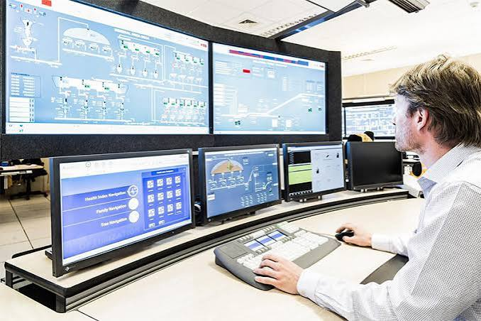

a) Os sistemas supervisórios, por meio de mecanismos de segurança, podem tornar rastreáveis quaisquer ações executadas neles.

b) Os sistemas supervisórios possuem ferramentas para visualização de gráficos em tempo real ou históricos, trata-se de sistema muito mais flexível do que os históricos em papel.

c) Os sistemas supervisórios, por meio de mecanismos de segurança, podem tornar determinadas ações, como por exemplo alterar parâmetros de malhas de controle, restritas a determinados usuários, como por exemplo usuários de “manutenção ” que teriam mais acesso a configurações que usuários de “operação “

d) Sistemas supervisórios não podem ser usados para visualizar sistemas elétricos.

e) Sistemas supervisórios frequentemente, fornecem uma “base” a onde os dados são gerados, esses dados podem em sequencia serem aproveitados por sistemas MES.

---

Respostas:

(1) 
A alternativa errada é a d). Na pirâmide da imagem, o Nível 2 corresponde à Célula, ou seja, à supervisão e coordenação de um conjunto de máquinas (IHMs, SCADA, coordenação de linha). O “Gerenciamento Corporativo através de sistemas como ERP” pertence ao Nível 5 (Empresa), no topo da pirâmide. A alternativa atribui a função do Nível 5 ao Nível 2.

As demais estão corretas:

a) O Nível 3 (Área) é o de supervisão e controle da produção, com sistemas como MES, LIMS, PIMS e AM. 
b) Subindo na pirâmide, o foco sai do equipamento físico e vai para sistemas de software e informação. 
c) O Nível 1 (Estação) é o de comando de máquinas e sequências, com CNCs, CLPs e controladores de processo. 
e) Subindo na pirâmide, o foco sai do chão de fábrica e vai para o negócio (planejamento, gestão e estratégia).

A pirâmide tem seis níveis, do mais baixo (chão de fábrica) ao mais alto (negócio):

0	Equipamento: O processo físico em si: sensores e atuadores que medem e agem diretamente sobre a máquina ou processo. Ex.: Sensores, válvulas, motores, atuadores

1	Estação:	Comando de máquinas, sequências e movimentos. Ex.: CLPs, CNCs, controladores de processo

2	Célula:	Supervisão e coordenação de um conjunto de máquinas ou de uma linha, com interface com o operador. Ex.:  IHMs, SCADA

3	Área:	Supervisão e controle da produção, dos recursos e otimização de processo. Ex.: MES, LIMS, PIMS, AM

4	Planta:	Gerenciamento da planta como um todo: planejamento da produção, logística, manutenção e qualidade da unidade. Ex.: 	Sistemas de planejamento e gestão da planta

5	Empresa:	Gerenciamento corporativo: missão da empresa, estratégia e gestão da corporação. Ex.: ERP

Ideia geral do modelo:

Base (níveis 0 e 1): foco no chão de fábrica, com o mundo físico, tempo real e controle direto.
Meio (níveis 2 e 3): supervisão e coordenação da produção, ligando o controle à gestão.
Topo (níveis 4 e 5): foco no negócio, com planejamento, decisões e estratégia.

À medida que se sobe, há menos hardware físico e mais software, menos foco na operação e mais foco em informação e negócio. Os tempos de resposta também mudam: na base são milissegundos, e no topo são horas, dias ou até meses.

Observação: a divisão exata dos níveis 2, 3 e 4 pode variar um pouco entre autores e livros (alguns modelos usam apenas 4 ou 5 camadas, como a ISA-95). Para a prova, vale seguir a nomenclatura da imagem e do material da sua disciplina.

(2) 
a) A definição de sistema automatizado está certa, mas a última frase é falsa. Na prática, a distinção entre sistemas trabalhador-máquina e sistemas automatizados nem sempre é clara, porque existem casos intermediários, em que o humano ainda participa de alguma forma. 
b) O erro está em dizer que os trabalhadores “nunca intervêm”. Eles estão presentes justamente para monitorar e intervir quando necessário (ajustes, falhas, emergências). 
c) está de acordo com essa definição: a máquina opera por longos períodos sem atenção humana, mas precisa dela de tempos em tempos para continuar funcionando corretamente. Isso não é uma contradição, como eu havia dito. É justamente a ideia de “períodos longos” em oposição a “sempre”. 
d) diz que a máquina totalmente automatizada opera “sempre” sem atenção humana. Isso é um exagero. Nenhuma máquina opera para sempre sem algum tipo de atenção, como manutenção, reabastecimento de material, troca de ferramentas ou resposta a falhas. A definição clássica (Groover) fala em operar por períodos prolongados sem atenção humana, e não sempre. 

e) Dizer que os sistemas trabalhador-máquina são “totalmente inviáveis” é falso. Eles são muito comuns (por exemplo, um operador usando um torno ou uma fresadora), e a tabela mostra que humanos e máquinas têm pontos fortes complementares.

Observação sobre a tabela: ela serve de apoio ao raciocínio, mostrando que humanos são melhores em adaptação, abstração e decisões com dados incompletos, e máquinas em repetição, força, armazenamento de dados e rapidez em cálculos. Por isso nem tudo deve ser automatizado, e muitos sistemas combinam as duas coisas.

(3) 
Alternativa A (Correta): As saídas digitais (ou discretas) operam fundamentalmente em dois estados binários (ligada/acionada ou desligada/desacionada) e representam a maior parte das aplicações industriais em controladores lógicos programáveis para acionamento de contatores, solenóides, lâmpadas e sinalizadores simples.

Alternativa B (Incorreta): A tensão de saída não é necessariamente idêntica à alimentação do CLP. No caso de saídas a relé, por exemplo, o circuito de saída atua como uma chave seca, permitindo comutar tensões alternadas (CA) ou contínuas (CC) externas e diferentes da tensão de alimentação da CPU.

Alternativa C (Incorreta): As saídas possuem limitações estritas de corrente e potência suportadas por cada ponto (por exemplo, 0,5 A para transistores ou 2 A para relés). Cargas de alta potência exigem sempre o uso de elementos intermediários, como relés auxiliares ou contatores.

Alternativa D (Incorreta): Estratégias de controle proporcional (como malhas PID) exigem tipicamente saídas analógicas (ou sinais PWM em aplicações específicas de alta frequência), e não saídas digitais convencionais de dois estados.

Alternativa E (Incorreta): As saídas a transistor, amplamente utilizadas, operam justamente com corrente contínua (CC).

(4) 
A alternativa errada em relação aos usos e características dos SDCDs (Sistemas Digitais de Controle Distribuído) costuma gerar dúvida, mas vamos analisar o papel principal de cada sistema:

Os SDCDs são primariamente concebidos e aplicados em processos contínuos e complexos em larga escala (como refinarias de petróleo, indústrias petroquímicas e químicas), com forte atuação em controle regulatório (malhas PID) e supervisão integrada.

Embora modernos SDCDs consigam gerenciar lógicas e sequências, o controle crítico de intertravamentos de segurança e paradas de emergência (ESD) é tradicionalmente atribuído a Sistemas Instrumentados de Segurança (SIS) ou a Controladores Lógicos Programáveis (CLPs/PLCs) dedicados à segurança, garantindo separação física/lógica entre o controle básico e a proteção de alta criticidade.

Portanto, a alternativa incorreta ou menos adequada conceitualmente no contexto de separação clássica de funções (onde o CLP/SIS lida prioritariamente com intertravamentos de segurança e o SDCD com o controle de processo contínuo) é a a) Os SDCDs são muito utilizados em controle de intertravamentos (ou quando comparados à exclusividade dos CLPs para lógicas de intertravamento de segurança).

(5) 
a) A própria definição de SDCD baseia-se na distribuição do processamento e controle pelo campo.

b) Sistemas de grande porte permitem a substituição de módulos de E/S (cartões) "a quente" (hot-swapping) sem desenergizar o sistema ou parar a planta.

c) Alternativa C (Incorreta/Falsa): Os CLPs (Controladores Lógicos Programáveis) são tradicionalmente concebidos e otimizados para controle discreto e de alta velocidade (lógicas de intertravamento, ciclos rápidos de varredura na faixa de milissegundos). Já os SDCDs (Sistemas Digitais de Controle Distribuído) priorizam a estabilidade, o gerenciamento de milhares de malhas contínuas (como PID) e o processamento massivo de dados de processo, não sendo focados em tempos de resposta ultrarrápidos para lógica discreta comparados aos CLPs dedicados.

d) Grandes fabricantes de SDCD (como Emerson, Yokogawa, ABB, Honeywell, Siemens) também desenvolvem instrumentação de campo integrada, facilitando a compatibilidade de comunicação.

e) Os SDCDs são exatamente os sistemas indicados para automação industrial de grande porte (refinarias, petroquímicas, siderúrgicas, etc.).

(6) 
Como a pergunta pede para identificar a alternativa errada (ou dependendo do contexto da questão de múltipla escolha que costuma aparecer em provas de automação), vamos avaliar as afirmações comuns sobre esse tema:

a) Os sensores indutivos não são adequados para detectar objetos plásticos: Verdadeiro. Sensores indutivos operam por campo eletromagnético e respondem exclusivamente a materiais metálicos, logo não detectam plástico de forma direta.

b) Os sensores indutivos podem detectar metais em esteiras: Verdadeiro. Essa é uma das aplicações industriais mais comuns para contagem ou posicionamento de peças metálicas em linhas de esteiras.

c) Os sensores capacitivos podem detectar objetos plásticos em esteiras: Verdadeiro. Sensores capacitivos detectam variações na constante dielétrica, permitindo identificar materiais não metálicos como plásticos, vidros, madeiras e líquidos.

d) Os sensores controlam processos automatizados: Verdadeiro em termos gerais de realimentação, embora os sensores em si coletem dados/forneçam sinais para os controladores (CLPs) que realizam o controle. No entanto, em muitas questões de introdução à automação, essa é tratada como correta por descrever o papel dos dispositivos no sistema. Por outro lado, controladores controlam processos. Logo, d) está errada.

e) Os sensores capacitivos podem detectar metais ou dielétricos: Verdadeiro. Eles detectam tanto materiais condutivos (metais) quanto isolantes/dielétricos (plásticos, líquidos, etc.).

(7) 
Por que os Reed Switches? O enunciado destaca que a esteira possui ímãs presos para auxiliar na medição da velocidade. O Reed Switch é um sensor de proximidade magnético composto por lâminas ferromagnéticas seladas em uma ampola de vidro, que se fecham na presença de um campo magnético (como o gerado pelos ímãs fixados na esteira). Além disso, por serem hermeticamente fechados, funcionam muito bem em ambientes com presença de poeira.

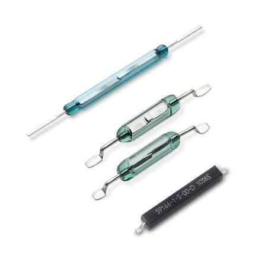

Por que as outras alternativas estão incorretas?

a) Ultra-sônicos: Podem sofrer interferências com correntes de ar, turbulência e densas nuvens de poeira típicas de instalações portuárias.

b) Indutivos: Detectam metais por indução eletromagnética gerada pelo próprio sensor, não sendo os mais indicados especificamente para a leitura de ímãs externos para essa finalidade de contagem de passagem em comparação aos magnéticos dedicados.

c) Ópticos: São severamente prejudicados pelo acúmulo de poeira característico de portos (grãos, minérios, etc.), o que bloqueia o feixe de luz e causa falhas de leitura.

e) De contato: Sofrem desgaste mecânico acelerado e atrito constante com uma esteira em movimento, tornando-se inviáveis a longo prazo.

(8) 
Por que a chave mecânica de contato não é um atuador? Uma chave mecânica de contato (como uma botoeira ou uma chave fim de curso) é um dispositivo de entrada (sensor ou comando), ou seja, ela é acionada fisicamente para enviar um sinal elétrico para o sistema de controle. Ela não realiza nenhuma ação física no processo a partir de um sinal de comando.

Por que as outras alternativas são atuadores ou elementos de acionamento/controle final?

a) Válvula proporcional e e) Válvula do tipo on-off: São elementos finais de controle (atuadores) que regulam o fluxo de fluidos (gases ou líquidos) em um processo.

b) Inversor de frequência: Atua diretamente no controle de velocidade e torque de motores elétricos, funcionando como um sistema de acionamento essencial do atuador.

d) Motor elétrico: É o atuador eletromecânico mais clássico da automação, convertendo energia elétrica em movimento mecânico.

(9) 
Por que a alternativa A está correta? Os encoders (codificadores rotativos ou lineares) são transdutores amplamente utilizados na automação industrial para converter o movimento mecânico em sinais elétricos. Ao contarem os pulsos do disco perfurado (ou magnético) acoplado a um eixo, eles permitem determinar com alta precisão tanto a posição (quantas voltas ou fração de volta o eixo deu) quanto a velocidade (a frequência com que os pulsos são gerados ao longo do tempo).

Por que as outras alternativas estão incorretas?

b e c) Restringem o uso apenas à posição ou apenas à velocidade, sendo que o encoder atende a ambas as grandezas simultaneamente.

d) São extremamente úteis e vitais no controle de elevadores, pontes rolantes e servomotores para monitorar o posicionamento exato e a velocidade da cabine ou motor.

e) Embora utilizem leitura óptica ou magnética sem contato físico direto no disco, eles exigem acoplamento mecânico rígido ou flexível ao eixo cuja rotação desejam medir.

(10) 
De acordo com a literatura clássica de sistemas de manufatura e automação (como os conceitos de Mikell P. Groover), os sistemas de produção industriais são amplamente divididos em duas categorias principais:

Instalações (Facilities): Incluem a fábrica física, o equipamento de produção, as ferramentas, o manuseio de materiais e o leiaute físico onde os processos ocorrem.

Sistemas de Apoio à Produção (Manufacturing Support Systems): São os procedimentos, softwares e sistemas corporativos utilizados pela empresa para gerenciar a produção, planejar o controle de estoque, projetar produtos e garantir a qualidade.

(11) 
A alternativa correta é a b): 
A) Layout de posição fixa (associado à produção por encomenda, com baixa quantidade e alta variedade) 
B) Layout por processo (associado à produção em lote e variedade intermediária) 
C) Layout celular (associado à manufatura celular)  
D) Layout por produto (associado à linha de fluxo / produção em massa com grande volume e baixa variedade) 

(12) 
Por que a alternativa C está correta? A automação rígida (também conhecida como automação fixa) caracteriza-se por ser aplicada em grandes volumes de produção com baixa variedade de produtos. Devido à sua construção específica para uma tarefa única, ela exige um alto investimento inicial em equipamentos com engenharia personalizada, proporciona altas taxas de produção e apresenta inflexibilidade para alterar o tipo de produto fabricado. A alternativa (a) erra ao afirmar que há um "baixo investimento inicial", enquanto a alternativa (c) corrige para "alto investimento inicial", alinhando-se perfeitamente com a teoria clássica de automação industrial de Mikell P. Groover

(13) 
(a) Layout de posição fixa (o produto principal permanece estático, como a construção de um navio ou aeronave, enquanto os trabalhadores e equipamentos se deslocam até ele).   

(b) Layout por processo (as máquinas e estações de trabalho são agrupadas por função ou tipo de processo similar).   

(c) Layout celular (máquinas e trabalhadores são agrupados em células para fabricar famílias de peças ou produtos similares com fluxo contínuo).   

(d) Layout por produto (as máquinas e estações são dispostas em linha sequencial, típica de linhas de montagem em massa ou esteiras).

(14) 
Por que a alternativa C está incorreta (falsa)? Nos sistemas de trabalho manual puramente manuais, o trabalhador executa as tarefas utilizando as próprias mãos ou apenas ferramentas manuais simples (como chaves de fenda, martelos, etc.), sem a necessidade ou o uso de ferramentas motorizadas. A alternativa e descreve corretamente essa categoria ao mencionar o uso opcional apenas de ferramentas manuais.

As demais alternativas (a, b, d e e) descrevem corretamente as categorias clássicas de participação humana nos sistemas de produção (trabalho manual, sistemas trabalhador-máquina e sistemas automatizados).

(15) 
Alternativa E (Correta): Na pirâmide de automação industrial (baseada no modelo ISA-95), o MES (Manufacturing Execution System) situa-se exatamente no Nível 3, atuando na gestão, supervisão e execução da produção no chão de fábrica, fazendo a ponte entre o nível de controle/supervisão (Níveis 1 e 2) e o planejamento corporativo (Nível 4).

Por que as outras alternativas estão incorretas?

a e b) O MES é um sistema de software de gestão e execução de manufatura, e não um hardware de campo (sensores/atuadores) nem um código executado diretamente em CLPs.

c e d) O Nível 4 da pirâmide é tipicamente ocupado pelos sistemas de gestão empresarial, como o ERP (Enterprise Resource Planning), voltados ao planejamento corporativo e global da empresa, e não ao MES.

(16) 
Por que a alternativa D está correta (sendo a "não razão")? Um dos principais objetivos e vantagens de se investir em automação industrial é justamente melhorar e padronizar a qualidade do produto, reduzindo erros humanos, retrabalho e variações dimensionais ou de processo. Portanto, "não melhorar a qualidade" é o oposto do que a automação busca proporcionar.

Por que as outras alternativas são razões reais para investir em automação?

a) Reduz o tempo de ciclo e aumenta a velocidade de produção.

b) Retira o trabalhador de ambientes perigosos, insalubres ou de tarefas com alto risco de acidentes.

c) Permite a execução de tarefas que exigem precisão microscópica, manipulação de cargas extremas ou condições inóspitas para o ser humano.

e) Reduz custos operacionais relacionados à mão de obra direta e a perdas de materiais.

(17) 
Nível A: Representa o Nível de Trip (ou intertravamento de segurança). É a barreira crítica onde o Sistema de Segurança é acionado para realizar o ShutDown (desligamento de emergência) da planta para evitar danos graves.   

Nível B: Corresponde ao Nível alto de alarme, onde o processo entra em valores anormais e a operação humana atua corretivamente para tentar estabilizar o sistema antes que atinja o nível de segurança.   

Níveis C e D: Estão na faixa verde do DCS (Sistema de Controle Distribuído), representando a zona de operação normal e os limites operacionais de controle do processo. 

(18) 
Por que a alternativa A é falsa? Os Safe PLCs (Controladores Lógicos Programáveis de Segurança) podem ser programados em linguagens padrão da norma IEC 61131-3, incluindo a linguagem Ladder (com instruções e blocos de função certificados para segurança) e Diagrama de Blocos Funcionais (FBD). Portanto, a afirmação de que eles "nunca" são programados em ladder está incorreta.

Por que as outras alternativas são verdadeiras?

b e c: Possuem arquiteturas altamente redundantes (como duplo canal ou redundância tripla) e sistemas avançados de autodiagnóstico para garantir alta cobertura de falhas e evitar falhas perigosas ocultas.

d: Atendem rigorosos padrões de segurança funcional (como IEC 61508 / ISO 13849), alcançando frequentemente níveis de integridade como SIL 3 ou Performance Level e (PL e).

e: Focam estritamente em funções de intertravamento e proteção de segurança da máquina/processo, separando o controle básico de processo do sistema de segurança dedicado.

(19) 
Por que a alternativa A está incorreta? Os painéis sinópticos tradicionais (compostos por mímicos físicos, lâmpadas e fiação dedicada) são conhecidos justamente por serem pouco flexíveis (ou rígidos). Qualquer alteração, expansão ou modificação no processo industrial exige reconfiguração física, troca de placas e reFiação, o que contrasta com a flexibilidade dos softwares de supervisão e IHMs modernos.

Por que as demais estão corretas?

b) Afirma corretamente que eles são pouco flexíveis, mas mantêm-se funcionais e robustos em algumas aplicações específicas.

c) Precisam de salas de controle amplas para acomodar grandes painéis físicos.

d) Exigem imensa quantidade de cabos físicos devido ao sinal individual de cada instrumento, ao passo que redes de comunicação reduzem drasticamente essa necessidade.

e) IHMs e sistemas supervisórios (SCADA) substituíram amplamente os painéis sinópticos físicos devido à facilidade de alteração de telas, redes de comunicação e armazenamento de dados.

(20) 
Por que a alternativa D está incorreta (falsa)? Os sistemas supervisórios (como o SCADA) são amplamente e frequentemente utilizados para monitorar e visualizar sistemas elétricos (subestações, redes de distribuição de energia, painéis elétricos, geração distribuída, etc.). Afirmar que eles não podem ser usados para essa finalidade está totalmente errado.

Por que as outras alternativas estão corretas?

a) Sistemas supervisórios possuem logs de auditoria e segurança que registram e tornam rastreáveis todas as ações e comandos executados pelos operadores.

b) Permitem a visualização de tendências (gráficos) em tempo real e de dados históricos de forma digital e infinitamente mais flexível que registros em papel.

c) Utilizam níveis de acesso por senha e perfis de usuário (como operador, mantenedor, engenheiro) para restringir ações críticas, como alteração de parâmetros de malhas de controle.

e) Servem como base de coleta de dados de chão de fábrica que podem alimentar sistemas de nível superior, como o MES.

